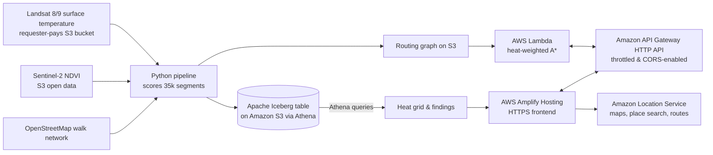
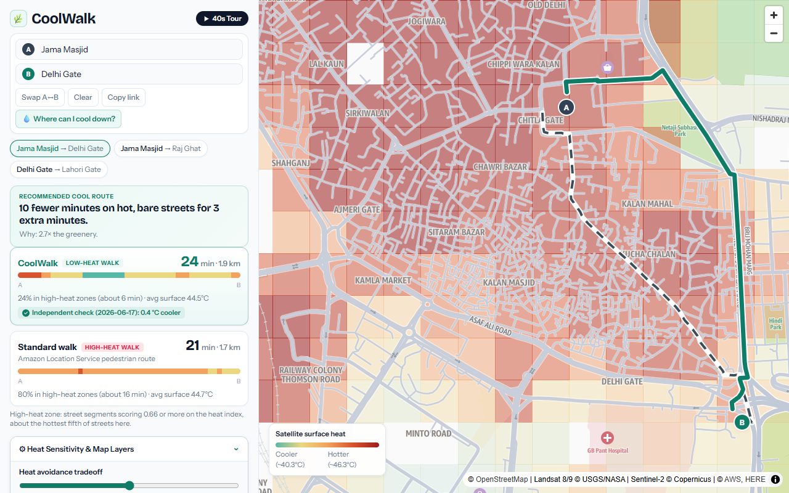
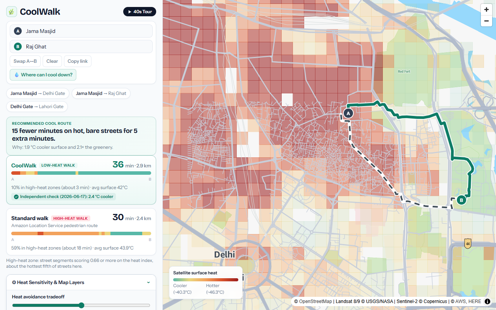
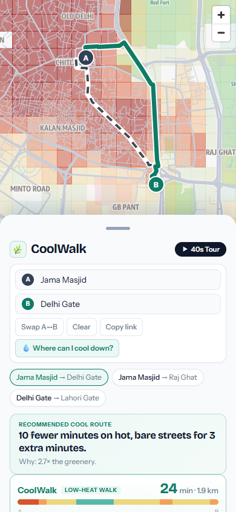
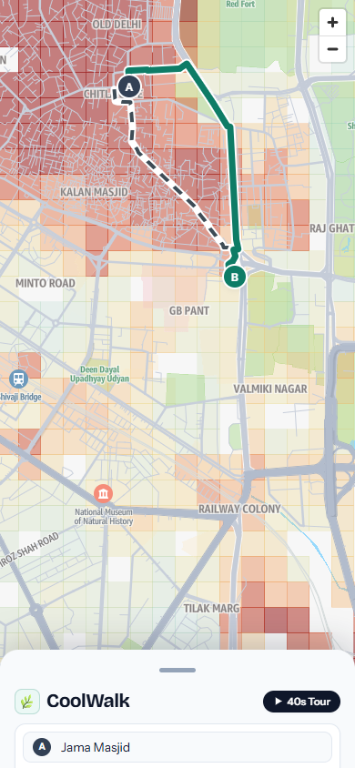

# CoolWalk: Complete Architecture, Mathematical Logic, and Full Source Code

This document provides a complete, unified reference for the entire **CoolWalk** application built for the AWS Builder Center "Weekend Challenge: Map It". It contains:
1. **The System Architecture & End-to-End Logic** explaining how every component connects to the next (from earth-observation satellite data down to pixel rendering in the browser).
2. **Mathematical Formulations** for thermal radiometric scaling, vegetation indexing, heat cost weights, detour-capped A* search, and Dijkstra cool-refuge optimization.
3. **Every Single Line of Code** across all infrastructure definitions, data pipelines, SQL queries, backend router microservices, test harnesses, evaluation scripts, documentation, and frontend user interface.

---

# Architecture & System Flow

CoolWalk bridges open earth-observation satellite data with real-time pedestrian navigation on AWS.

```mermaid
flowchart TD
    subgraph Data_Acquisition ["Phase 1: Ingestion and Spatial Scoring"]
        STAC[Earth Search STAC API] -->|Query cloud < 15%| P1[01_pick_scenes.py]
        P1 -->|Select clear scene| S_JSON[work/scenes.json]
        
        USGS[(s3://usgs-landsat/<br/>TIRS Band 10 LST + QA)] -->|Requester-Pays S3| P2[02_score_segments.py]
        S2_COG[(s3://sentinel-cogs/<br/>B04 Red, B08 NIR, SCL)] -->|HTTPS COG Window| P2
        OSM[(OpenStreetMap Overpass)] -->|ox.graph_from_bbox| P2
        S_JSON --> P2
        
        P2 -->|Export scored edges| PARQUET[work/segments.parquet<br/>35,748 rows]
        P2 -->|Serialize compact graph| GRAPH_GZ[work/graph.json.gz<br/>Nodes, Edges, Geometries]

        VAL[05_validation.py] -->|Sample 3 held-out scenes| GRAPH_GZ
        PLC[06_places.py] -->|OSM civic places + Satellite heat| PL_PARQUET[work/places.parquet<br/>974 places]
        PLC -->|Embed 463 refuges| GRAPH_GZ
        PLC -->|Export GeoJSON| PL_GEOJSON[frontend/data/places.geojson]
    end

    subgraph Analytics_Engine ["Phase 2: Lakehouse Analytics (Iceberg + Athena)"]
        PARQUET -->|S3 Upload| S3_STAGE[s3://DataBucket/staging/segments/]
        S3_STAGE -->|External Table| GLUE[AWS Glue Catalog / Athena]
        P3[03_build_iceberg.py] -->|CTAS query| ICEBERG[(coolwalk.segments<br/>Apache Iceberg on S3)]

        PL_PARQUET -->|S3 Upload| S3_PL_STAGE[s3://DataBucket/staging/places/]
        PL_ICE[07_build_places_iceberg.py] -->|CTAS query| ICEBERG_PL[(coolwalk.places<br/>Apache Iceberg on S3)]
        
        ICEBERG -->|q_heat_grid.sql| P4[04_export_assets.py]
        ICEBERG -->|q_hot_share.sql| P4
        ICEBERG -->|q_hottest_streets.sql| P4
        ICEBERG -->|q_coolest_streets.sql| P4
        
        P4 -->|Spatial binning| HEAT_GEOJSON[frontend/data/heat_grid.geojson<br/>2,092 cells]
        P4 -->|Statistics| FINDINGS_JSON[frontend/data/findings.json]
        GRAPH_GZ -->|Upload| S3_GRAPH[s3://DataBucket/router/graph.json.gz]
    end

    subgraph Backend_Routing ["Phase 3: Serverless Routing Microservice"]
        S3_GRAPH -->|Cold-start load| LAMBDA[AWS Lambda: Python 3.12<br/>2048 MB Memory]
        APIGW[Amazon API Gateway HTTP API] <-->|Event v2 payload| LAMBDA
        
        LAMBDA -->|GET /health| HEALTH_EP[Coverage metadata and provenance]
        LAMBDA -->|POST /route| ROUTE_EP[A* heat-weighted path and metrics]
        LAMBDA -->|POST /score| SCORE_EP[Flexible/Simple polyline heat scoring]
        LAMBDA -->|POST /refuge| REFUGE_EP[Dijkstra nearest cool refuge finder]
    end

    subgraph Frontend_App ["Phase 4: Client Web Application"]
        AMPLIFY[AWS Amplify Hosting (HTTPS)] -->|Serve HTML/JS| BROWSER[User Web Browser]
        BROWSER <-->|Fetch routes and refuges| APIGW
        BROWSER <-->|Vector tiles, place search, routes| ALS[Amazon Location Service v2]
        BROWSER -->|Overlay heat grid and places| HEAT_GEOJSON
        BROWSER -->|Display independent checks| ROUTE_EP
        BROWSER -->|Interactive 40-sec tour| BROWSER
    end
```

---

# Infrastructure as Code & CI/CD

## `infra/template.yaml`

```yaml
AWSTemplateFormatVersion: "2010-09-09"
Transform: AWS::Serverless-2016-10-31
Description: CoolWalk - heat-aware walking routes (S3, Lambda, HTTP API, Amplify Hosting)

Resources:
  # Holds the routing graph, Athena results, and the Iceberg table
  DataBucket:
    Type: AWS::S3::Bucket
    Properties:
      PublicAccessBlockConfiguration:
        BlockPublicAcls: true
        BlockPublicPolicy: true
        IgnorePublicAcls: true
        RestrictPublicBuckets: true
      BucketEncryption:
        ServerSideEncryptionConfiguration:
          - ServerSideEncryptionByDefault: { SSEAlgorithm: AES256 }

  RouterFunction:
    Type: AWS::Serverless::Function
    Properties:
      Runtime: python3.12
      Handler: app.handler
      CodeUri: ../backend/router/
      MemorySize: 2048          # the graph is parsed into memory on cold start
      Timeout: 30
      Environment:
        Variables:
          BUCKET: !Ref DataBucket
          GRAPH_KEY: router/graph.json.gz
      Policies:
        - S3ReadPolicy: { BucketName: !Ref DataBucket }
      Events:
        Health:   { Type: HttpApi, Properties: { ApiId: !Ref Api, Path: /health, Method: GET } }
        Route:    { Type: HttpApi, Properties: { ApiId: !Ref Api, Path: /route,  Method: POST } }
        Score:    { Type: HttpApi, Properties: { ApiId: !Ref Api, Path: /score,  Method: POST } }
        Refuge:   { Type: HttpApi, Properties: { ApiId: !Ref Api, Path: /refuge, Method: POST } }
        KeepWarm: { Type: Schedule, Properties: { Schedule: rate(5 minutes) } }

  Api:
    Type: AWS::Serverless::HttpApi
    Properties:
      CorsConfiguration:
        AllowOrigins: ["*"]
        AllowMethods: [GET, POST, OPTIONS]
        AllowHeaders: [content-type]
        MaxAge: 3600
      DefaultRouteSettings:
        ThrottlingBurstLimit: 50
        ThrottlingRateLimit: 20

Outputs:
  AmplifyUrl:     { Value: "https://main.d3miw0zrayytbj.amplifyapp.com" }
  ApiUrl:         { Value: !Sub "https://${Api}.execute-api.${AWS::Region}.${AWS::URLSuffix}" }
  DataBucket:     { Value: !Ref DataBucket }
```

## `scripts/deploy.ps1`

```powershell
# PowerShell deploy script for CoolWalk
param(
    [string]$Region = $(if ($env:AWS_REGION) { $env:AWS_REGION } else { "us-east-1" }),
    [string]$MapKey = $(if ($env:MAP_API_KEY) { $env:MAP_API_KEY } else { "" }),
    [string]$StackName = "coolwalk"
)

$ErrorActionPreference = "Stop"
$root = (Get-Item $PSScriptRoot).Parent.FullName
Set-Location $root

if (-not $MapKey) {
    # Check if key exists
    $keyDesc = aws location describe-key --key-name CoolWalkMapKey 2>$null | ConvertFrom-Json
    if ($keyDesc -and $keyDesc.Key) {
        $MapKey = $keyDesc.Key
    } else {
        Write-Error "Please specify -MapKey or set `$env:MAP_API_KEY"
    }
}

sam build -t infra/template.yaml
sam deploy --stack-name $StackName --region $Region --resolve-s3 --capabilities CAPABILITY_IAM --no-confirm-changeset --no-fail-on-empty-changeset

$stackDesc = aws cloudformation describe-stacks --stack-name $StackName --region $Region | ConvertFrom-Json
$outputs = @{}
foreach ($o in $stackDesc.Stacks[0].Outputs) {
    $outputs[$o.OutputKey] = $o.OutputValue
}

$apiUrl = $outputs["ApiUrl"]
$dataBucket = $outputs["DataBucket"]
$amplifyUrl = $outputs["AmplifyUrl"]

$cfg = @"
window.COOLWALK = {
  region: "$Region",
  mapKey: "$MapKey",
  apiUrl: "$apiUrl",
  bbox: [77.19, 28.585, 77.26, 28.668]
};
"@

Set-Content -Path (Join-Path $root "frontend\config.js") -Value $cfg -NoNewline

# Deploy to AWS Amplify Hosting (provides managed HTTPS)
python (Join-Path $root "scripts\deploy_amplify.py")

Write-Host ""
Write-Host "Amplify:     $amplifyUrl"
Write-Host "API:         $apiUrl"
Write-Host "Data bucket: $dataBucket   (`$env:COOLWALK_BUCKET = '$dataBucket')"
```

## `scripts/deploy.sh`

```bash
#!/usr/bin/env bash
# One-command deploy: backend + hosting, then publish the website with its config.
#   export AWS_REGION=us-east-1            # a region where Amazon Location Maps/Places/Routes v2 exist
#   export MAP_API_KEY=v1.public....       # Amazon Location API key (see README step 4)
#   ./scripts/deploy.sh
set -euo pipefail
cd "$(dirname "$0")/.."
: "${AWS_REGION:?Set AWS_REGION}"
: "${MAP_API_KEY:?Set MAP_API_KEY (Amazon Location API key)}"
STACK="${STACK:-coolwalk}"

sam build -t infra/template.yaml
sam deploy --stack-name "$STACK" --region "$AWS_REGION" --resolve-s3 \
  --capabilities CAPABILITY_IAM --no-confirm-changeset --no-fail-on-empty-changeset

out() { aws cloudformation describe-stacks --stack-name "$STACK" --region "$AWS_REGION" \
  --query "Stacks[0].Outputs[?OutputKey=='$1'].OutputValue" --output text; }
API_URL="$(out ApiUrl)"; DATA_BUCKET="$(out DataBucket)"; AMPLIFY_URL="$(out AmplifyUrl)"

cat > frontend/config.js <<CFG
window.COOLWALK = {
  region: "$AWS_REGION",
  mapKey: "$MAP_API_KEY",
  apiUrl: "$API_URL",
  bbox: [77.19, 28.585, 77.26, 28.668]
};
CFG

# Deploy to AWS Amplify Hosting (provides managed HTTPS)
python3 scripts/deploy_amplify.py

echo
echo "Amplify:     $AMPLIFY_URL"
echo "API:         $API_URL"
echo "Data bucket: $DATA_BUCKET   (export COOLWALK_BUCKET=$DATA_BUCKET)"
echo "Add $AMPLIFY_URL/* to the API key's allowed referers."
```

## `scripts/deploy_amplify.py`

```python
"""Deploy the frontend directory to AWS Amplify Hosting via manual zip deployment."""
import io
import os
import sys
import time
import urllib.request
import zipfile
import boto3

REGION = os.getenv("AMPLIFY_REGION", "us-east-2").strip()
BRANCH = os.getenv("AMPLIFY_BRANCH", "main").strip()
FRONTEND_DIR = os.path.join(os.path.dirname(__file__), "..", "frontend")


def get_app_id(amp):
    app_id = os.getenv("AMPLIFY_APP_ID")
    if app_id:
        return app_id
    print("AMPLIFY_APP_ID is not set; checking for existing app or creating a new Amplify app...")
    apps = amp.list_apps().get("apps", [])
    matches = [a for a in apps if a.get("name") == "coolwalk"]
    if matches:
        app_id = matches[0]["appId"]
        print(f"Found existing Amplify app 'coolwalk' with ID: {app_id}")
    else:
        created = amp.create_app(name="coolwalk", platform="WEB")
        app_id = created["app"]["appId"]
        print(f"Created new Amplify app 'coolwalk' with ID: {app_id}")

    try:
        amp.get_branch(appId=app_id, branchName=BRANCH)
    except Exception:
        print(f"Creating branch '{BRANCH}' on app {app_id}...")
        amp.create_branch(appId=app_id, branchName=BRANCH)

    print(f"AMPLIFY_APP_ID={app_id}")
    return app_id


def main():
    print(f"Packaging {FRONTEND_DIR}...")
    buf = io.BytesIO()
    with zipfile.ZipFile(buf, "w", zipfile.ZIP_DEFLATED) as z:
        for root, _, files in os.walk(FRONTEND_DIR):
            for f in files:
                path = os.path.join(root, f)
                arcname = os.path.relpath(path, FRONTEND_DIR)
                z.write(path, arcname)
    zip_bytes = buf.getvalue()
    print(f"Created zip ({len(zip_bytes):,} bytes).")

    amp = boto3.client("amplify", region_name=REGION)
    app_id = get_app_id(amp)

    print(f"Creating deployment on Amplify App {app_id} ({BRANCH})...")
    dep = amp.create_deployment(appId=app_id, branchName=BRANCH)
    job_id = dep["jobId"]
    upload_url = dep["zipUploadUrl"]

    print("Uploading zip archive...")
    req = urllib.request.Request(upload_url, data=zip_bytes, method="PUT")
    req.add_header("Content-Type", "application/zip")
    with urllib.request.urlopen(req) as resp:
        if resp.status not in (200, 204):
            sys.exit(f"Upload failed: {resp.status}")

    print(f"Starting deployment job {job_id}...")
    amp.start_deployment(appId=app_id, branchName=BRANCH, jobId=job_id)

    print("Waiting for deployment to succeed...")
    for _ in range(30):
        time.sleep(3)
        job = amp.get_job(appId=app_id, branchName=BRANCH, jobId=job_id)
        status = job["job"]["summary"]["status"]
        print(f"Job {job_id} status: {status}")
        if status == "SUCCEED":
            url = f"https://{BRANCH}.{app_id}.amplifyapp.com"
            print(f"\nSuccessfully deployed to Amplify: {url}")
            return
        if status in ("FAILED", "CANCELLED"):
            sys.exit(f"Deployment {status}")
    sys.exit("Deployment timed out.")


if __name__ == "__main__":
    main()
```

## `.github/workflows/test.yml`

```yaml
name: Tests

on:
  push:
    branches: ["*"]
  pull_request:
    branches: ["*"]

jobs:
  test:
    runs-on: ubuntu-latest
    steps:
      - uses: actions/checkout@v4
      - name: Set up Python 3.12
        uses: actions/setup-python@v5
        with:
          python-version: "3.12"
      - name: Run offline router tests
        run: python backend/tests/test_router.py
      - name: Run cool-refuge finder tests
        run: python backend/tests/test_refuge.py
```

## `LICENSE`

```text
MIT License

Copyright (c) 2026 CoolWalk contributors

Permission is hereby granted, free of charge, to any person obtaining a copy
of this software and associated documentation files (the "Software"), to deal
in the Software without restriction, including without limitation the rights
to use, copy, modify, merge, publish, distribute, sublicense, and/or sell
copies of the Software, and to permit persons to whom the Software is
furnished to do so, subject to the following conditions:

The above copyright notice and this permission notice shall be included in all
copies or substantial portions of the Software.

THE SOFTWARE IS PROVIDED "AS IS", WITHOUT WARRANTY OF ANY KIND, EXPRESS OR
IMPLIED, INCLUDING BUT NOT LIMITED TO THE WARRANTIES OF MERCHANTABILITY,
FITNESS FOR A PARTICULAR PURPOSE AND NONINFRINGEMENT. IN NO EVENT SHALL THE
AUTHORS OR COPYRIGHT HOLDERS BE LIABLE FOR ANY CLAIM, DAMAGES OR OTHER
LIABILITY, WHETHER IN AN ACTION OF CONTRACT, TORT OR OTHERWISE, ARISING FROM,
OUT OF OR IN CONNECTION WITH THE SOFTWARE OR THE USE OR OTHER DEALINGS IN THE
SOFTWARE.
```

# Satellite Data Ingestion & Geometry Scoring Pipeline

## `pipeline/config.py`

```python
"""Shared settings. Change BBOX and DATE_RANGE to reuse CoolWalk for another city."""
import os
from pathlib import Path

ROOT = Path(__file__).resolve().parent.parent
WORK = ROOT / "work"
FRONT_DATA = ROOT / "frontend" / "data"
WORK.mkdir(exist_ok=True)
FRONT_DATA.mkdir(parents=True, exist_ok=True)

REGION = os.getenv("AWS_REGION", "us-east-1")
BUCKET = os.getenv("COOLWALK_BUCKET", "")          # data bucket from the CloudFormation stack
if not BUCKET:
    try:
        import boto3
        cf = boto3.client("cloudformation", region_name=REGION)
        st = cf.describe_stacks(StackName="coolwalk")["Stacks"][0]
        for o in st.get("Outputs", []):
            if o.get("OutputKey") == "DataBucket":
                BUCKET = o["OutputValue"]
                break
    except Exception:
        pass
DB = "coolwalk"

# west, south, east, north (central Delhi: Old Delhi to Lodhi Garden)
BBOX = (77.19, 28.585, 77.26, 28.668)
DATE_RANGE = os.getenv("COOLWALK_DATES", "2026-04-15/2026-06-20")   # pre-monsoon, hottest and clearest
LANDSAT_MAX_CLOUD = 15
S2_MAX_CLOUD = 20

STEP_M = 15                 # sample spacing along each street segment
W_LST, W_VEG = 0.6, 0.4     # heat index = W_LST * surface temperature + W_VEG * lack of vegetation
HOT_T = 0.66                # keep in sync with backend/router/app.py
```

## `pipeline/requirements.txt`

```text
boto3>=1.35
numpy>=1.26
pandas>=2.2
pyarrow>=16
shapely>=2.0
pyproj>=3.6
rasterio>=1.3.10
osmnx>=2.0
geopandas>=1.0
pystac-client>=0.8
```

## `pipeline/01_pick_scenes.py`

```python
"""Step 1. Pick one clear Landsat 8/9 scene and same-day Sentinel-2 tiles for the study area.

Reads the Earth Search STAC API (public, no login). Writes work/scenes.json.
Choose a different Landsat scene with:  SCENE_INDEX=2 python pipeline/01_pick_scenes.py
"""
import json
import os
import sys

from pystac_client import Client
from shapely.geometry import box, shape

import config

STAC = "https://earth-search.aws.element84.com/v1"


def s3_href(asset):
    """Prefer the s3:// location. Landsat's default https link needs a USGS login."""
    alt = (asset.extra_fields.get("alternate") or {}).get("s3", {}).get("href")
    return alt or asset.href


def need(item, keys):
    missing = [k for k in keys if k not in item.assets]
    if missing:
        print(f"{item.id}: missing assets {missing}. Available: {sorted(item.assets)}")
        sys.exit(1)


def search(collection, max_cloud):
    cat = Client.open(STAC)
    res = cat.search(collections=[collection], bbox=config.BBOX, datetime=config.DATE_RANGE,
                     query={"eo:cloud_cover": {"lt": max_cloud}}, max_items=300)
    return list(res.items())


def main():
    area = box(*config.BBOX)
    ls = [i for i in search("landsat-c2-l2", config.LANDSAT_MAX_CLOUD) if shape(i.geometry).contains(area)]
    if not ls:
        sys.exit("No clear Landsat scene found. Widen COOLWALK_DATES or raise LANDSAT_MAX_CLOUD.")
    ls.sort(key=lambda i: i.properties.get("eo:cloud_cover", 100))
    print("Landsat candidates (lowest cloud first):")
    for n, i in enumerate(ls[:8]):
        print(f"  [{n}] {i.id}  {i.datetime:%Y-%m-%d}  cloud {i.properties.get('eo:cloud_cover'):.1f}%")
    chosen = ls[min(int(os.getenv("SCENE_INDEX", "0")), len(ls) - 1)]
    need(chosen, ["lwir11", "qa_pixel"])

    s2_all = search("sentinel-2-l2a", config.S2_MAX_CLOUD)
    if not s2_all:
        sys.exit("No Sentinel-2 scene found. Raise S2_MAX_CLOUD or widen the date range.")
    day = chosen.datetime.date()
    s2_all.sort(key=lambda i: abs((i.datetime.date() - day).days))
    s2_day = s2_all[0].datetime.date()
    s2 = [i for i in s2_all if i.datetime.date() == s2_day]
    for i in s2:
        need(i, ["red", "nir", "scl"])

    out = {
        "landsat": {"id": chosen.id, "date": f"{chosen.datetime:%Y-%m-%d}",
                    "cloud": chosen.properties.get("eo:cloud_cover"),
                    "lwir11": s3_href(chosen.assets["lwir11"]), "qa": s3_href(chosen.assets["qa_pixel"])},
        "sentinel": {"date": str(s2_day), "items": [
            {"id": i.id, "cloud": i.properties.get("eo:cloud_cover"),
             "red": s3_href(i.assets["red"]), "nir": s3_href(i.assets["nir"]), "scl": s3_href(i.assets["scl"])}
            for i in s2]},
    }

    # Pick up to 3 clear Landsat scenes on different dates for independent held-out validation
    val_candidates = []
    seen_dates = {chosen.datetime.date()}
    for item in ls:
        d = item.datetime.date()
        if d not in seen_dates and item.id != chosen.id and item.properties.get("eo:cloud_cover", 100) < 15:
            seen_dates.add(d)
            val_candidates.append({
                "id": item.id,
                "date": f"{item.datetime:%Y-%m-%d}",
                "cloud": item.properties.get("eo:cloud_cover"),
                "lwir11": s3_href(item.assets["lwir11"]),
                "qa": s3_href(item.assets["qa_pixel"])
            })
            if len(val_candidates) == 3:
                break
    out["validation_scenes"] = val_candidates

    (config.WORK / "scenes.json").write_text(json.dumps(out, indent=2))
    print(f"\nLandsat {out['landsat']['date']} + Sentinel-2 {out['sentinel']['date']} "
          f"({len(s2)} tile(s)). Picked {len(val_candidates)} validation scene(s). Saved work/scenes.json")


if __name__ == "__main__":
    main()
```

## `pipeline/02_score_segments.py`

```python
"""Step 2. Score every walkable street segment for heat.

Inputs : work/scenes.json (step 1), OpenStreetMap walking network (downloaded here)
Outputs: work/segments.parquet   one row per street segment (loaded into Athena/Iceberg in step 3)
         work/graph.json.gz      compact routing graph for the Lambda
Heat index (0..1) = 0.6 * normalised surface temperature + 0.4 * lack of vegetation.
"""
import gzip
import json
import sys

import boto3
import numpy as np
import osmnx as ox
import pandas as pd
import rasterio
from pyproj import Transformer
from rasterio.errors import WindowError
from rasterio.session import AWSSession
from rasterio.windows import Window, from_bounds

import config


class Raster:
    """Reads the study-area window of a COG once, then answers point lookups in lon/lat."""

    def __init__(self, href):
        self.data = None
        with rasterio.open(href) as ds:
            tf = Transformer.from_crs("EPSG:4326", ds.crs, always_xy=True)
            w, s, e, n = config.BBOX
            xs, ys = tf.transform([w, e, w, e], [s, s, n, n])
            try:
                win = from_bounds(min(xs), min(ys), max(xs), max(ys), ds.transform)
                win = win.round_offsets().round_lengths().intersection(Window(0, 0, ds.width, ds.height))
            except WindowError:
                return  # this tile does not overlap the study area
            self.data = ds.read(1, window=win)
            self.inv = ~ds.window_transform(win)
            self.crs = ds.crs
        self.tf = Transformer.from_crs("EPSG:4326", self.crs, always_xy=True)

    def sample(self, lons, lats):
        out = np.full(len(lons), np.nan)
        if self.data is None:
            return out
        x, y = self.tf.transform(lons, lats)
        cols, rows = self.inv * (np.asarray(x), np.asarray(y))
        rows, cols = np.floor(rows).astype(int), np.floor(cols).astype(int)
        ok = (rows >= 0) & (rows < self.data.shape[0]) & (cols >= 0) & (cols < self.data.shape[1])
        out[ok] = self.data[rows[ok], cols[ok]]
        return out


def edge_points(edges):
    lon, lat, eid = [], [], []
    for i, (geom, length) in enumerate(zip(edges.geometry, edges["length"])):
        for t in np.linspace(0.0, 1.0, max(2, int(length // config.STEP_M) + 1)):
            p = geom.interpolate(t, normalized=True)
            lon.append(p.x)
            lat.append(p.y)
            eid.append(i)
    return np.array(lon), np.array(lat), np.array(eid)


def surface_temp_c(sc, lon, lat):
    ls = sc["landsat"]
    dn = Raster(ls["lwir11"]).sample(lon, lat)
    qa = Raster(ls["qa"]).sample(lon, lat)
    bad = np.isnan(qa) | ((np.nan_to_num(qa).astype(np.int64) & 0b11011) != 0)  # fill, cloud, shadow
    t = dn * 0.00341802 + 149.0 - 273.15                                          # Landsat C2 L2 scale, Kelvin to C
    t[(dn <= 0) | bad | (t < 15) | (t > 75)] = np.nan
    return t


def ndvi(sc, lon, lat):
    out = np.full(len(lon), np.nan)
    for it in sc["sentinel"]["items"]:
        red, nir, scl = Raster(it["red"]), Raster(it["nir"]), Raster(it["scl"])
        r, n, c = red.sample(lon, lat), nir.sample(lon, lat), scl.sample(lon, lat)
        r = np.where(r > 0, np.clip((r - 1000.0) / 10000.0, 0.01, None), np.nan)   # L2A BOA offset, floored to prevent zero division
        n = np.where(n > 0, np.clip((n - 1000.0) / 10000.0, 0, None), np.nan)
        v = (n - r) / (n + r + 1e-6)
        v[np.isin(np.nan_to_num(c), [0, 1, 3, 8, 9, 10, 11])] = np.nan
        out = np.where(np.isnan(out), v, out)
    return out


def main():
    sc = json.loads((config.WORK / "scenes.json").read_text())
    print("Downloading OpenStreetMap walking network ...")
    G = ox.graph.graph_from_bbox(bbox=config.BBOX, network_type="walk", simplify=True)
    nodes, edges = ox.convert.graph_to_gdfs(G, fill_edge_geometry=True)
    edges = edges.reset_index()
    print(f"{len(edges):,} street segments, {len(nodes):,} intersections")
    if len(edges) > 120_000:
        print("WARNING: graph is large. Shrink BBOX in pipeline/config.py to keep Lambda cold starts fast.")

    lon, lat, eid = edge_points(edges)
    print(f"Sampling {len(lon):,} points ...")
    session = AWSSession(boto3.Session(), requester_pays=True)       # Landsat bucket is requester-pays
    with rasterio.Env(session, AWS_REGION="us-west-2", GDAL_DISABLE_READDIR_ON_OPEN="EMPTY_DIR"):
        lst = surface_temp_c(sc, lon, lat)
        veg = ndvi(sc, lon, lat)

    per = pd.DataFrame({"e": eid, "lst": lst, "ndvi": veg}).groupby("e").mean().reindex(range(len(edges)))
    print(f"Missing after masking: LST {per.lst.isna().mean():.1%}, NDVI {per.ndvi.isna().mean():.1%}")
    per = per.fillna(per.median())
    p5, p95 = np.percentile(per.lst, [5, 95])
    lst_n = ((per.lst - p5) / (p95 - p5)).clip(0, 1)
    veg_n = 1.0 - (per.ndvi / 0.6).clip(0, 1)
    heat = (config.W_LST * lst_n + config.W_VEG * veg_n).round(4)

    mid = edges.geometry.interpolate(0.5, normalized=True)
    seg = pd.DataFrame({
        "edge_id": np.arange(len(edges), dtype="int64"),
        "u": edges["u"].astype("int64"), "v": edges["v"].astype("int64"),
        "length_m": edges["length"].round(1), "mid_lon": mid.x.round(6), "mid_lat": mid.y.round(6),
        "lst_c": per.lst.round(2).values, "ndvi": per.ndvi.round(3).values, "heat_index": heat.values,
        "highway": edges["highway"].map(lambda v: v[0] if isinstance(v, list) else str(v)),
        "name": edges["name"].map(lambda v: (v[0] if isinstance(v, list) else v) if isinstance(v, (str, list)) else ""),
    })
    seg.to_parquet(config.WORK / "segments.parquet", index=False)

    # compact routing graph: edge schema [u, v, length, heat, edge_id, lst_c, ndvi]
    ids = pd.unique(pd.concat([seg.u, seg.v]))
    index = {int(n): i for i, n in enumerate(ids)}
    node_xy = [[round(float(nodes.loc[n, "x"]), 6), round(float(nodes.loc[n, "y"]), 6)] for n in ids]
    g_edges, g_geoms = [], []
    for row, geom in zip(seg.itertuples(index=False), edges.geometry):
        coords = [[round(x, 5), round(y, 5)] for x, y in geom.coords]
        u_xy = node_xy[index[int(row.u)]]
        if (coords[0][0] - u_xy[0]) ** 2 + (coords[0][1] - u_xy[1]) ** 2 > \
           (coords[-1][0] - u_xy[0]) ** 2 + (coords[-1][1] - u_xy[1]) ** 2:
            coords.reverse()                                          # make geometry run u -> v
        g_edges.append([index[int(row.u)], index[int(row.v)], float(row.length_m), float(row.heat_index), int(row.edge_id), float(row.lst_c), float(row.ndvi)])
        g_geoms.append(coords)
    meta = {"bbox": list(config.BBOX), "landsat_date": sc["landsat"]["date"], "landsat_id": sc["landsat"]["id"],
            "sentinel_date": sc["sentinel"]["date"], "weights": {"lst": config.W_LST, "veg": config.W_VEG},
            "lst_p5_c": round(float(p5), 2), "lst_p95_c": round(float(p95), 2), "hot_threshold": config.HOT_T}
    with gzip.open(config.WORK / "graph.json.gz", "wt", encoding="utf-8") as f:
        json.dump({"nodes": node_xy, "edges": g_edges, "geoms": g_geoms, "meta": meta}, f, separators=(",", ":"))

    print(f"Saved work/segments.parquet and work/graph.json.gz")
    print(f"Surface temperature range in the area (5th to 95th percentile): {p5:.1f} to {p95:.1f} C")
    print(f"Share of street length at or above the hot threshold: "
          f"{(seg.length_m[seg.heat_index >= config.HOT_T].sum() / seg.length_m.sum()):.1%}")


if __name__ == "__main__":
    sys.exit(main())
```

## `pipeline/05_validation.py`

```python
"""Step 5. Independent validation on held-out Landsat scenes from other dates.

Samples surface temperature on clear Landsat scenes that were never used for routing,
and writes per-edge means into work/graph.json.gz under the 'val' key.
"""
import gzip
import json
import os
import sys
from pathlib import Path

import boto3
import numpy as np
import rasterio
from pyproj import Transformer
from rasterio.errors import WindowError
from rasterio.session import AWSSession
from rasterio.windows import Window, from_bounds

ROOT = Path(__file__).parent.parent
sys.path.insert(0, str(ROOT / "pipeline"))
import config


class Raster:
    def __init__(self, href):
        self.data = None
        with rasterio.open(href) as ds:
            tf = Transformer.from_crs("EPSG:4326", ds.crs, always_xy=True)
            w, s, e, n = config.BBOX
            xs, ys = tf.transform([w, e, w, e], [s, s, n, n])
            try:
                win = from_bounds(min(xs), min(ys), max(xs), max(ys), ds.transform)
                win = win.round_offsets().round_lengths().intersection(Window(0, 0, ds.width, ds.height))
            except WindowError:
                return
            self.data = ds.read(1, window=win)
            self.inv = ~ds.window_transform(win)
            self.crs = ds.crs
        self.tf = Transformer.from_crs("EPSG:4326", self.crs, always_xy=True)

    def sample(self, lons, lats):
        out = np.full(len(lons), np.nan)
        if self.data is None:
            return out
        x, y = self.tf.transform(lons, lats)
        cols, rows = self.inv * (np.asarray(x), np.asarray(y))
        rows, cols = np.floor(rows).astype(int), np.floor(cols).astype(int)
        ok = (rows >= 0) & (rows < self.data.shape[0]) & (cols >= 0) & (cols < self.data.shape[1])
        out[ok] = self.data[rows[ok], cols[ok]]
        return out


def surface_temp_c(ls, lon, lat):
    dn = Raster(ls["lwir11"]).sample(lon, lat)
    qa = Raster(ls["qa"]).sample(lon, lat)
    bad = np.isnan(qa) | ((np.nan_to_num(qa).astype(np.int64) & 0b11011) != 0)
    t = dn * 0.00341802 + 149.0 - 273.15
    t[(dn <= 0) | bad | (t < 15) | (t > 75)] = np.nan
    return t


def main():
    with open(config.WORK / "scenes.json") as f:
        sc = json.load(f)
    val_scenes = sc.get("validation_scenes", [])
    if not val_scenes:
        print("No validation scenes in work/scenes.json.")
        return

    print(f"Scoring {len(val_scenes)} held-out validation scenes:")
    for v in val_scenes:
        print(f"  {v['id']} ({v['date']}) cloud: {v['cloud']}%")

    with gzip.open(config.WORK / "graph.json.gz", "rt", encoding="utf-8") as f:
        g = json.load(f)

    # Collect sample points per edge
    edge_pts = []
    eids = []
    for i, geom in enumerate(g["geoms"]):
        if not geom:
            continue
        coords = np.array(geom)
        # sample at vertices and midpoints
        for k in range(len(coords)):
            edge_pts.append(coords[k])
            eids.append(i)
        if len(coords) > 1:
            mid = (coords[0] + coords[-1]) / 2.0
            edge_pts.append(mid)
            eids.append(i)

    edge_pts = np.array(edge_pts)
    lons, lats = edge_pts[:, 0], edge_pts[:, 1]
    eids = np.array(eids)
    print(f"Sample points across {len(g['edges']):,} edges: {len(lons):,}")

    session = AWSSession(boto3.Session(), requester_pays=True)
    all_scene_lsts = []

    with rasterio.Env(session, AWS_REGION="us-west-2", GDAL_DISABLE_READDIR_ON_OPEN="EMPTY_DIR"):
        for v in val_scenes:
            print(f"Sampling {v['date']} ({v['id']})...")
            t = surface_temp_c(v, lons, lats)
            # Compute per-edge mean
            # Group by edge index
            edge_means = np.full(len(g["edges"]), np.nan)
            valid = ~np.isnan(t)
            if np.any(valid):
                sums = np.bincount(eids[valid], weights=t[valid], minlength=len(g["edges"]))
                counts = np.bincount(eids[valid], minlength=len(g["edges"]))
                has_data = counts > 0
                edge_means[has_data] = sums[has_data] / counts[has_data]
            
            med = np.nanmedian(edge_means)
            edge_means[np.isnan(edge_means)] = med
            print(f"  {v['date']} median LST: {med:.1f} °C, range: {np.nanmin(edge_means):.1f} to {np.nanmax(edge_means):.1f} °C")
            all_scene_lsts.append([round(float(x), 2) for x in edge_means])

    g["val"] = {
        "scenes": [{"date": v["date"], "id": v["id"]} for v in val_scenes],
        "lst": all_scene_lsts
    }

    with gzip.open(config.WORK / "graph.json.gz", "wt", encoding="utf-8") as f:
        json.dump(g, f, separators=(",", ":"))

    print(f"Successfully added held-out validation data to work/graph.json.gz")


if __name__ == "__main__":
    main()
```

## `pipeline/06_places.py`

```python
"""Step 6. Ingest, score, and analyze OpenStreetMap points of interest (places).

Fetches bus stops, drinking water, parks, metro stations, hospitals, and schools.
Scores them against Landsat LST and Sentinel-2 NDVI.
Embeds refuge places (park, water, metro) into work/graph.json.gz.
Exports frontend/data/places.geojson and updates findings.json with exposure metrics.
"""
import gzip
import json
import sys
from pathlib import Path

import boto3
import numpy as np
import osmnx as ox
import pandas as pd
import rasterio
from pyproj import Transformer
from rasterio.errors import WindowError
from rasterio.session import AWSSession
from rasterio.windows import Window, from_bounds

ROOT = Path(__file__).parent.parent
sys.path.insert(0, str(ROOT / "pipeline"))
import config


class Raster:
    def __init__(self, href):
        self.data = None
        with rasterio.open(href) as ds:
            tf = Transformer.from_crs("EPSG:4326", ds.crs, always_xy=True)
            w, s, e, n = config.BBOX
            xs, ys = tf.transform([w, e, w, e], [s, s, n, n])
            try:
                win = from_bounds(min(xs), min(ys), max(xs), max(ys), ds.transform)
                win = win.round_offsets().round_lengths().intersection(Window(0, 0, ds.width, ds.height))
            except WindowError:
                return
            self.data = ds.read(1, window=win)
            self.inv = ~ds.window_transform(win)
            self.crs = ds.crs
        self.tf = Transformer.from_crs("EPSG:4326", self.crs, always_xy=True)

    def sample(self, lons, lats):
        out = np.full(len(lons), np.nan)
        if self.data is None:
            return out
        x, y = self.tf.transform(lons, lats)
        cols, rows = self.inv * (np.asarray(x), np.asarray(y))
        rows, cols = np.floor(rows).astype(int), np.floor(cols).astype(int)
        ok = (rows >= 0) & (rows < self.data.shape[0]) & (cols >= 0) & (cols < self.data.shape[1])
        out[ok] = self.data[rows[ok], cols[ok]]
        return out


def surface_temp_c(ls, lon, lat):
    dn = Raster(ls["lwir11"]).sample(lon, lat)
    qa = Raster(ls["qa"]).sample(lon, lat)
    bad = np.isnan(qa) | ((np.nan_to_num(qa).astype(np.int64) & 0b11011) != 0)
    t = dn * 0.00341802 + 149.0 - 273.15
    t[(dn <= 0) | bad | (t < 15) | (t > 75)] = np.nan
    return t


def ndvi(sc, lon, lat):
    out = np.full(len(lon), np.nan)
    for it in sc["sentinel"]["items"]:
        red, nir, scl = Raster(it["red"]), Raster(it["nir"]), Raster(it["scl"])
        r, n, c = red.sample(lon, lat), nir.sample(lon, lat), scl.sample(lon, lat)
        r = np.where(r > 0, np.clip((r - 1000.0) / 10000.0, 0.01, None), np.nan)
        n = np.where(n > 0, np.clip((n - 1000.0) / 10000.0, 0, None), np.nan)
        v = (n - r) / (n + r + 1e-6)
        v[np.isin(np.nan_to_num(c), [0, 1, 3, 8, 9, 10, 11])] = np.nan
        out = np.where(np.isnan(out), v, out)
    return out


def main():
    w, s, e, n = config.BBOX
    print(f"Fetching OpenStreetMap places in bbox: {config.BBOX}...")
    tags = {
        "highway": "bus_stop",
        "amenity": ["drinking_water", "hospital", "clinic", "school"],
        "leisure": ["park", "garden"],
        "railway": "station",
        "public_transport": "station"
    }
    gdf = ox.features_from_bbox(bbox=(w, s, e, n), tags=tags)
    print(f"Retrieved {len(gdf):,} raw features from OSM.")

    records = []
    seen = set()
    for idx, row in gdf.iterrows():
        geom = row.geometry
        if geom is None or geom.is_empty:
            continue
        pt = geom.centroid if geom.geom_type != "Point" else geom
        lon, lat = round(float(pt.x), 6), round(float(pt.y), 6)
        
        name = str(row.get("name") or "").strip()
        kind = None
        if row.get("highway") == "bus_stop":
            kind = "bus_stop"
        elif row.get("amenity") == "drinking_water":
            kind = "water"
        elif row.get("leisure") in ("park", "garden"):
            kind = "park"
        elif (row.get("railway") == "station" and row.get("station") == "subway") or \
             (row.get("public_transport") == "station" and row.get("subway") == "yes") or \
             ("metro" in name.lower() and row.get("railway") == "station"):
            kind = "metro"
        elif row.get("amenity") in ("hospital", "clinic"):
            kind = "hospital"
        elif row.get("amenity") == "school":
            kind = "school"

        if not kind:
            continue

        # Deduplicate
        key = (kind, round(lon, 4), round(lat, 4))
        if key in seen:
            continue
        seen.add(key)

        records.append({
            "place_id": len(records),
            "kind": kind,
            "name": name if name else f"Unnamed {kind.replace('_', ' ')}",
            "lon": lon,
            "lat": lat
        })

    df = pd.DataFrame(records)
    print("\nPlaces count per kind (after deduplication):")
    counts = df["kind"].value_counts().to_dict()
    for k, count in sorted(counts.items()):
        print(f"  {k:<12}: {count}")

    # Gate verification: drop kinds with fewer than 15 places
    valid_kinds = {k for k, count in counts.items() if count >= 15}
    dropped_kinds = set(counts.keys()) - valid_kinds
    if dropped_kinds:
        print(f"Dropping kinds with < 15 places: {dropped_kinds}")
        df = df[df["kind"].isin(valid_kinds)].reset_index(drop=True)
        df["place_id"] = df.index

    # Score places with satellite rasters
    with open(config.WORK / "scenes.json") as f:
        sc = json.load(f)

    with gzip.open(config.WORK / "graph.json.gz", "rt", encoding="utf-8") as f:
        g = json.load(f)

    meta = g.get("meta", {})
    p5 = meta.get("lst_p5_c", 40.33)
    p95 = meta.get("lst_p95_c", 46.28)

    print(f"\nSampling Landsat and Sentinel-2 rasters at {len(df):,} place coordinates...")
    session = AWSSession(boto3.Session(), requester_pays=True)
    with rasterio.Env(session, AWS_REGION="us-west-2", GDAL_DISABLE_READDIR_ON_OPEN="EMPTY_DIR"):
        lst = surface_temp_c(sc["landsat"], df["lon"].values, df["lat"].values)
        veg = ndvi(sc, df["lon"].values, df["lat"].values)

    df["lst_c"] = pd.Series(lst).fillna(float(np.nanmedian(lst))).round(1)
    df["ndvi"] = pd.Series(veg).fillna(float(np.nanmedian(veg))).round(3)

    lst_n = np.clip((df["lst_c"] - p5) / (p95 - p5), 0, 1)
    veg_n = 1.0 - np.clip(df["ndvi"] / 0.6, 0, 1)
    df["heat_index"] = (config.W_LST * lst_n + config.W_VEG * veg_n).round(4)

    # Save work/places.parquet
    out_parquet = config.WORK / "places.parquet"
    df.to_parquet(out_parquet, index=False)
    print(f"Saved {len(df):,} scored places to {out_parquet}")

    # Embed refuge places (park, water, metro) in graph.json.gz
    refuge_kinds = {"park", "water", "metro"}
    refuge_df = df[df["kind"].isin(refuge_kinds)]
    g["places"] = [
        {"kind": r.kind, "name": r.name, "lon": round(float(r.lon), 5), "lat": round(float(r.lat), 5)}
        for r in refuge_df.itertuples()
    ]
    with gzip.open(config.WORK / "graph.json.gz", "wt", encoding="utf-8") as f:
        json.dump(g, f, separators=(",", ":"))
    print(f"Embedded {len(g['places'])} refuge places (park, water, metro) into work/graph.json.gz")

    # Export frontend/data/places.geojson
    features = []
    for r in df.itertuples():
        features.append({
            "type": "Feature",
            "properties": {
                "id": int(r.place_id),
                "kind": r.kind,
                "name": r.name,
                "heat": float(r.heat_index),
                "lst_c": float(r.lst_c),
                "ndvi": float(r.ndvi)
            },
            "geometry": {
                "type": "Point",
                "coordinates": [round(float(r.lon), 5), round(float(r.lat), 5)]
            }
        })
    (config.FRONT_DATA / "places.geojson").write_text(
        json.dumps({"type": "FeatureCollection", "features": features}, separators=(",", ":"))
    )
    print(f"Exported frontend/data/places.geojson ({len(features):,} features)")

    # Compute findings exposure metrics
    bus = df[df.kind == "bus_stop"]
    sch = df[df.kind == "school"]
    hosp = df[df.kind == "hospital"]
    parks = df[df.kind == "park"]

    def exp_stat(sub):
        if len(sub) == 0:
            return {"total": 0, "hot": 0, "hot_pct": 0.0}
        hot = (sub.heat_index >= 0.66).sum()
        return {"total": len(sub), "hot": int(hot), "hot_pct": round(float(hot / len(sub)), 3)}

    hottest_bus = bus.sort_values("heat_index", ascending=False).head(5)
    coolest_parks = parks.sort_values("heat_index", ascending=True).head(5)

    with open(config.FRONT_DATA / "findings.json") as f:
        findings = json.load(f)

    findings["place_exposure"] = {
        "bus_stops": exp_stat(bus),
        "schools": exp_stat(sch),
        "hospitals": exp_stat(hosp),
        "hottest_bus_stops": [
            {"name": r.name, "heat": float(r.heat_index), "lst_c": float(r.lst_c), "lon": float(r.lon), "lat": float(r.lat)}
            for r in hottest_bus.itertuples()
        ],
        "coolest_parks": [
            {"name": r.name, "heat": float(r.heat_index), "lst_c": float(r.lst_c), "ndvi": float(r.ndvi), "lon": float(r.lon), "lat": float(r.lat)}
            for r in coolest_parks.itertuples()
        ]
    }

    with open(config.FRONT_DATA / "findings.json", "w", encoding="utf-8") as f:
        json.dump(findings, f, indent=2)

    print("\nUpdated frontend/data/findings.json with place exposure metrics:")
    print(f"  Bus stops in high-heat zones: {findings['place_exposure']['bus_stops']['hot']}/{findings['place_exposure']['bus_stops']['total']} ({findings['place_exposure']['bus_stops']['hot_pct']:.1%})")
    print(f"  Schools in high-heat zones:   {findings['place_exposure']['schools']['hot']}/{findings['place_exposure']['schools']['total']} ({findings['place_exposure']['schools']['hot_pct']:.1%})")
    print(f"  Hospitals in high-heat zones: {findings['place_exposure']['hospitals']['hot']}/{findings['place_exposure']['hospitals']['total']} ({findings['place_exposure']['hospitals']['hot_pct']:.1%})")


if __name__ == "__main__":
    main()
```

## `pipeline/07_build_places_iceberg.py`

```python
"""Upload places.parquet and create the Iceberg table coolwalk.places in Amazon Athena."""
import sys
import time
from pathlib import Path
import boto3

ROOT = Path(__file__).parent.parent
sys.path.insert(0, str(ROOT / "pipeline"))
import config
import importlib

ath = importlib.import_module("03_build_iceberg")


def main():
    bucket = config.BUCKET
    if not bucket:
        sys.exit("Error: config.BUCKET is not set.")
    parquet = config.WORK / "places.parquet"
    if not parquet.exists():
        sys.exit("work/places.parquet does not exist.")

    print(f"Uploading places.parquet to s3://{bucket}/staging/places/...")
    ath.clear_prefix("staging/places/")
    ath.s3.upload_file(str(parquet), bucket, "staging/places/places.parquet")

    # Staging table
    sql_staging = f"""
    CREATE EXTERNAL TABLE IF NOT EXISTS coolwalk.places_staging (
      place_id BIGINT,
      kind STRING,
      name STRING,
      lon DOUBLE,
      lat DOUBLE,
      lst_c DOUBLE,
      ndvi DOUBLE,
      heat_index DOUBLE
    )
    STORED AS PARQUET
    LOCATION 's3://{bucket}/staging/places/'
    """
    print("Athena: Creating staging table coolwalk.places_staging...")
    ath.run(sql_staging.strip(), config.DB)

    # Iceberg table
    print("Athena: Creating Iceberg table coolwalk.places...")
    ath.clear_prefix("iceberg/places/")
    ath.run("DROP TABLE IF EXISTS coolwalk.places", config.DB)
    sql_iceberg = f"""
    CREATE TABLE coolwalk.places
    WITH (
      table_type = 'ICEBERG',
      format = 'PARQUET',
      is_external = false,
      location = 's3://{bucket}/iceberg/places/'
    ) AS
    SELECT * FROM coolwalk.places_staging
    """
    ath.run(sql_iceberg.strip(), config.DB)

    n = ath.rows(ath.run("SELECT count(*) AS n FROM coolwalk.places", config.DB))[0]["n"]
    print(f"Iceberg table coolwalk.places is ready with {int(n):,} places!")


if __name__ == "__main__":
    main()
```

## `scripts/augment_graph.py`

```python
import gzip, json, pandas as pd

seg = pd.read_parquet("work/segments.parquet").set_index("edge_id")
lst, veg = seg.lst_c.to_dict(), seg.ndvi.to_dict()
with gzip.open("work/graph.json.gz", "rt", encoding="utf-8") as f:
    g = json.load(f)
for e in g["edges"]:
    e[5:] = [round(float(lst[e[4]]), 2), round(float(veg[e[4]]), 3)]
with gzip.open("work/graph.json.gz", "wt", encoding="utf-8") as f:
    json.dump(g, f, separators=(",", ":"))
print("edges with lst and ndvi:", len(g["edges"]))
```

# Apache Iceberg & Amazon Athena SQL Engine

## `pipeline/sql/01_database.sql`

```sql
CREATE DATABASE IF NOT EXISTS coolwalk;
```

## `pipeline/sql/02_staging_table.sql`

```sql
DROP TABLE IF EXISTS coolwalk.segments_raw;
CREATE EXTERNAL TABLE coolwalk.segments_raw (
  edge_id bigint, u bigint, v bigint, length_m double,
  mid_lon double, mid_lat double, lst_c double, ndvi double,
  heat_index double, highway string, name string
)
STORED AS PARQUET
LOCATION 's3://${BUCKET}/staging/segments/';
```

## `pipeline/sql/03_iceberg_table.sql`

```sql
DROP TABLE IF EXISTS coolwalk.segments;
CREATE TABLE coolwalk.segments
WITH (table_type = 'ICEBERG', location = 's3://${BUCKET}/iceberg/segments/', is_external = false, format = 'PARQUET')
AS SELECT * FROM coolwalk.segments_raw;
```

## `pipeline/sql/q_heat_grid.sql`

```sql
SELECT cast(floor(mid_lon / 0.0015) AS bigint) AS cx, cast(floor(mid_lat / 0.0015) AS bigint) AS cy,
       avg(heat_index) AS heat, sum(length_m) AS length_m
FROM coolwalk.segments GROUP BY 1, 2
```

## `pipeline/sql/q_hot_share.sql`

```sql
SELECT round(sum(CASE WHEN heat_index >= 0.66 THEN length_m ELSE 0 END) / sum(length_m), 4) AS hot_share,
       round(sum(length_m) / 2000, 1) AS network_km,
       round(approx_percentile(lst_c, 0.05), 1) AS lst_p05_c,
       round(approx_percentile(lst_c, 0.95), 1) AS lst_p95_c
FROM coolwalk.segments;
```

## `pipeline/sql/q_hottest_streets.sql`

```sql
SELECT name, round(avg(heat_index), 3) AS heat, round(sum(length_m) / 2) AS length_m,
       round(avg(lst_c), 1) AS lst_c, round(max_by(mid_lon, length_m), 5) AS lon, round(max_by(mid_lat, length_m), 5) AS lat
FROM coolwalk.segments
WHERE name IS NOT NULL AND name <> '' AND highway IN ('primary','secondary','tertiary','residential','unclassified','pedestrian','living_street')
GROUP BY name HAVING sum(length_m) > 1000
ORDER BY heat DESC LIMIT 8;
```

## `pipeline/sql/q_coolest_streets.sql`

```sql
SELECT name, round(avg(heat_index), 3) AS heat, round(sum(length_m) / 2) AS length_m,
       round(avg(lst_c), 1) AS lst_c, round(max_by(mid_lon, length_m), 5) AS lon, round(max_by(mid_lat, length_m), 5) AS lat
FROM coolwalk.segments
WHERE name IS NOT NULL AND name <> '' AND highway IN ('primary','secondary','tertiary','residential','unclassified','pedestrian','living_street')
GROUP BY name HAVING sum(length_m) > 1000
ORDER BY heat ASC LIMIT 8;
```

## `pipeline/sql/q_shade_priority.sql`

```sql
WITH hot AS (
  SELECT name, length_m, lst_c, heat_index, mid_lon, mid_lat
  FROM coolwalk.segments
  WHERE heat_index >= 0.66 AND name IS NOT NULL AND name <> ''),
st AS (
  SELECT name, round(avg(lst_c), 1) AS avg_surface_c, round(avg(heat_index), 2) AS avg_heat_index,
         round(sum(length_m) / 2) AS total_hot_m,
         round(max_by(mid_lon, length_m), 5) AS lon, round(max_by(mid_lat, length_m), 5) AS lat
  FROM hot GROUP BY name),
near AS (
  SELECT DISTINCT h.name, p.place_id, p.kind
  FROM hot h JOIN coolwalk.places p
    ON p.kind IN ('bus_stop', 'school', 'hospital')
   AND abs(h.mid_lat - p.lat) <= 0.0013 AND abs(h.mid_lon - p.lon) <= 0.0015
   AND sqrt(power((h.mid_lon - p.lon) * 111320.0 * 0.878, 2) + power((h.mid_lat - p.lat) * 110540.0, 2)) <= 150.0),
pc AS (
  SELECT name,
         count(CASE WHEN kind = 'bus_stop' THEN 1 END) AS bus_stops,
         count(CASE WHEN kind = 'school' THEN 1 END) AS schools,
         count(CASE WHEN kind = 'hospital' THEN 1 END) AS hospitals
  FROM near GROUP BY name)
SELECT st.name AS corridor, st.avg_surface_c, st.avg_heat_index, st.total_hot_m,
       pc.bus_stops, pc.schools, pc.hospitals, st.lon, st.lat
FROM st JOIN pc ON st.name = pc.name
ORDER BY (pc.schools * 3 + pc.hospitals * 3 + pc.bus_stops * 2) DESC, st.total_hot_m DESC
LIMIT 20;
```

## `pipeline/03_build_iceberg.py`

```python
"""Step 3. Put the scored street segments into an Apache Iceberg table on S3 using Amazon Athena.

  work/segments.parquet -> s3://BUCKET/staging/segments/ -> coolwalk.segments (Iceberg)

Needs: COOLWALK_BUCKET set, AWS credentials with S3 + Athena + Glue access.
"""
import sys
import time
from pathlib import Path

import boto3

import config

SQL = Path(__file__).parent / "sql"
athena = boto3.client("athena", region_name=config.REGION)
s3 = boto3.client("s3", region_name=config.REGION)


def run(sql, database=None):
    """Run one Athena statement and wait for it. Returns the query execution id."""
    args = {"QueryString": sql, "WorkGroup": "primary",
            "ResultConfiguration": {"OutputLocation": f"s3://{config.BUCKET}/athena-results/"}}
    if database:
        args["QueryExecutionContext"] = {"Database": database}
    qid = athena.start_query_execution(**args)["QueryExecutionId"]
    while True:
        st = athena.get_query_execution(QueryExecutionId=qid)["QueryExecution"]["Status"]
        if st["State"] in ("SUCCEEDED", "FAILED", "CANCELLED"):
            break
        time.sleep(1.0)
    if st["State"] != "SUCCEEDED":
        raise RuntimeError(f"Athena {st['State']}: {st.get('StateChangeReason', '')}\n{sql[:300]}")
    return qid


def rows(qid):
    """Return result rows as a list of dicts (strings)."""
    out, header = [], None
    for page in athena.get_paginator("get_query_results").paginate(QueryExecutionId=qid):
        for r in page["ResultSet"]["Rows"]:
            vals = [c.get("VarCharValue") for c in r["Data"]]
            if header is None:
                header = vals
            else:
                out.append(dict(zip(header, vals)))
    return out


def clear_prefix(prefix):
    """Iceberg CTAS needs an empty target location, so wipe it before re-running."""
    for page in s3.get_paginator("list_objects_v2").paginate(Bucket=config.BUCKET, Prefix=prefix):
        keys = [{"Key": o["Key"]} for o in page.get("Contents", [])]
        if keys:
            s3.delete_objects(Bucket=config.BUCKET, Delete={"Objects": keys})


def statements(name):
    text = (SQL / name).read_text().replace("${BUCKET}", config.BUCKET)
    return [s.strip() for s in text.split(";") if s.strip()]


def main():
    if not config.BUCKET:
        sys.exit("Set COOLWALK_BUCKET to the data bucket name (stack output DataBucket).")
    parquet = config.WORK / "segments.parquet"
    if not parquet.exists():
        sys.exit("Run pipeline/02_score_segments.py first.")

    print("Uploading segments.parquet ...")
    clear_prefix("staging/segments/")
    s3.upload_file(str(parquet), config.BUCKET, "staging/segments/segments.parquet")

    for f in ("01_database.sql", "02_staging_table.sql"):
        for s in statements(f):
            print("Athena:", s.splitlines()[0])
            run(s)
    clear_prefix("iceberg/segments/")
    for s in statements("03_iceberg_table.sql"):
        print("Athena:", s.splitlines()[0])
        run(s, config.DB)

    n = rows(run("SELECT count(*) AS n FROM coolwalk.segments", config.DB))[0]["n"]
    print(f"Iceberg table coolwalk.segments is ready with {int(n):,} street segments.")


if __name__ == "__main__":
    main()
```

## `pipeline/04_export_assets.py`

```python
"""Step 4. Query the Iceberg table with Athena and write the assets the website and Lambda need.

  frontend/data/heat_grid.geojson   150 m heat cells for the map layer
  frontend/data/findings.json       hottest / coolest streets and the share of hot streets
  frontend/data/shade_priority.json civic planner high-heat corridors
  frontend/data/shade_priority.csv  civic planner high-heat corridors CSV
  s3://BUCKET/router/graph.json.gz  routing graph for the Lambda
"""
import csv
import importlib
import json
import sys
from pathlib import Path

import numpy as np

import config

ath = importlib.import_module("03_build_iceberg")      # reuse its Athena helpers
SQL = Path(__file__).parent / "sql"
CELL = 0.0015


def query(name):
    return ath.rows(ath.run((SQL / name).read_text().strip().rstrip(";"), config.DB))


def main():
    if not config.BUCKET:
        sys.exit("Set COOLWALK_BUCKET first.")

    grid = query("q_heat_grid.sql")
    heat = np.array([float(r["heat"]) for r in grid])
    lo, hi = np.percentile(heat, [5, 95])
    feats = []
    for r in grid:
        cx, cy, h = int(r["cx"]), int(r["cy"]), float(r["heat"])
        x0, y0 = cx * CELL, cy * CELL
        feats.append({"type": "Feature",
                      "properties": {"h": round(h, 3), "hs": round(float(np.clip((h - lo) / (hi - lo), 0, 1)), 3)},
                      "geometry": {"type": "Polygon", "coordinates": [[
                          [x0, y0], [x0 + CELL, y0], [x0 + CELL, y0 + CELL], [x0, y0 + CELL], [x0, y0]]]}})
    (config.FRONT_DATA / "heat_grid.geojson").write_text(
        json.dumps({"type": "FeatureCollection", "features": feats}, separators=(",", ":")))

    # Load existing findings to preserve place_exposure if present
    findings_path = config.FRONT_DATA / "findings.json"
    existing_findings = {}
    if findings_path.exists():
        try:
            existing_findings = json.loads(findings_path.read_text(encoding="utf-8"))
        except Exception:
            pass

    share = query("q_hot_share.sql")[0]
    findings = {
        "hot_share": float(share["hot_share"]), "network_km": float(share["network_km"]),
        "lst_p05_c": float(share["lst_p05_c"]), "lst_p95_c": float(share["lst_p95_c"]),
        "hottest": [{"name": r["name"], "heat": float(r["heat"]), "lst_c": float(r["lst_c"]),
                     "length_m": float(r["length_m"]), "lon": float(r["lon"]), "lat": float(r["lat"])}
                    for r in query("q_hottest_streets.sql")],
        "coolest": [{"name": r["name"], "heat": float(r["heat"]), "lst_c": float(r["lst_c"]),
                     "length_m": float(r["length_m"]), "lon": float(r["lon"]), "lat": float(r["lat"])}
                    for r in query("q_coolest_streets.sql")],
    }
    if "place_exposure" in existing_findings:
        findings["place_exposure"] = existing_findings["place_exposure"]

    findings_path.write_text(json.dumps(findings, indent=2))

    # Shade priority export (A2)
    try:
        shade_rows = query("q_shade_priority.sql")
        shade_data = []
        for r in shade_rows:
            shade_data.append({
                "corridor": r["corridor"],
                "avg_surface_c": float(r["avg_surface_c"]),
                "avg_heat_index": float(r["avg_heat_index"]),
                "total_hot_m": int(float(r["total_hot_m"])),
                "bus_stops": int(r["bus_stops"]),
                "schools": int(r["schools"]),
                "hospitals": int(r["hospitals"]),
                "lon": float(r["lon"]),
                "lat": float(r["lat"]),
            })
        (config.FRONT_DATA / "shade_priority.json").write_text(json.dumps(shade_data, indent=2), encoding="utf-8")
        
        csv_path = config.FRONT_DATA / "shade_priority.csv"
        with open(csv_path, "w", newline="", encoding="utf-8") as f:
            writer = csv.writer(f)
            writer.writerow(["Corridor", "Avg Surface Temp (°C)", "Avg Heat Index", "Hot Segment Length (m)", "Bus Stops", "Schools", "Hospitals/Clinics", "Longitude", "Latitude"])
            for r in shade_data:
                writer.writerow([r["corridor"], r["avg_surface_c"], r["avg_heat_index"], r["total_hot_m"], r["bus_stops"], r["schools"], r["hospitals"], r["lon"], r["lat"]])
        print(f"Wrote {len(shade_data)} shade priority corridors to JSON and CSV.")
    except Exception as e:
        print(f"Note: Shade priority query error: {e}")

    ath.s3.upload_file(str(config.WORK / "graph.json.gz"), config.BUCKET, "router/graph.json.gz")
    print(f"Wrote {len(feats):,} heat cells, findings.json, and uploaded router/graph.json.gz")
    print(f"{findings['hot_share']:.1%} of street length ({findings['network_km']} km total) is in high-heat zones.")
    print("Hottest:", ", ".join(h["name"] for h in findings["hottest"][:3]))
    print("Coolest:", ", ".join(c["name"] for c in findings["coolest"][:3]))


if __name__ == "__main__":
    main()
```

## `pipeline/08_shade_priority.py`

```python
"""Step 8. Civic planner view - Where shade matters most.

Queries Amazon Athena / Apache Iceberg tables to find the highest-priority
walking corridors needing shade canopy, ranked by thermal exposure (heat >= 0.66)
and proximity (within 150m) to vulnerable civic facilities (schools, clinics/hospitals, bus stops).

Outputs:
  frontend/data/shade_priority.csv
  frontend/data/shade_priority.json
"""
import csv
import json
import math
import sys
from pathlib import Path
import pandas as pd

ROOT = Path(__file__).resolve().parent.parent
sys.path.insert(0, str(ROOT / "pipeline"))
import config
import importlib

ath = importlib.import_module("03_build_iceberg")

SQL_ATHENA = """
WITH hot AS (
  SELECT name, length_m, lst_c, heat_index, mid_lon, mid_lat
  FROM coolwalk.segments
  WHERE heat_index >= 0.66 AND name IS NOT NULL AND name <> ''),
st AS (
  SELECT name, round(avg(lst_c), 1) AS avg_surface_c, round(avg(heat_index), 2) AS avg_heat_index,
         round(sum(length_m) / 2) AS total_hot_m,
         round(max_by(mid_lon, length_m), 5) AS lon, round(max_by(mid_lat, length_m), 5) AS lat
  FROM hot GROUP BY name),
near AS (
  SELECT DISTINCT h.name, p.place_id, p.kind
  FROM hot h JOIN coolwalk.places p
    ON p.kind IN ('bus_stop', 'school', 'hospital')
   AND abs(h.mid_lat - p.lat) <= 0.0013 AND abs(h.mid_lon - p.lon) <= 0.0015
   AND sqrt(power((h.mid_lon - p.lon) * 111320.0 * 0.878, 2) + power((h.mid_lat - p.lat) * 110540.0, 2)) <= 150.0),
pc AS (
  SELECT name,
         count(CASE WHEN kind = 'bus_stop' THEN 1 END) AS bus_stops,
         count(CASE WHEN kind = 'school' THEN 1 END) AS schools,
         count(CASE WHEN kind = 'hospital' THEN 1 END) AS hospitals
  FROM near GROUP BY name)
SELECT st.name AS corridor, st.avg_surface_c, st.avg_heat_index, st.total_hot_m,
       pc.bus_stops, pc.schools, pc.hospitals, st.lon, st.lat
FROM st JOIN pc ON st.name = pc.name
ORDER BY (pc.schools * 3 + pc.hospitals * 3 + pc.bus_stops * 2) DESC, st.total_hot_m DESC
LIMIT 20
"""


def compute_from_parquet():
    """Fallback if Athena is unreachable: exact same spatial logic using local parquet files."""
    seg_file = config.WORK / "segments.parquet"
    places_file = config.WORK / "places.parquet"
    if not seg_file.exists() or not places_file.exists():
        raise RuntimeError("Missing segments.parquet or places.parquet in work/")

    df_seg = pd.read_parquet(seg_file)
    df_places = pd.read_parquet(places_file)

    # Filter hot segments with names
    hot = df_seg[(df_seg["heat_index"] >= 0.66) & (df_seg["name"].str.strip().str.len() > 0)].copy()
    civic = df_places[df_places["kind"].isin(["bus_stop", "school", "hospital"])].copy()

    records = []
    # Group by name
    for name, group in hot.groupby("name"):
        tot_m = group["length_m"].sum() / 2
        avg_lst = round(float(group["lst_c"].mean()), 1)
        avg_h = round(float(group["heat_index"].mean()), 2)
        longest_row = group.loc[group["length_m"].idxmax()]
        rep_lon = round(float(longest_row["mid_lon"]), 5)
        rep_lat = round(float(longest_row["mid_lat"]), 5)

        # Match facilities within 150m of any segment midpoint in group
        matched_places = set()
        for _, s_row in group.iterrows():
            slon, slat = s_row["mid_lon"], s_row["mid_lat"]
            box = civic[
                (civic["lat"].between(slat - 0.0013, slat + 0.0013)) &
                (civic["lon"].between(slon - 0.0015, slon + 0.0015))
            ]
            for _, p_row in box.iterrows():
                plon, plat = p_row["lon"], p_row["lat"]
                d = math.hypot((plon - slon) * 111320.0 * 0.878, (plat - slat) * 110540.0)
                if d <= 150.0:
                    matched_places.add((p_row["place_id"], p_row["kind"]))

        if not matched_places:
            continue

        b_count = sum(1 for _, k in matched_places if k == "bus_stop")
        s_count = sum(1 for _, k in matched_places if k == "school")
        h_count = sum(1 for _, k in matched_places if k == "hospital")
        score = s_count * 3 + h_count * 3 + b_count * 2

        records.append({
            "corridor": name,
            "avg_surface_c": avg_lst,
            "avg_heat_index": avg_h,
            "total_hot_m": round(tot_m),
            "bus_stops": b_count,
            "schools": s_count,
            "hospitals": h_count,
            "score": score,
            "lon": rep_lon,
            "lat": rep_lat,
        })

    records.sort(key=lambda r: (r["score"], r["total_hot_m"]), reverse=True)
    return records[:20]


def main():
    print("Running shade priority analysis...")
    data = None
    try:
        print("Querying Amazon Athena (coolwalk.segments JOIN coolwalk.places)...")
        qid = ath.run(SQL_ATHENA.strip(), config.DB)
        raw_rows = ath.rows(qid)
        data = []
        for r in raw_rows:
            data.append({
                "corridor": r["corridor"],
                "avg_surface_c": float(r["avg_surface_c"]),
                "avg_heat_index": float(r["avg_heat_index"]),
                "total_hot_m": int(float(r["total_hot_m"])),
                "bus_stops": int(r["bus_stops"]),
                "schools": int(r["schools"]),
                "hospitals": int(r["hospitals"]),
                "lon": float(r["lon"]),
                "lat": float(r["lat"]),
            })
        print(f"Athena returned {len(data)} corridors.")
    except Exception as e:
        print(f"Athena query note: {e}. Falling back to exact local parquet computation...")
        data = compute_from_parquet()
        print(f"Computed {len(data)} corridors from parquet.")

    # Save to frontend/data/
    out_dir = ROOT / "frontend" / "data"
    out_dir.mkdir(parents=True, exist_ok=True)

    csv_path = out_dir / "shade_priority.csv"
    with open(csv_path, "w", newline="", encoding="utf-8") as f:
        writer = csv.writer(f)
        writer.writerow(["Corridor", "Avg Surface Temp (°C)", "Avg Heat Index", "Hot Segment Length (m)", "Bus Stops", "Schools", "Hospitals/Clinics", "Longitude", "Latitude"])
        for r in data:
            writer.writerow([
                r["corridor"],
                f"{r['avg_surface_c']:.1f}",
                f"{r['avg_heat_index']:.2f}",
                r["total_hot_m"],
                r["bus_stops"],
                r["schools"],
                r["hospitals"],
                r["lon"],
                r["lat"],
            ])
    print(f"Wrote {csv_path}")

    json_path = out_dir / "shade_priority.json"
    with open(json_path, "w", encoding="utf-8") as f:
        json.dump(data, f, indent=2)
    print(f"Wrote {json_path}")

    print("\n--- TOP PRIORITY CORRIDORS FOR CIVIC SHADE INTERVENTION ---")
    print(f"{'Corridor':<30} | {'Hot (m)':<8} | {'Avg °C':<7} | {'Schools':<8} | {'Hospitals':<10} | {'Bus Stops':<9}")
    print("-" * 85)
    for r in data[:10]:
        print(f"{r['corridor']:<30} | {r['total_hot_m']:<8} | {r['avg_surface_c']:<7.1f} | {r['schools']:<8} | {r['hospitals']:<10} | {r['bus_stops']:<9}")


if __name__ == "__main__":
    main()
```

# Serverless Heat-Aware Routing Microservice

## `backend/router/app.py`

```python
"""CoolWalk router (AWS Lambda, HTTP API payload v2).

Endpoints
  GET  /health  -> coverage box and data provenance
  POST /route   -> {origin:[lon,lat], destination:[lon,lat], alpha?, max_detour?}
                   returns the shortest walk and the heat-aware walk, with metrics
  POST /score   -> {line:[[lon,lat],...]}
                   scores any walking route (used for the Amazon Location baseline)

Heat-aware cost of a street segment = length_m * (1 + alpha * heat), heat in 0..1.
alpha = 0 gives the plain shortest walk. Standard library only (boto3 is imported lazily).
"""
import bisect
import gzip
import heapq
import json
import math
import os

WALK_MPS = 1.35          # average walking speed, metres per second
HOT_T = 0.66             # heat index at or above this counts as a "high-heat zone"
CELL = 0.001             # spatial hash cell, degrees (about 110 m)
SAMPLE_M = 20.0          # spacing of sample points along streets and routes
SNAP_MAX_M = 400.0       # farthest we will snap a click to a street
MATCH_M = 60.0           # farthest a route point may sit from a scored street
BINS = 48                # resolution of the heat strip

_G = None


class ApiError(Exception):
    def __init__(self, status, message):
        super().__init__(message)
        self.status = status


# ---------------------------------------------------------------- geometry
def dist_m(lon1, lat1, lon2, lat2):
    k = math.cos(math.radians((lat1 + lat2) / 2))
    return math.hypot((lon2 - lon1) * 111320.0 * k, (lat2 - lat1) * 110540.0)


def densify(coords, step=SAMPLE_M):
    """Yield points roughly every `step` metres along a polyline."""
    if not coords:
        return
    for (x1, y1), (x2, y2) in zip(coords, coords[1:]):
        n = max(1, int(dist_m(x1, y1, x2, y2) // step))
        for k in range(n):
            t = k / n
            yield (x1 + (x2 - x1) * t, y1 + (y2 - y1) * t)
    yield tuple(coords[-1])


def cell(lon, lat):
    return (int(lon // CELL), int(lat // CELL))


# ---------------------------------------------------------------- graph
def build(data):
    nodes, edges, geoms = data["nodes"], data["edges"], data["geoms"]
    adj = [[] for _ in nodes]
    for i, e in enumerate(edges):
        u, v, length, heat, _eid = e[:5]          # 6th is lst_c, 7th is ndvi if present
        adj[u].append((v, length, heat, i))
    node_grid = {}
    for i, (lon, lat) in enumerate(nodes):
        node_grid.setdefault(cell(lon, lat), []).append(i)
    pt_grid = {}
    for i, e in enumerate(edges):
        lst = e[5] if len(e) > 5 else None
        ndvi = e[6] if len(e) > 6 else None
        for lon, lat in densify(geoms[i]):
            pt_grid.setdefault(cell(lon, lat), []).append((lon, lat, e[3], lst, ndvi, i))
    return {"nodes": nodes, "edges": edges, "geoms": geoms, "adj": adj,
            "node_grid": node_grid, "pt_grid": pt_grid, "meta": data.get("meta", {}),
            "places": data.get("places", []), "val": data.get("val")}


def load():
    global _G
    if _G is not None:
        return _G
    local = os.environ.get("GRAPH_LOCAL")
    if local:
        with open(local, "rb") as f:
            raw = f.read()
    else:
        import boto3
        obj = boto3.client("s3").get_object(
            Bucket=os.environ["BUCKET"], Key=os.environ.get("GRAPH_KEY", "router/graph.json.gz"))
        raw = obj["Body"].read()
    _G = build(json.loads(gzip.decompress(raw)))
    return _G


def nearest_node(g, lon, lat):
    cx, cy = cell(lon, lat)
    best, stop_at = None, None
    for r in range(0, 9):
        if stop_at is not None and r > stop_at:
            break
        for dx in range(-r, r + 1):
            for dy in range(-r, r + 1):
                if max(abs(dx), abs(dy)) != r:
                    continue
                for i in g["node_grid"].get((cx + dx, cy + dy), ()):
                    d = dist_m(lon, lat, *g["nodes"][i])
                    if best is None or d < best[0]:
                        best = (d, i)
        if best and stop_at is None:
            stop_at = r + 1
    return best  # (metres, node index) or None


def astar(g, s, t, alpha):
    nodes, adj = g["nodes"], g["adj"]
    tx, ty = nodes[t]

    def h(n):
        return dist_m(nodes[n][0], nodes[n][1], tx, ty)

    best = {s: 0.0}
    prev = {}
    done = set()
    pq = [(h(s), 0.0, s)]
    while pq:
        _f, gc, n = heapq.heappop(pq)
        if n in done:
            continue
        if n == t:
            break
        done.add(n)
        for v, length, heat, ei in adj[n]:
            if v in done:
                continue
            c = gc + length * (1.0 + alpha * heat)
            if c < best.get(v, 1e18):
                best[v] = c
                prev[v] = (n, ei)
                heapq.heappush(pq, (c + h(v), c, v))
    else:
        return None
    path, n = [], t
    while n != s:
        n, ei = prev[n][0], prev[n][1]
        path.append(ei)
    path.reverse()
    return path


# ---------------------------------------------------------------- metrics
def _round_line(line):
    return [[round(x, 5), round(y, 5)] for x, y in line]


def _finish(length_m, heats, profile, line=None, extra=None, lsts=None, ndvis=None, val_lst_c=None):
    known = [h for h in heats if h is not None]
    known_lst = [t for t in (lsts or []) if t is not None]
    known_ndvi = [v for v in (ndvis or []) if v is not None]
    out = {
        "length_m": round(length_m, 1),
        "minutes": round(length_m / WALK_MPS / 60.0, 1),
        "mean_heat": round(sum(known) / len(known), 3) if known else None,
        "hot_share": round(sum(1 for h in known if h >= HOT_T) / len(known), 3) if known else None,
        "mean_lst_c": round(sum(known_lst) / len(known_lst), 1) if known_lst else None,
        "mean_ndvi": round(sum(known_ndvi) / len(known_ndvi), 3) if known_ndvi else None,
        "profile": [None if p is None else round(p, 3) for p in profile],
    }
    if val_lst_c is not None:
        out["val_lst_c"] = val_lst_c
    if line is not None:
        out["line"] = _round_line(line)
    if extra:
        out.update(extra)
    return out


def path_metrics(g, eis):
    edges, geoms = g["edges"], g["geoms"]
    line, cum, total, per_edge, per_lst, per_ndvi = [], [], 0.0, [], [], []
    for ei in eis:
        gm = geoms[ei]
        line.extend(gm if not line else gm[1:])
        total += edges[ei][2]
        cum.append(total)
        per_edge.append(edges[ei][3])
        per_lst.append(edges[ei][5] if len(edges[ei]) > 5 else None)
        per_ndvi.append(edges[ei][6] if len(edges[ei]) > 6 else None)
    # length-weighted heat samples at 5 m spacing for stable shares
    heats, lsts, ndvis, prev = [], [], [], 0.0
    for c, h, t, v in zip(cum, per_edge, per_lst, per_ndvi):
        n = max(1, int((c - prev) // 5))
        heats.extend([h] * n)
        lsts.extend([t] * n)
        ndvis.extend([v] * n)
        prev = c
    profile = []
    for k in range(BINS):
        d = (k + 0.5) / BINS * total
        profile.append(per_edge[min(bisect.bisect_left(cum, d), len(per_edge) - 1)])
    val_lst = g.get("val", {}).get("lst") if isinstance(g.get("val"), dict) else None
    val_lst_c = None
    if val_lst and eis:
        val_lst_c = []
        for vl in val_lst:
            w_sum = sum(vl[ei] * edges[ei][2] for ei in eis if ei < len(vl) and vl[ei] is not None)
            val_lst_c.append(round(w_sum / total, 1) if total > 0 else None)
    return _finish(total, heats, profile, line, lsts=lsts, ndvis=ndvis, val_lst_c=val_lst_c)


def score_line(g, line):
    pts = list(densify([tuple(p) for p in line]))
    heats, lsts, ndvis, matched_eis = [], [], [], []
    for lon, lat in pts:
        cx, cy = cell(lon, lat)
        best = None
        for dx in (-1, 0, 1):
            for dy in (-1, 0, 1):
                for pt_tuple in g["pt_grid"].get((cx + dx, cy + dy), ()):
                    plon, plat, h = pt_tuple[:3]
                    lst = pt_tuple[3] if len(pt_tuple) > 3 else None
                    ndvi = pt_tuple[4] if len(pt_tuple) > 4 else None
                    ei = pt_tuple[5] if len(pt_tuple) > 5 else None
                    d = dist_m(lon, lat, plon, plat)
                    if d <= MATCH_M and (best is None or d < best[0]):
                        best = (d, h, lst, ndvi, ei)
        heats.append(best[1] if best else None)
        lsts.append(best[2] if best else None)
        ndvis.append(best[3] if best else None)
        if best and best[4] is not None:
            matched_eis.append(best[4])
    length = sum(dist_m(a[0], a[1], b[0], b[1]) for a, b in zip(line, line[1:]))
    profile = [heats[min(int((k + 0.5) / BINS * len(heats)), len(heats) - 1)] for k in range(BINS)] if heats else []
    matched = sum(1 for h in heats if h is not None)
    val_lst = g.get("val", {}).get("lst") if isinstance(g.get("val"), dict) else None
    val_lst_c = None
    if val_lst and matched_eis:
        val_lst_c = []
        for vl in val_lst:
            mvals = [vl[ei] for ei in matched_eis if ei < len(vl) and vl[ei] is not None]
            val_lst_c.append(round(sum(mvals) / len(mvals), 1) if mvals else None)
    return _finish(length, heats, profile, None,
                   {"coverage": round(matched / len(heats), 3) if heats else 0.0},
                   lsts=lsts, ndvis=ndvis, val_lst_c=val_lst_c)


# ---------------------------------------------------------------- handlers
def _point(v, name):
    if (not isinstance(v, (list, tuple)) or len(v) != 2
            or not all(isinstance(x, (int, float)) for x in v)):
        raise ApiError(400, f"{name} must be [longitude, latitude].")
    return float(v[0]), float(v[1])


def _inside(g, lon, lat):
    w, s, e, n = g["meta"].get("bbox", (-180, -90, 180, 90))
    return w - 0.01 <= lon <= e + 0.01 and s - 0.01 <= lat <= n + 0.01


def route(g, body):
    o = _point(body.get("origin"), "origin")
    d = _point(body.get("destination"), "destination")
    if not (_inside(g, *o) and _inside(g, *d)):
        raise ApiError(400, "Both points need to be inside the central Delhi coverage area.")
    alpha = min(max(float(body.get("alpha", 3.0)), 0.0), 8.0)
    max_detour = min(max(float(body.get("max_detour", 1.45)), 1.0), 2.5)
    so, sd = nearest_node(g, *o), nearest_node(g, *d)
    if not so or not sd or so[0] > SNAP_MAX_M or sd[0] > SNAP_MAX_M:
        raise ApiError(400, "One of the points is too far from a walkable street. Move it closer to a road.")
    shortest = astar(g, so[1], sd[1], 0.0)
    if shortest is None:
        raise ApiError(404, "No walking connection between those points.")
    s_met = path_metrics(g, shortest)
    cool, used = shortest, 0.0
    a = alpha
    while a > 0.05 and alpha > 0:
        cand = astar(g, so[1], sd[1], a)
        if cand is not None:
            m = path_metrics(g, cand)
            if m["length_m"] <= s_met["length_m"] * max_detour:
                cool, used = cand, a
                break
        a /= 2.0
    c_met = path_metrics(g, cool)
    return {
        "shortest": s_met,
        "cool": c_met,
        "alpha_used": round(used, 2),
        "snapped": {"origin_m": round(so[0]), "destination_m": round(sd[0])},
    }


def score(g, body):
    line = body.get("line")
    if not isinstance(line, list) or len(line) < 2 or len(line) > 6000:
        raise ApiError(400, "line must be a list of 2 to 6000 [longitude, latitude] points.")
    return score_line(g, [_point(p, "line point") for p in line])


def health(g):
    val_info = [s.get("date") for s in g.get("val", {}).get("scenes", [])] if g.get("val") else []
    return {"ok": True, "bbox": g["meta"].get("bbox"), "meta": g["meta"],
            "nodes": len(g["nodes"]), "edges": len(g["edges"]),
            "places": len(g.get("places", [])),
            "validation_scenes": val_info,
            "hot_threshold": HOT_T, "walk_speed_mps": WALK_MPS}


HEADERS = {"Content-Type": "application/json", "Access-Control-Allow-Origin": "*"}


def _resp(status, payload):
    return {"statusCode": status, "headers": HEADERS, "body": json.dumps(payload)}


def handler(event, _context=None):
    if event.get("source") in ("aws.events", "serverless-plugin-warmup") or event.get("detail-type") == "Scheduled Event":
        try:
            load()
        except Exception:
            pass
        return _resp(200, {"ok": True, "warmed": True})
    path = event.get("rawPath", "/")
    try:
        g = load()
        if path.endswith("/health"):
            return _resp(200, health(g))
        body = json.loads(event.get("body") or "{}")
        if path.endswith("/route"):
            return _resp(200, route(g, body))
        if path.endswith("/score"):
            return _resp(200, score(g, body))
        if path.endswith("/refuge"):
            import refuge, sys
            return _resp(200, refuge.run(g, body, sys.modules[__name__]))
        return _resp(404, {"error": "Not found."})
    except ApiError as e:
        return _resp(e.status, {"error": str(e)})
    except json.JSONDecodeError:
        return _resp(400, {"error": "Request body must be valid JSON."})
    except Exception as e:  # noqa: BLE001 - log, never leak internals
        print("router error:", repr(e))
        return _resp(500, {"error": "Routing failed. Try again in a moment."})
```

## `backend/router/refuge.py`

```python
"""Cool-refuge finder: nearest park / water point / metro station by a fast walk and by a cool walk.

POST /refuge {origin:[lon,lat], alpha?, kinds?:[...], max_minutes?}
Needs graph["places"] = [{"kind","name","lon","lat"}]. Wire-up in app.py handler:
    if path.endswith("/refuge"):
        import refuge, sys
        return _resp(200, refuge.run(g, body, sys.modules[__name__]))
"""
import heapq


def _places_by_node(g, A):
    if "_pbn" not in g:
        pbn = {}
        for p in g.get("places", []):
            s = A.nearest_node(g, p["lon"], p["lat"])
            if s and s[0] <= 150:                      # ignore places not near a walkable street
                pbn.setdefault(s[1], []).append(p)
        g["_pbn"] = pbn
    return g["_pbn"]


def _search(g, A, s, alpha, kinds, max_len):
    """Dijkstra on length * (1 + alpha * heat); returns best place per kind and the path pointers."""
    pbn, adj = _places_by_node(g, A), g["adj"]
    cost, length, prev, done, best = {s: 0.0}, {s: 0.0}, {}, set(), {}
    pq = [(0.0, s)]
    while pq:
        c, n = heapq.heappop(pq)
        if n in done:
            continue
        done.add(n)
        for p in pbn.get(n, ()):
            if (not kinds or p["kind"] in kinds) and p["kind"] not in best:
                best[p["kind"]] = (p, n)
        if kinds and all(k in best for k in kinds):
            break
        for v, L, h, ei in adj[n]:
            nl = length[n] + L
            if v in done or nl > max_len:
                continue
            nc = c + L * (1.0 + alpha * h)
            if nc < cost.get(v, 1e18):
                cost[v], length[v], prev[v] = nc, nl, (n, ei)
                heapq.heappush(pq, (nc, v))
    return best, prev


def _metrics(g, A, prev, s, t):
    eis, n = [], t
    while n != s:
        n, ei = prev[n]
        eis.append(ei)
    if not eis:
        return {"length_m": 0.0, "minutes": 0.0, "hot_share": None, "mean_lst_c": None, "line": []}
    return A.path_metrics(g, eis[::-1])


def run(g, body, A):
    o = A._point(body.get("origin"), "origin")
    if not A._inside(g, *o):
        raise A.ApiError(400, "Pick a point inside the central Delhi coverage area.")
    so = A.nearest_node(g, *o)
    if not so or so[0] > A.SNAP_MAX_M:
        raise A.ApiError(400, "That point is too far from a walkable street.")
    alpha = min(max(float(body.get("alpha", 3.0)), 0.0), 8.0)
    kinds = [k for k in (body.get("kinds") or []) if isinstance(k, str)] or None
    max_len = min(max(float(body.get("max_minutes", 20)), 3.0), 40.0) * 60.0 * A.WALK_MPS
    s = so[1]
    fast, pf = _search(g, A, s, 0.0, kinds, max_len)
    cool, pc = _search(g, A, s, alpha, kinds, max_len)
    options = []
    for kind in sorted(set(fast) | set(cool)):
        opt = {"kind": kind}
        for label, (best, prev) in (("fastest", (fast, pf)), ("cool", (cool, pc))):
            if kind in best:
                p, n = best[kind]
                name = p.get("name")
                if not name or str(name).strip().lower() in ("", "nan", "none"):
                    name = f"Public {kind.capitalize()}" if kind != "water" else "Drinking Water Point"
                opt[label] = {"name": name, "lon": p["lon"], "lat": p["lat"],
                              **_metrics(g, A, prev, s, n)}
        options.append(opt)
    return {"options": options, "snapped_m": round(so[0])}
```

## `backend/tests/test_router.py`

```python
"""Offline tests: a 3-lane synthetic city. Run: python backend/tests/test_router.py"""
import os
import sys

sys.path.insert(0, os.path.join(os.path.dirname(__file__), "..", "router"))
import app  # noqa: E402

LON0, LAT0, STEP = 77.2000, 28.6000, 0.001  # ~100 m grid


def make_graph(cols=12, rows=3, hot_row=0, cool_row=2, edge_len=7):
    """rows are horizontal streets; the direct row is hot, the far row is cool."""
    nodes, idx = [], {}
    for r in range(rows):
        for c in range(cols):
            idx[(c, r)] = len(nodes)
            nodes.append([LON0 + c * STEP, LAT0 + r * STEP])
    edges, geoms = [], []

    def add(a, b, heat, lst, ndvi):
        for u, v in ((a, b), (b, a)):
            length = app.dist_m(*nodes[u], *nodes[v])
            edge = [u, v, length, heat, len(edges)]
            if edge_len >= 6:
                edge.append(lst)
            if edge_len >= 7:
                edge.append(ndvi)
            edges.append(edge)
            geoms.append([nodes[u], nodes[v]])

    for r in range(rows):
        heat = 0.95 if r == hot_row else (0.05 if r == cool_row else 0.5)
        lst = 46.0 if r == hot_row else (38.0 if r == cool_row else 42.0)
        ndvi = 0.1 if r == hot_row else (0.8 if r == cool_row else 0.4)
        for c in range(cols - 1):
            add(idx[(c, r)], idx[(c + 1, r)], heat, lst, ndvi)
    for c in (0, cols - 1):  # only the two ends connect the streets
        for r in range(rows - 1):
            add(idx[(c, r)], idx[(c, r + 1)], 0.5, 42.0, 0.4)
    meta = {"bbox": [LON0 - 0.001, LAT0 - 0.001, LON0 + cols * STEP, LAT0 + rows * STEP]}
    return app.build({"nodes": nodes, "edges": edges, "geoms": geoms, "meta": meta})


def test_alpha_zero_is_shortest():
    g = make_graph()
    a, b = nearest = app.nearest_node(g, LON0, LAT0), app.nearest_node(g, LON0 + 11 * STEP, LAT0)
    assert nearest and a[1] != b[1]
    p0 = app.astar(g, a[1], b[1], 0.0)
    m = app.path_metrics(g, p0)
    assert abs(m["length_m"] - 11 * app.dist_m(LON0, LAT0, LON0 + STEP, LAT0)) < 1.0
    assert m["hot_share"] == 1.0  # the direct street is the hot one
    assert m["mean_lst_c"] == 46.0
    assert m["mean_ndvi"] == 0.1


def test_cool_route_avoids_heat_with_bounded_detour():
    g = make_graph()
    out = app.route(g, {"origin": [LON0, LAT0], "destination": [LON0 + 11 * STEP, LAT0],
                        "alpha": 3, "max_detour": 1.8})
    assert out["cool"]["hot_share"] < out["shortest"]["hot_share"]
    assert out["cool"]["mean_heat"] < out["shortest"]["mean_heat"]
    assert out["cool"]["mean_lst_c"] < out["shortest"]["mean_lst_c"]
    assert out["cool"]["mean_ndvi"] > out["shortest"]["mean_ndvi"]
    assert out["cool"]["length_m"] <= out["shortest"]["length_m"] * 1.8
    assert out["cool"]["minutes"] > out["shortest"]["minutes"]
    assert len(out["cool"]["profile"]) == app.BINS


def test_detour_cap_falls_back_to_shortest():
    g = make_graph()
    out = app.route(g, {"origin": [LON0, LAT0], "destination": [LON0 + 11 * STEP, LAT0],
                        "alpha": 8, "max_detour": 1.0})
    assert out["cool"]["length_m"] == out["shortest"]["length_m"]


def test_score_line_matches_streets():
    g = make_graph()
    hot_line = [[LON0, LAT0], [LON0 + 11 * STEP, LAT0]]
    cool_line = [[LON0, LAT0 + 2 * STEP], [LON0 + 11 * STEP, LAT0 + 2 * STEP]]
    hot, cool = app.score_line(g, hot_line), app.score_line(g, cool_line)
    assert hot["coverage"] > 0.9 and cool["coverage"] > 0.9
    assert hot["mean_heat"] > 0.9 and cool["mean_heat"] < 0.1
    assert hot["mean_lst_c"] > cool["mean_lst_c"]
    assert hot["mean_ndvi"] < cool["mean_ndvi"]


def test_backward_compatible_legacy_graph():
    # 5-element edges (no lst, no ndvi)
    g5 = make_graph(edge_len=5)
    out5 = app.route(g5, {"origin": [LON0, LAT0], "destination": [LON0 + 11 * STEP, LAT0], "alpha": 3})
    assert out5["cool"]["mean_lst_c"] is None
    assert out5["cool"]["mean_ndvi"] is None

    # 6-element edges (lst only)
    g6 = make_graph(edge_len=6)
    out6 = app.route(g6, {"origin": [LON0, LAT0], "destination": [LON0 + 11 * STEP, LAT0], "alpha": 3})
    assert out6["cool"]["mean_lst_c"] is not None
    assert out6["cool"]["mean_ndvi"] is None


def test_validation_errors():
    g = make_graph()
    for body, status in [({"origin": [LON0, LAT0]}, 400),
                         ({"origin": [10, 10], "destination": [LON0, LAT0]}, 400)]:
        try:
            app.route(g, body)
            raise AssertionError("expected ApiError")
        except app.ApiError as e:
            assert e.status == status


def test_handler_roundtrip():
    import json
    os.environ.pop("GRAPH_LOCAL", None)
    app._G = make_graph()
    ev = {"rawPath": "/route", "body": json.dumps(
        {"origin": [LON0, LAT0], "destination": [LON0 + 11 * STEP, LAT0], "alpha": 3})}
    r = app.handler(ev)
    assert r["statusCode"] == 200 and "cool" in json.loads(r["body"])
    assert app.handler({"rawPath": "/health"})["statusCode"] == 200
    assert app.handler({"rawPath": "/route", "body": "{oops"})["statusCode"] == 400


if __name__ == "__main__":
    fns = [v for k, v in sorted(globals().items()) if k.startswith("test_")]
    for fn in fns:
        fn()
        print("ok  ", fn.__name__)
    print(f"{len(fns)} passed")
```

## `backend/tests/test_refuge.py`

```python
"""Run: python backend/tests/test_refuge.py  (uses the synthetic city from test_router.py)"""
import os, sys
sys.path.insert(0, os.path.dirname(__file__)); sys.path.insert(0, os.path.join(os.path.dirname(__file__), "..", "router"))
import app, refuge, test_router as T


def city():
    g = T.make_graph()
    # two shaded places of the same kind: one on the hot street (close), one on the cool street (farther)
    g["places"] = [
        {"kind": "park", "name": "Hot-street park", "lon": T.LON0 + 5 * T.STEP, "lat": T.LAT0},
        {"kind": "park", "name": "Cool-street park", "lon": T.LON0 + 5 * T.STEP, "lat": T.LAT0 + 2 * T.STEP},
        {"kind": "water", "name": "Far fountain", "lon": T.LON0 + 40 * T.STEP, "lat": T.LAT0},  # off the network
    ]
    return g


def test_fastest_vs_cool_choose_differently():
    g = city()
    out = refuge.run(g, {"origin": [T.LON0, T.LAT0], "alpha": 3, "max_minutes": 20}, app)
    park = next(o for o in out["options"] if o["kind"] == "park")
    assert park["fastest"]["name"] == "Hot-street park"
    assert park["cool"]["name"] == "Cool-street park"
    assert park["cool"]["hot_share"] < park["fastest"]["hot_share"]
    assert park["cool"]["minutes"] > park["fastest"]["minutes"]
    assert all(o["kind"] != "water" for o in out["options"])      # not near a street, ignored


def test_budget_and_validation():
    g = city()
    out = refuge.run(g, {"origin": [T.LON0, T.LAT0], "max_minutes": 3}, app)
    assert out["options"] == []                                   # 3 minutes reaches nothing here
    for bad in ({"origin": [10, 10]}, {}):
        try:
            refuge.run(g, bad, app); raise AssertionError("expected ApiError")
        except app.ApiError as e:
            assert e.status == 400


def test_origin_on_a_place():
    g = city()
    out = refuge.run(g, {"origin": [T.LON0 + 5 * T.STEP, T.LAT0], "kinds": ["park"]}, app)
    assert out["options"][0]["fastest"]["minutes"] == 0.0


if __name__ == "__main__":
    for k, v in sorted(globals().items()):
        if k.startswith("test_"): v(); print("ok  ", k)
```

# Client-Side Web Application & UI

## `frontend/index.html`

```html
<!doctype html>
<html lang="en">
<head>
<meta charset="utf-8">
<meta name="viewport" content="width=device-width, initial-scale=1, viewport-fit=cover">
<title>CoolWalk: the cooler way to walk across Delhi</title>
<meta name="description" content="Walking routes for central Delhi that trade a few minutes for much less time in the heat.">
<meta property="og:type" content="website">
<meta property="og:title" content="CoolWalk: the cooler way to walk across Delhi">
<meta property="og:description" content="Walking routes for central Delhi that trade a few minutes for far less time on hot, bare streets.">
<meta property="og:image" content="https://main.d3miw0zrayytbj.amplifyapp.com/og.png">
<meta name="twitter:card" content="summary_large_image">
<link rel="icon" href="data:image/svg+xml,%3Csvg xmlns='http://www.w3.org/2000/svg' viewBox='0 0 100 100'%3E%3Ctext y='.9em' font-size='90'%3E%F0%9F%8C%BF%3C/text%3E%3C/svg%3E">
<link rel="preconnect" href="https://fonts.googleapis.com">
<link rel="preconnect" href="https://fonts.gstatic.com" crossorigin>
<link href="https://fonts.googleapis.com/css2?family=Bricolage+Grotesque:opsz,wght@12..96,500;12..96,600;12..96,700;12..96,800&family=Instrument+Sans:wght@400;500;600;700&display=swap" rel="stylesheet">
<link href="https://cdn.jsdelivr.net/npm/maplibre-gl@4.7.1/dist/maplibre-gl.css" rel="stylesheet">
<style>
/* ---------- design tokens & modern theme ---------- */
:root{
  --ink:#0F172A;
  --ink2:#64748B;
  --ink3:#94A3B8;
  --panel:#F8FAFC;
  --panel-card:#FFFFFF;
  --line:#E2E8F0;
  --line-strong:#CBD5E1;
  --white:#FFFFFF;
  --cool:#0E7C66;
  --cool-dark:#095C4B;
  --cool-soft:#EBF8F5;
  --cool-border:rgba(14,124,102,.22);
  --cool-glow:rgba(14,124,102,.12);
  --std:#334155;
  --std-soft:#F1F5F9;
  --hot:#E11D48;
  --hot-soft:#FFE4E6;
  --warn:#D97706;
  --warn-soft:#FEF3C7;
  --display:'Bricolage Grotesque','Segoe UI',system-ui,sans-serif;
  --body:'Instrument Sans','Segoe UI',system-ui,sans-serif;
  --shadow-xs:0 1px 2px rgba(15,23,42,.04);
  --shadow-sm:0 2px 6px rgba(15,23,42,.06);
  --shadow-md:0 6px 20px rgba(15,23,42,.08);
  --shadow-lg:0 14px 36px rgba(15,23,42,.12);
  --radius-sm:8px;
  --radius-md:12px;
  --radius-lg:16px;
}
*{box-sizing:border-box}
html,body{height:100%;margin:0}
body{
  font-family:var(--body);
  color:var(--ink);
  background:var(--panel);
  display:grid;
  grid-template-columns:420px 1fr;
  font-size:14px;
  line-height:1.5;
  -webkit-font-smoothing:antialiased;
}
button,input{font:inherit;color:inherit}
:focus-visible{outline:2.5px solid var(--cool);outline-offset:2px}
#map{height:100dvh;width:100%}

/* ---------- sidebar panel ---------- */
.panel{
  height:100dvh;
  overflow-y:auto;
  overflow-x:hidden;
  padding:16px 16px 20px;
  display:flex;
  flex-direction:column;
  gap:10px;
  background:var(--panel);
  border-right:1px solid var(--line);
  scrollbar-width:thin;
  scrollbar-color:var(--line-strong) transparent;
}
.panel::-webkit-scrollbar{width:5px}
.panel::-webkit-scrollbar-thumb{background:var(--line-strong);border-radius:4px}

/* ---------- mobile grab bar ---------- */
.grab{display:none;border:0;background:none;padding:8px;width:100%;cursor:pointer}
.grab::after{content:"";display:block;width:40px;height:4.5px;margin:0 auto;border-radius:3px;background:var(--ink3)}

/* ---------- header ---------- */
.header{display:flex;flex-direction:column;gap:4px}
.header-top{display:flex;align-items:center;justify-content:space-between;gap:8px}
.brand{display:flex;align-items:center;gap:7px}
.brand-icon{
  width:28px;height:28px;border-radius:8px;
  background:var(--cool-soft);color:var(--cool);
  display:grid;place-items:center;font-size:16px;
  border:1px solid var(--cool-border);
}
h1{
  font:700 24px/1 var(--display);
  letter-spacing:-.025em;
  margin:0;
  color:var(--ink);
}
.tag{margin:0;color:var(--ink2);font-size:12.5px;line-height:1.4}

/* ---------- tour pill button ---------- */
.tour-pill{
  display:inline-flex;align-items:center;gap:5px;
  background:var(--ink);color:var(--white);
  border:0;border-radius:20px;padding:5px 11px;
  font:600 11.5px var(--body);cursor:pointer;
  white-space:nowrap;transition:all .15s ease;
  box-shadow:var(--shadow-xs);
}
.tour-pill:hover{background:var(--cool);transform:translateY(-1px);box-shadow:var(--shadow-sm)}
.tour-pill svg{width:11px;height:11px;fill:currentColor}

/* ---------- finder card ---------- */
.finder-card{
  background:var(--panel-card);
  border:1px solid var(--line);
  border-radius:var(--radius-md);
  padding:10px;
  box-shadow:var(--shadow-xs);
  display:grid;
  gap:7px;
}
.fieldwrap{position:relative}
.field{
  display:flex;align-items:center;gap:9px;
  background:var(--panel);border:1.5px solid var(--line);border-radius:9px;
  padding:0 10px;height:38px;
  transition:border-color .15s,box-shadow .15s,background .15s;
}
.field:focus-within{
  border-color:var(--cool);
  background:var(--white);
  box-shadow:0 0 0 3px var(--cool-glow);
}
.field input{border:0;outline:0;flex:1;background:transparent;height:100%;min-width:0;font-size:13.5px}
.field input::placeholder{color:var(--ink3)}
.pin{
  flex:none;width:20px;height:20px;border-radius:50%;
  display:grid;place-items:center;
  font:700 10.5px var(--body);color:var(--white);background:var(--std);
}
.pin.b{background:var(--cool)}

/* ---------- search dropdown ---------- */
.sugg{
  list-style:none;margin:4px 0 0;padding:5px;
  position:absolute;left:0;right:0;z-index:25;
  background:var(--white);border:1px solid var(--line);border-radius:10px;
  box-shadow:var(--shadow-lg);
}
.sugg:empty{display:none}
.sugg button{
  display:block;width:100%;text-align:left;
  background:none;border:0;padding:7px 9px;border-radius:6px;cursor:pointer;
  transition:background .12s;
}
.sugg button:hover,.sugg button:focus-visible{background:var(--cool-soft);color:var(--cool-dark)}
.sugg small{display:block;color:var(--ink2);font-size:11.5px;margin-top:2px}

/* ---------- action bar ---------- */
.actions{display:flex;gap:5px;flex-wrap:wrap}
.ghost{
  background:var(--white);border:1px solid var(--line);border-radius:7px;
  padding:5px 9px;cursor:pointer;color:var(--ink2);font-size:12px;font-weight:500;
  transition:all .15s;white-space:nowrap;
}
.ghost:hover{border-color:var(--line-strong);color:var(--ink);background:var(--panel)}
.ghost.accent{border-color:var(--cool-border);background:var(--cool-soft);color:var(--cool);font-weight:600}
.ghost.accent:hover{background:#ddf3ec;border-color:var(--cool)}

/* ---------- presets row ---------- */
.presets-section{display:flex;flex-direction:column;gap:5px}
.section-title{
  font:600 11px/1.2 var(--body);
  text-transform:uppercase;letter-spacing:.04em;
  color:var(--ink2);
}
.presets-pills{display:flex;flex-wrap:wrap;gap:6px}
.preset-chip{
  background:var(--white);border:1px solid var(--line);border-radius:16px;
  padding:4px 10px;font-size:12px;font-weight:500;cursor:pointer;
  white-space:nowrap;transition:all .15s;color:var(--ink);
  box-shadow:var(--shadow-xs);
}
.preset-chip:hover{border-color:var(--cool);color:var(--cool);background:var(--cool-soft)}
.preset-chip span{color:var(--ink2);font-weight:400}

/* ---------- verdict banner card ---------- */
.verdict-card{
  background:linear-gradient(135deg,var(--cool-soft) 0%,#F4FBF9 100%);
  border:1.5px solid var(--cool-border);
  border-radius:var(--radius-md);
  padding:12px 14px;
  box-shadow:var(--shadow-xs);
  display:flex;
  flex-direction:column;
  gap:4px;
}
.verdict-tag{
  font:700 9.5px/1 var(--body);
  color:var(--cool);text-transform:uppercase;letter-spacing:.06em;
  display:flex;align-items:center;gap:4px;
}
.verdict{
  font:700 18px/1.22 var(--display);
  letter-spacing:-.02em;margin:0;color:var(--ink);
}
.verdict-why{
  margin:0;color:var(--ink2);font-size:12.5px;line-height:1.4;
}

/* ---------- route comparison cards ---------- */
.routes-container{
  display:flex;
  flex-direction:column;
  gap:9px;
}
.route{
  background:var(--white);
  border:1.5px solid var(--line);
  border-radius:var(--radius-md);
  padding:12px 14px;
  box-shadow:var(--shadow-xs);
  transition:transform .12s,box-shadow .15s,border-color .15s;
  display:flex;flex-direction:column;gap:6px;
}
.route:hover{box-shadow:var(--shadow-sm)}
.route.cool{
  background:linear-gradient(180deg,#FFFFFF 0%,var(--cool-soft) 100%);
  border-color:rgba(14,124,102,.35);
}
.route-header{
  display:flex;flex-wrap:wrap;align-items:baseline;justify-content:space-between;gap:4px 10px;
}
.route-title-wrap{
  display:flex;align-items:center;gap:7px;flex-wrap:wrap;min-width:0;
}
.route-title{
  font:700 14px/1 var(--body);color:var(--ink);
}
.route.cool .route-title{color:var(--cool)}
.route-stats{
  display:flex;align-items:baseline;gap:5px;margin-left:auto;
}
.big,.risk-badge{white-space:nowrap}
.route-sub{flex-basis:100%;font-size:11.5px;color:var(--ink2);margin-top:-2px}
.strip-ends{display:flex;justify-content:space-between;font-size:10px;color:var(--ink3);margin-top:-2px}
.big{
  font:700 24px/1 var(--display);
  letter-spacing:-.02em;
  color:var(--ink);
}
.route.cool .big{color:var(--cool)}
.big small{
  font:500 12.5px var(--body);
  color:var(--ink2);
  margin-left:4px;
  letter-spacing:0;
}
.strip{
  display:flex;height:9px;border-radius:5px;
  overflow:hidden;background:#E2E8F0;cursor:crosshair;
}
.strip i{flex:1;transition:opacity .1s}
.strip i:hover{opacity:.8}
.route-meta{
  display:flex;align-items:center;justify-content:space-between;
  gap:6px;font-size:12px;color:var(--ink2);
}
.cap{margin:0;color:var(--ink2);font-size:12px;line-height:1.35}

/* ---------- validation badge ---------- */
.val-check{
  display:inline-flex;align-items:center;gap:4px;
  color:var(--cool);font:600 11px/1.2 var(--body);
  background:rgba(14,124,102,.08);padding:3px 7px;border-radius:5px;
  align-self:flex-start;
}
.val-check svg{width:12px;height:12px;fill:currentColor}

/* ---------- risk badges ---------- */
.risk-badge{
  display:inline-flex;align-items:center;gap:3px;
  font:700 9.5px/1 var(--body);text-transform:uppercase;letter-spacing:.04em;
  padding:2.5px 6px;border-radius:4px;vertical-align:middle;
}
.risk-hot{background:var(--hot-soft);color:var(--hot)}
.risk-mod{background:var(--warn-soft);color:var(--warn)}
.risk-low{background:var(--cool-soft);color:var(--cool)}

/* ---------- feedback messages ---------- */
.note{
  background:var(--warn-soft);color:var(--warn);
  border-radius:var(--radius-sm);padding:8px 11px;font-size:12px;
  margin:0;border:1px solid rgba(217,119,6,.18);
}
.err{
  background:var(--hot-soft);color:var(--hot);
  border-radius:var(--radius-sm);padding:9px 12px;font-size:12.5px;
  margin:0;border:1px solid rgba(225,29,72,.18);
}
.busy{
  height:3px;background:linear-gradient(90deg,var(--cool) 30%,transparent 30%) 0 0/200% 100%;
  animation:sweep 1s linear infinite;border-radius:2px;margin:2px 0 8px;
}
@keyframes sweep{to{background-position:-200% 0}}
@media (prefers-reduced-motion:reduce){.busy{animation:none;background:var(--cool)}}

/* ---------- accordion tools & civic view ---------- */
.accordions-container{
  display:flex;
  flex-direction:column;
  gap:6px;
  margin-top:2px;
}
.accordion{
  background:var(--white);
  border:1px solid var(--line);
  border-radius:var(--radius-md);
  overflow:hidden;
  transition:border-color .15s,box-shadow .15s;
  box-shadow:var(--shadow-xs);
}
.accordion[open]{
  border-color:var(--line-strong);
  box-shadow:var(--shadow-sm);
}
.accordion summary{
  list-style:none;
  padding:10px 14px;
  font:600 12.5px/1.2 var(--body);
  color:var(--ink);
  cursor:pointer;
  display:flex;align-items:center;justify-content:space-between;gap:8px;
  user-select:none;
  background:var(--white);
  transition:background .12s;
}
.accordion summary::-webkit-details-marker{display:none}
.accordion summary:hover{background:var(--panel)}
.accordion summary::after{
  content:"›";font-size:16px;color:var(--ink2);
  transition:transform .2s ease;font-weight:600;
}
.accordion[open] summary::after{transform:rotate(90deg);color:var(--cool)}
.accordion-content{
  padding:8px 14px 14px;
  border-top:1px solid var(--line);
  background:var(--panel);
  font-size:12.5px;color:var(--ink2);line-height:1.45;
  display:grid;gap:8px;
}

/* ---------- slider & layer controls ---------- */
.slider-wrap{display:grid;gap:4px}
.slider-wrap input[type="range"]{width:100%;accent-color:var(--cool);margin:2px 0}
.ends{display:flex;justify-content:space-between;color:var(--ink2);font-size:11.5px}
.legend{height:8px;border-radius:4px;background:linear-gradient(90deg,#58B8A8,#EBD77F,#F2A25C,#D9532C,#9B1C1C);margin:3px 0}
.layer-checkbox{display:flex;align-items:center;gap:7px;cursor:pointer;font-size:12.5px;color:var(--ink)}

/* ---------- civic priority table ---------- */
.table-wrap{
  max-height:190px;overflow:auto;
  border:1px solid var(--line);border-radius:var(--radius-sm);
  background:var(--white);
}
.priority-table{width:100%;border-collapse:collapse;font-size:11.5px;text-align:left}
.priority-table thead{background:var(--panel);position:sticky;top:0;z-index:2}
.priority-table th{padding:6px 8px;border-bottom:1px solid var(--line);font-weight:600;color:var(--ink2)}
.priority-table td{padding:5px 8px;border-bottom:1px solid var(--line)}
.priority-table tr:hover{background:var(--cool-soft);cursor:pointer}

/* ---------- findings lists ---------- */
.cols{display:grid;grid-template-columns:1fr 1fr;gap:10px}
.cols h2{font:600 11px/1 var(--body);color:var(--ink2);text-transform:uppercase;letter-spacing:.03em;margin:0 0 5px}
.cols ol{margin:0;padding-left:16px;font-size:12px}
.cols li{margin:2px 0}
.link-btn{
  background:none;border:0;padding:2px 0;cursor:pointer;text-align:left;
  color:var(--ink);text-decoration:underline;text-decoration-color:var(--line-strong);
  text-underline-offset:3px;font:inherit;display:inline-flex;align-items:baseline;gap:4px;
}
.link-btn:hover,.link-btn:focus-visible{color:var(--cool);text-decoration-color:var(--cool)}
.link-btn small{color:var(--ink2);text-decoration:none}

/* ---------- refuge cards ---------- */
.refuge-card{
  background:var(--white);border:1px solid var(--line);
  border-radius:var(--radius-sm);padding:10px 12px;display:grid;gap:5px;
}
.refuge-card h4{margin:0;font:600 13px var(--body);display:flex;align-items:center;gap:6px}
.refuge-grid{display:grid;grid-template-columns:1fr 1fr;gap:6px;font-size:12px;color:var(--ink2)}
.refuge-grid strong{color:var(--ink)}

/* ---------- markers ---------- */
.mk{
  width:28px;height:28px;border-radius:50%;display:grid;place-items:center;
  color:#fff;font:700 12px var(--body);border:2.5px solid #fff;
  box-shadow:var(--shadow-sm);cursor:grab;background:var(--std);
}
.mk.b{background:var(--cool)}

/* ---------- tour banner overlay ---------- */
.tour-banner{
  position:fixed;top:16px;left:440px;right:20px;max-width:500px;margin:0 auto;z-index:30;
  background:rgba(15,23,42,.95);color:#fff;backdrop-filter:blur(14px);
  padding:16px 18px;border-radius:var(--radius-md);box-shadow:var(--shadow-lg);
  display:grid;gap:7px;animation:slideDown .22s ease;
  border:1px solid rgba(255,255,255,.1);
}
@keyframes slideDown{from{transform:translateY(-8px);opacity:0}to{transform:translateY(0);opacity:1}}
.tour-step-tag{font:700 10.5px var(--body);color:#58B8A8;text-transform:uppercase;letter-spacing:.06em}
.tour-title{font:700 16px/1.25 var(--display);margin:0}
.tour-text{font:400 13px/1.4 var(--body);margin:0;color:#CBD5E1}
.tour-controls{display:flex;justify-content:space-between;align-items:center;margin-top:4px}
.tour-btn{background:rgba(255,255,255,.14);border:0;color:#fff;padding:5px 11px;border-radius:6px;cursor:pointer;font:500 12px var(--body)}
.tour-btn:hover{background:rgba(255,255,255,.24)}
.tour-btn.primary{background:var(--cool);color:#fff;font-weight:600}
.tour-btn.primary:hover{background:#11987d}

/* ---------- footer ---------- */
.foot{color:var(--ink3);font-size:11.5px;margin-top:auto;padding-top:10px;line-height:1.4}
.foot a{color:var(--cool);text-decoration:none}
.foot a:hover{text-decoration:underline}

/* ---------- on-map legend (B4) ---------- */
.map-legend{
  position:fixed;left:436px;bottom:28px;z-index:4;width:190px;
  background:rgba(255,255,255,.94);backdrop-filter:blur(6px);
  border:1px solid var(--line);border-radius:10px;padding:8px 10px;
  box-shadow:var(--shadow-sm);font-size:11.5px;
}
@media (max-width:820px){.map-legend{display:none}}

/* ---------- laptop viewport optimization (B3) ---------- */
@media (max-height:900px){
  .tag{display:none}
  .finder-card{padding:8px;gap:6px}
  .field{height:34px}
  .presets-section .section-title{display:none}
  .presets-pills{flex-wrap:nowrap;overflow-x:auto;padding-bottom:2px}
  .preset-chip{flex:none}
  .verdict{font-size:16.5px}
  .route{padding:10px 12px}
}
@media (max-height:900px) and (min-height:721px){ .presets-pills{flex-wrap:wrap;overflow:visible} }

/* ---------- mobile drawer responsiveness ---------- */
@media (max-width:820px){
  body{grid-template-columns:1fr}
  #map{position:fixed;inset:0}
  .panel{
    position:fixed;left:0;right:0;bottom:0;
    height:auto;max-height:58dvh;
    z-index:5;border:0;
    border-radius:20px 20px 0 0;
    box-shadow:0 -10px 32px rgba(15,23,42,.18);
    padding:12px 16px calc(18px + env(safe-area-inset-bottom,0px));
    gap:10px;
  }
  .grab{display:block}
  .panel.collapsed{max-height:130px;overflow:hidden}
  h1{font-size:21px}
  .tag{display:none}
  .tour-banner{left:14px;right:14px;top:14px;max-width:none}
}
</style>
</head>
<body>
<aside class="panel" id="panel">
  <button class="grab" id="grab" type="button" aria-label="Expand or collapse panel" aria-expanded="true"></button>

  <!-- ===== 1. HEADER ===== -->
  <header class="header">
    <div class="header-top">
      <div class="brand">
        <div class="brand-icon">🌿</div>
        <h1>CoolWalk</h1>
      </div>
      <button id="tourBtn" type="button" class="tour-pill" title="Take a 40-second guided tour of CoolWalk">
        <svg viewBox="0 0 16 16"><polygon points="4,2 14,8 4,14"/></svg>
        40s Tour
      </button>
    </div>
    <p class="tag">Walking routes that trade a few minutes for far less time in extreme heat. Central Delhi, pre-monsoon 2026.</p>
  </header>

  <!-- ===== 2. SEARCH & ACTIONS ===== -->
  <section class="finder-card" aria-label="Choose your walk">
    <div class="fieldwrap">
      <label class="field"><span class="pin">A</span><input id="from" type="search" placeholder="Start: search place or click map" autocomplete="off" aria-label="Start"></label>
      <ul class="sugg" id="suggFrom"></ul>
    </div>
    <div class="fieldwrap">
      <label class="field"><span class="pin b">B</span><input id="to" type="search" placeholder="End: search place or click map" autocomplete="off" aria-label="End"></label>
      <ul class="sugg" id="suggTo"></ul>
    </div>
    <div class="actions">
      <button class="ghost" id="swap" type="button" title="Swap start and destination">Swap A↔B</button>
      <button class="ghost" id="clear" type="button" title="Clear route and markers">Clear</button>
      <button class="ghost" id="share" type="button" title="Copy shareable link to this walk">Copy link</button>
      <button class="ghost accent" id="refugeBtn" type="button" title="Find nearest parks, metro stations or water">💧 Where can I cool down?</button>
    </div>
  </section>

  <!-- ===== 3. PRESETS ===== -->
  <section class="presets-section" aria-label="Preset walking routes">
    <div class="section-title">Try a walk</div>
    <div class="presets-pills" id="presets"></div>
  </section>

  <!-- ===== 4. ROUTE COMPARISON (HERO RESULT) ===== -->
  <section id="result" aria-live="polite">
    <p class="empty" style="color:var(--ink2)">Click two points on the map, search for a place, or choose a walk above.</p>
  </section>

  <!-- ===== 5. COLLAPSIBLE CIVIC, SETTINGS & STORY ACCORDIONS ===== -->
  <div class="accordions-container">
    <details class="accordion" id="settingsAccordion" open>
      <summary>⚙ Heat Sensitivity & Map Layers</summary>
      <div class="accordion-content">
        <div class="slider-wrap">
          <div style="display:flex;justify-content:space-between;align-items:center">
            <label for="alpha" style="font-weight:600;color:var(--ink);font-size:12px">Heat avoidance tradeoff</label>
          </div>
          <input id="alpha" type="range" min="0" max="6" step="0.5" value="3" aria-label="Heat avoidance sensitivity">
          <div class="ends"><span>Fastest walk</span><span>Coolest route</span></div>
        </div>
        <div style="height:1px;background:var(--line);margin:3px 0"></div>
        <label class="layer-checkbox"><input type="checkbox" id="heat" checked> Show satellite surface heat map</label>
        <div class="legend" aria-hidden="true"></div>
        <div class="ends" id="legendEnds"><span>Cooler</span><span>Hotter</span></div>
        <label class="layer-checkbox" style="margin-top:4px"><input type="checkbox" id="places"> Show places in the heat (parks, metro, water)</label>
      </div>
    </details>

    <details class="accordion" id="plannerView">
      <summary>🏛 Shade Priority Corridors (Civic Planner)</summary>
      <div class="accordion-content">
        <p style="margin:0">Corridors identified via Amazon Athena across 35,748 directed street segments (1,188.5 km of network) intersecting schools, healthcare clinics, and bus stops nearby (within 150 m) where shade infrastructure reduces high heat exposure most urgently.</p>
        <div class="table-wrap">
          <table class="priority-table">
            <thead><tr><th>Corridor</th><th>Surface</th><th>Hot (m)</th><th style="text-align:center">Civic Facilities</th></tr></thead>
            <tbody id="shadePriorityRows"></tbody>
          </table>
        </div>
        <div>
          <a href="data/shade_priority.csv" download="shade_priority.csv" class="ghost" style="display:inline-block;text-decoration:none;font-weight:600;font-size:11.5px;padding:5px 9px">📥 Download Shade Priority Data (CSV)</a>
        </div>
      </div>
    </details>

    <details class="accordion" id="findings" hidden>
      <summary>📊 What the Data Shows</summary>
      <div class="accordion-content">
        <p id="findLead" style="margin:0"></p>
        <p id="placeLead" style="margin:0;font-weight:600;color:var(--ink)"></p>
        <div class="cols">
          <div><h2>Hottest streets</h2><ol id="hotList"></ol></div>
          <div><h2>Coolest streets</h2><ol id="coolList"></ol></div>
        </div>
      </div>
    </details>

    <details class="accordion" id="howItWorks">
      <summary>ℹ How It Works & Scientific Limits</summary>
      <div class="accordion-content">
        <p><strong>Data sources:</strong> Surface temperature from USGS Landsat 8 (June 2026), vegetation index from Copernicus Sentinel-2 (June 2026), and pedestrian network from OpenStreetMap.</p>
        <p><strong>Routing algorithm:</strong> Street segments carry a heat cost weighted by high surface temperatures and low greenery. An A* router searches for the coolest path within a bounded detour cap.</p>
        <p><strong>Limits:</strong> Satellites measure radiative skin temperature on clear summer mornings, not ambient 2m air temperature or transient humidity. Tree canopy is captured via NDVI, while building shadows vary by hour. Walking pace: 1.35 m/s.</p>
      </div>
    </details>
  </div>

  <!-- ===== 6. FOOTER ===== -->
  <p class="foot" id="foot">Heat is estimated from Landsat surface temperature and Sentinel-2 vegetation. It shows where streets hold heat, not the air temperature you will feel. <a href="data/heat_grid.geojson" download="heat_grid.geojson">Download the data</a> (GeoJSON).</p>
</aside>
<div id="map" role="application" aria-label="Map of central Delhi"></div>
<div class="map-legend" id="mapLegend" aria-hidden="true">
  <div style="font-weight:600;margin-bottom:4px">Satellite surface heat</div>
  <div class="legend"></div>
  <div class="ends" id="mapLegendEnds"><span>Cooler</span><span>Hotter</span></div>
</div>

<script src="config.js"></script>
<script src="https://cdn.jsdelivr.net/npm/maplibre-gl@4.7.1/dist/maplibre-gl.js"></script>
<script>
const C = Object.assign({region:'us-east-1', mapKey:'', apiUrl:'', bbox:[77.19,28.585,77.26,28.668]}, window.COOLWALK || {});
const PRESETS = [
  {label:'Jama Masjid', to:'Delhi Gate', a:[77.2334,28.6507], b:[77.2405,28.6395]},
  {label:'Jama Masjid', to:'Raj Ghat', a:[77.2334,28.6507], b:[77.2485,28.6405]},
  {label:'Delhi Gate', to:'Lahori Gate', a:[77.2405,28.6395], b:[77.2220,28.6580]},
];
const RAMP = [[0,'#58B8A8'],[.35,'#EBD77F'],[.6,'#F2A25C'],[.8,'#D9532C'],[1,'#9B1C1C']];
const $ = (s) => document.querySelector(s);
const esc = (s) => String(s).replace(/[&<>"']/g, (c) => ({'&':'&amp;','<':'&lt;','>':'&gt;','"':'&quot;',"'":'&#39;'}[c]));
const state = {a:null, b:null, mk:{}, alpha:3};
const center = [(C.bbox[0]+C.bbox[2])/2, (C.bbox[1]+C.bbox[3])/2];
const inBox = (p) => p[0]>=C.bbox[0] && p[0]<=C.bbox[2] && p[1]>=C.bbox[1] && p[1]<=C.bbox[3];

$('#grab').onclick = () => {
  const c = $('#panel').classList.toggle('collapsed');
  $('#grab').setAttribute('aria-expanded', String(!c));
};

$('#share').onclick = async () => {
  const b = $('#share');
  try {
    await navigator.clipboard.writeText(location.href);
    b.textContent = 'Link copied';
  } catch (_) {
    b.textContent = 'Press Ctrl+C on the address bar';
  }
  setTimeout(() => { b.textContent = 'Copy link'; }, 1800);
};

/* ---------- map setup ---------- */
const styleUrl = `https://maps.geo.${C.region}.amazonaws.com/v2/styles/Standard/descriptor?key=${encodeURIComponent(C.mapKey)}&color-scheme=Light`;
const map = new maplibregl.Map({
  container: 'map',
  style: styleUrl,
  center: center,
  zoom: 13,
  minZoom: 11,
  maxZoom: 18,
  maxBounds: [[C.bbox[0]-0.05, C.bbox[1]-0.05], [C.bbox[2]+0.05, C.bbox[3]+0.05]],
  attributionControl: false
});
map.addControl(new maplibregl.NavigationControl({showCompass:false}), 'top-right');
map.addControl(new maplibregl.AttributionControl({compact:true, customAttribution:'&copy; <a href="https://www.openstreetmap.org/copyright">OpenStreetMap</a> | Landsat 8/9 &copy; USGS/NASA | Sentinel-2 &copy; Copernicus'}), 'bottom-right');

const pad = () => matchMedia('(max-width:820px)').matches
  ? {top:70, left:20, right:20, bottom:Math.round(innerHeight*.64)} : {top:60, bottom:60, right:60, left:460};
map.fitBounds([[C.bbox[0],C.bbox[1]],[C.bbox[2],C.bbox[3]]], {padding: pad(), duration: 0});
const emptyLine = {type:'Feature', geometry:{type:'LineString', coordinates:[]}};

map.on('error', (e) => { if (e && e.error && /40[13]|Forbidden|Unauthorized/.test(String(e.error.message||e.error))) showError('The map could not load. Check the Amazon Location API key and its allowed referers.'); });
map.on('load', async () => {
  try {
    const grid = await (await fetch('data/heat_grid.geojson')).json();
    map.addSource('heat', {type:'geojson', data:grid});
    const firstLabel = map.getStyle().layers.find((l) => l.type === 'symbol');
    map.addLayer({id:'heat', type:'fill', source:'heat', paint:{
      'fill-color':['interpolate',['linear'],['get','hs'], ...RAMP.flat()],
      'fill-opacity':['interpolate',['linear'],['get','hs'], 0,.1, 1,.55]}}, firstLabel && firstLabel.id);
  } catch (e) { console.warn('Heat layer unavailable', e); $('#heat').closest('label').hidden = true; }
  for (const [id, color, width, dash] of [['std','#3E4C56',4,[2,1.6]], ['cool','#0E7C66',7,null]]){
    map.addSource('r-'+id, {type:'geojson', data: emptyLine});
    map.addLayer({id:'r-'+id+'-case', type:'line', source:'r-'+id, layout:{'line-cap':'round','line-join':'round'}, paint:{'line-color':'#fff','line-width':width+4}});
    map.addLayer({id:'r-'+id, type:'line', source:'r-'+id, layout:{'line-cap': dash ? 'butt':'round','line-join':'round'}, paint:Object.assign({'line-color':color,'line-width':width}, dash ? {'line-dasharray':dash} : {})});
  }
  if (!loadFromHash()) {
    const p = PRESETS[1];
    setPoint('a', p.a, p.label);
    setPoint('b', p.b, p.to);
  }
  plan();
});
$('#heat').addEventListener('change', (e) => {
  if (map.getLayer('heat')) map.setLayoutProperty('heat','visibility', e.target.checked ? 'visible' : 'none');
  const leg = $('#mapLegend');
  if (leg) leg.style.display = e.target.checked ? '' : 'none';
});

function distM(a, b){
  const k = Math.cos((a[1] + b[1]) * Math.PI / 360);
  return Math.hypot((b[0] - a[0]) * 111320 * k, (b[1] - a[1]) * 110540);
}

async function nameFor(ll){
  for (const p of PRESETS){
    if (distM(ll, p.a) < 40) return p.label;
    if (distM(ll, p.b) < 40) return p.to;
  }
  try {
    const r = await fetch(`https://places.geo.${C.region}.amazonaws.com/v2/reverse-geocode?key=${encodeURIComponent(C.mapKey)}`, {
      method:'POST', headers:{'Content-Type':'application/json'},
      body: JSON.stringify({QueryPosition: ll, MaxResults: 1})
    });
    if (!r.ok) throw new Error('reverse geocode ' + r.status);
    const it = ((await r.json()).ResultItems || [])[0];
    return (it && (it.Title || (it.Address && it.Address.Label))) || 'Dropped pin';
  } catch (_) { return 'Dropped pin'; }
}

function labelPoint(k){
  const ll = state[k];
  if (!ll) return;
  nameFor(ll).then((n) => {
    if (state[k] === ll) $(k === 'a' ? '#from' : '#to').value = n;
  });
}

function loadFromHash(){
  const h = location.hash.replace(/^#/,'') || location.search.replace(/^\?/,'');
  if (!h) return false;
  const p = new URLSearchParams(h);
  const aStr = p.get('a'), bStr = p.get('b'), alStr = p.get('alpha');
  if (aStr && bStr){
    const a = aStr.split(',').map(Number), b = bStr.split(',').map(Number);
    if (a.length === 2 && b.length === 2 && inBox(a) && inBox(b)){
      if (alStr && !isNaN(+alStr)) { state.alpha = +alStr; $('#alpha').value = state.alpha; }
      setPoint('a', a, 'Selected start');
      setPoint('b', b, 'Selected destination');
      labelPoint('a');
      labelPoint('b');
      return true;
    }
  }
  return false;
}

/* ---------- points ---------- */
function setPoint(k, ll, label){
  state[k] = ll;
  $(k === 'a' ? '#from' : '#to').value = label || 'Dropped pin';
  if (!state.mk[k]){
    const el = document.createElement('div'); el.className = 'mk ' + k; el.textContent = k.toUpperCase();
    state.mk[k] = new maplibregl.Marker({element: el, draggable: true}).setLngLat(ll).addTo(map);
    state.mk[k].on('dragend', () => {
      const p = state.mk[k].getLngLat();
      setPoint(k, [p.lng, p.lat], 'Dropped pin');
      labelPoint(k);
      plan();
    });
  } else state.mk[k].setLngLat(ll);
}
map.on('click', (e) => {
  const p = [e.lngLat.lng, e.lngLat.lat];
  if (!inBox(p)) return showError('That spot is outside the central Delhi coverage area.');
  const k = state.a ? 'b' : 'a';
  setPoint(k, p);   // first click sets A; later clicks move B
  labelPoint(k);
  plan();
});
$('#swap').onclick = () => {
  if (!state.a || !state.b) return;
  const [a, b, la, lb] = [state.a, state.b, $('#from').value, $('#to').value];
  setPoint('a', b, lb); setPoint('b', a, la); plan();
};
$('#clear').onclick = () => {
  if (hoverDot) { hoverDot.remove(); hoverDot = null; }
  delete state.lastRoutes;
  for (const k of ['a','b']){ state[k] = null; if (state.mk[k]) { state.mk[k].remove(); delete state.mk[k]; } }
  $('#from').value = $('#to').value = '';
  for (const id of ['std','cool']) if (map.getSource('r-'+id)) map.getSource('r-'+id).setData(emptyLine);
  $('#result').innerHTML = '<p class="empty" style="color:var(--ink2)">Click two points on the map, search for a place, or choose a walk above.</p>';
};
$('#presets').innerHTML = PRESETS.map((p,i) => `<button type="button" class="preset-chip" data-i="${i}">${esc(p.label)} <span>→ ${esc(p.to)}</span></button>`).join('');
$('#presets').addEventListener('click', (e) => {
  const b = e.target.closest('button'); if (!b) return;
  const p = PRESETS[+b.dataset.i]; setPoint('a', p.a, p.label); setPoint('b', p.b, p.to); plan();
});

/* ---------- Amazon Location: place search ---------- */
function debounce(fn, ms){ let t; return (...a) => { clearTimeout(t); t = setTimeout(() => fn(...a), ms); }; }
async function search(q){
  const r = await fetch(`https://places.geo.${C.region}.amazonaws.com/v2/search-text?key=${encodeURIComponent(C.mapKey)}`, {
    method:'POST', headers:{'Content-Type':'application/json'},
    body: JSON.stringify({QueryText: q + ' Delhi', BiasPosition: center, MaxResults: 6, Filter:{IncludeCountries:['IND']}})});
  if (!r.ok) throw new Error('Place search is unavailable right now.');
  const j = await r.json();
  return (j.ResultItems || []).filter((x) => x.Position && inBox(x.Position)).map((x) => ({title:x.Title, sub:(x.Address && x.Address.Label) || '', pos:x.Position}));
}
function wireSearch(inputId, listId, k){
  const input = $(inputId), list = $(listId);
  const run = debounce(async () => {
    const q = input.value.trim(); list.innerHTML = '';
    if (q.length < 3) return;
    try {
      const items = await search(q);
      if (!items.length) { list.innerHTML = '<li><button type="button" disabled>No match inside the coverage area</button></li>'; return; }
      list.innerHTML = items.map((it,i) => `<li><button type="button" data-i="${i}">${esc(it.title)}<small>${esc(it.sub)}</small></button></li>`).join('');
      list.onclick = (e) => { const b = e.target.closest('button[data-i]'); if (!b) return; const it = items[+b.dataset.i]; list.innerHTML = ''; setPoint(k, it.pos, it.title); map.easeTo({center: it.pos, duration: 400}); plan(); };
    } catch (e) { list.innerHTML = `<li><button type="button" disabled>${esc(e.message)}</button></li>`; }
  }, 300);
  input.addEventListener('input', run);
  input.addEventListener('keydown', (e) => { if (e.key === 'Enter') { const b = list.querySelector('button[data-i]'); if (b) b.click(); } if (e.key === 'Escape') list.innerHTML = ''; });
  document.addEventListener('click', (e) => { if (!e.target.closest('.fieldwrap')) list.innerHTML = ''; });
}
wireSearch('#from', '#suggFrom', 'a'); wireSearch('#to', '#suggTo', 'b');

/* ---------- routing ---------- */
async function api(path, body){
  const r = await fetch(C.apiUrl + path, {method:'POST', headers:{'Content-Type':'application/json'}, body: JSON.stringify(body)});
  const j = await r.json().catch(() => ({}));
  if (!r.ok) throw new Error(j.error || `The routing service returned an error (${r.status}).`);
  return j;
}
async function awsRoute(a, b){
  const r = await fetch(`https://routes.geo.${C.region}.amazonaws.com/v2/routes?key=${encodeURIComponent(C.mapKey)}`, {
    method:'POST', headers:{'Content-Type':'application/json'},
    body: JSON.stringify({Origin:a, Destination:b, TravelMode:'Pedestrian', LegGeometryFormat:'Simple'})});
  if (!r.ok) throw new Error('Amazon Location route ' + r.status);
  const route = ((await r.json()).Routes || [])[0];
  const line = route.Legs.flatMap((l) => l.Geometry.LineString);
  if (line.length < 2) throw new Error('Empty route');
  return line;
}
let runId = 0; const baseline = new Map();
async function plan(){
  if (!state.a || !state.b) return;
  const me = ++runId, key = state.a + '|' + state.b;
  busy(); 
  try {
    const mine = api('/route', {origin: state.a, destination: state.b, alpha: state.alpha});
    if (!baseline.has(key)) baseline.set(key, (async () => {
      try { const line = await awsRoute(state.a, state.b); const s = await api('/score', {line}); return Object.assign(s, {line}); }
      catch (e) { console.warn('Amazon Location baseline unavailable:', e.message); return null; }
    })());
    const [r, aws] = await Promise.all([mine, baseline.get(key)]);
    if (me === runId) show(r, aws);
  } catch (e) { if (me === runId) showError(e.message); }
}
const pct = (v) => Math.round((v || 0) * 100);

function why(cool, std){
  const parts = [];
  const dT = (std.mean_lst_c != null && cool.mean_lst_c != null) ? std.mean_lst_c - cool.mean_lst_c : 0;
  if (dT >= 0.3) parts.push(`${dT.toFixed(1)} °C cooler surface`);
  if (std.mean_ndvi > 0 && cool.mean_ndvi != null) {
    const g = (cool.mean_ndvi - std.mean_ndvi) / std.mean_ndvi;
    const greener = (g) => g >= 1 ? `${(1 + g).toFixed(1)}× the greenery` : `${Math.round(g * 100)}% more greenery`;
    if (g >= 0.1) parts.push(greener(g));
  }
  return parts.length ? `Why: ${parts.join(' and ')}.`
    : 'Average surface temperature and greenery are similar; the gain is in avoiding the hottest stretches.';
}

function show(r, aws){
  clearTimeout(warmTimer);
  const usable = aws && aws.coverage >= 0.6;
  const std = usable ? aws : r.shortest;
  const stdLabel = usable ? 'Standard walk' : 'Shortest walk';
  const stdSub = usable ? 'Amazon Location Service pedestrian route' : 'Shortest path on the street graph';
  const cool = r.cool;
  const dMin = Math.round(cool.minutes - std.minutes);
  const stdHotMin = Math.round(std.minutes * (std.hot_share || 0));
  const coolHotMin = Math.round(cool.minutes * (cool.hot_share || 0));
  const dHotMin = stdHotMin - coolHotMin;
  const dHotPct = pct(std.hot_share) - pct(cool.hot_share);
  let verdict;
  if (dHotMin > 0 && dMin > 0) {
    verdict = `${dHotMin} fewer minute${dHotMin === 1 ? '' : 's'} on hot, bare streets for ${dMin} extra minute${dMin === 1 ? '' : 's'}.`;
  } else if (dHotMin > 0 && dMin <= 0) {
    verdict = `${dHotMin} fewer minute${dHotMin === 1 ? '' : 's'} on hot, bare streets with no extra walking time.`;
  } else if (dHotPct < 4) {
    verdict = 'The usual walk is already about as cool as it gets here.';
  } else {
    verdict = `${dMin > 0 ? `${dMin} extra minute${dMin === 1 ? '' : 's'}` : 'No extra time'} cuts your time in high-heat zones from ${pct(std.hot_share)}% to ${pct(cool.hot_share)}% of the walk.`;
  }
  let valCheckHtml = '';
  if (cool.val_lst_c && cool.val_lst_c.length && std.val_lst_c && std.val_lst_c.length) {
    const diff = (std.val_lst_c[0] - cool.val_lst_c[0]).toFixed(1);
    const vDate = state.valDate || 'held-out scene';
    if (+diff > 0) {
      valCheckHtml = `<div class="val-check"><svg viewBox="0 0 16 16"><path d="M8 0a8 8 0 110 16A8 8 0 018 0zm3.78 5.22a.75.75 0 00-1.06 0L7 8.94 5.28 7.22a.75.75 0 00-1.06 1.06l2.25 2.25a.75.75 0 001.06 0l4.25-4.25a.75.75 0 000-1.06z"/></svg> Independent check (${esc(vDate)}): ${diff} °C cooler</div>`;
    } else if (+diff === 0) {
      valCheckHtml = `<div class="val-check" style="color:var(--ink2)">Independent check (${esc(vDate)}): equal surface temp</div>`;
    }
  }
  const notes = [];
  if (r.snapped.origin_m > 150 || r.snapped.destination_m > 150) notes.push('One point was far from a street, so we used the nearest street.');
  if (r.alpha_used < state.alpha) notes.push('The cooler route was limited to a reasonable detour.');
  const stdBadge = (std.hot_share || 0) >= 0.50 ? '<span class="risk-badge risk-hot">High-heat walk</span>'
    : ((std.hot_share || 0) >= 0.25 ? '<span class="risk-badge risk-mod">Moderate-heat walk</span>' : '<span class="risk-badge risk-low">Low-heat walk</span>');
  const coolBadge = (cool.hot_share || 0) >= 0.50 ? '<span class="risk-badge risk-hot">High-heat walk</span>'
    : ((cool.hot_share || 0) >= 0.25 ? '<span class="risk-badge risk-mod">Moderate-heat walk</span>' : '<span class="risk-badge risk-low">Low-heat walk</span>');
  
  $('#result').innerHTML = `
    <div class="verdict-card">
      <div class="verdict-tag">RECOMMENDED COOL ROUTE</div>
      <p class="verdict">${esc(verdict)}</p>
      <p class="cap verdict-why">${esc(why(cool, std))}</p>
    </div>
    ${notes.map((n) => `<p class="note">${esc(n)}</p>`).join('')}
    <div class="routes-container">
      <div class="route cool">
        <div class="route-header">
          <div class="route-title-wrap">
            <span class="route-title">CoolWalk</span>
            ${coolBadge}
          </div>
          <div class="route-stats">
            <span class="big">${Math.round(cool.minutes)}<small>min · ${(cool.length_m/1000).toFixed(1)} km</small></span>
          </div>
        </div>
        ${strip(cool.profile, 'cool')}
        <div class="strip-ends"><span>A</span><span>B</span></div>
        <div class="route-meta">
          <span class="cap">${pct(cool.hot_share)}% in high-heat zones (about ${coolHotMin} min)${cool.mean_lst_c != null ? ` · avg surface ${cool.mean_lst_c}°C` : ''}</span>
        </div>
        ${valCheckHtml}
      </div>

      <div class="route std">
        <div class="route-header">
          <div class="route-title-wrap">
            <span class="route-title">${esc(stdLabel)}</span>
            ${stdBadge}
          </div>
          <div class="route-stats">
            <span class="big">${Math.round(std.minutes)}<small>min · ${(std.length_m/1000).toFixed(1)} km</small></span>
          </div>
          <span class="route-sub">${esc(stdSub)}</span>
        </div>
        ${strip(std.profile, 'std')}
        <div class="strip-ends"><span>A</span><span>B</span></div>
        <div class="route-meta">
          <span class="cap">${pct(std.hot_share)}% in high-heat zones (about ${stdHotMin} min)${std.mean_lst_c != null ? ` · avg surface ${std.mean_lst_c}°C` : ''}</span>
        </div>
      </div>
    </div>
    <p class="cap" style="margin-top:6px;font-size:11.5px;color:var(--ink2)">High-heat zone: street segments scoring 0.66 or more on the heat index, about the hottest fifth of streets here.</p>`;

  state.lastRoutes = {
    cool: { line: cool.line, length_m: cool.length_m },
    std: { line: usable ? aws.line : r.shortest.line, length_m: std.length_m }
  };
  draw('cool', cool.line); draw('std', usable ? aws.line : r.shortest.line);
  try { history.replaceState(null, '', `#a=${state.a[0].toFixed(5)},${state.a[1].toFixed(5)}&b=${state.b[0].toFixed(5)},${state.b[1].toFixed(5)}&alpha=${state.alpha}`); } catch(_){}
  const all = cool.line.concat(usable ? aws.line : r.shortest.line);
  const b = all.reduce((bb, p) => bb.extend(p), new maplibregl.LngLatBounds(all[0], all[0]));
  map.fitBounds(b, {padding: pad(), duration: 600, maxZoom: 16});
}
function draw(id, line){ const s = map.getSource('r-' + id); if (s) s.setData({type:'Feature', geometry:{type:'LineString', coordinates: line}}); }
let warmTimer;
const busy = () => {
  $('#result').insertAdjacentHTML('afterbegin', '<div class="busy" role="status" aria-label="Finding the coolest walk"></div>');
  clearTimeout(warmTimer);
  warmTimer = setTimeout(() => {
    const b = $('#result .busy');
    if (b) b.insertAdjacentHTML('afterend', '<p class="cap">Waking the routing service. The first request takes a few seconds.</p>');
  }, 1500);
};
function showError(msg){
  clearTimeout(warmTimer);
  $('#result').innerHTML = `<p class="err" role="alert">${esc(msg)}</p>`;
}
function strip(profile, which){
  if (!profile || !profile.length) return '';
  return `<div class="strip" data-which="${which || ''}">${profile.map((h, i) => {
    if (h == null) return '<i style="background:#8C9BA5" data-idx="'+i+'"></i>';
    for (let k = RAMP.length - 1; k >= 0; k--) if (h >= RAMP[k][0]) return `<i style="background:${RAMP[k][1]}" data-idx="${i}"></i>`;
    return `<i style="background:${RAMP[0][1]}" data-idx="${i}"></i>`;
  }).join('')}</div>`;
}

function distM(a, b){
  const k = Math.cos((a[1] + b[1]) * Math.PI / 360);
  return Math.hypot((b[0] - a[0]) * 111320 * k, (b[1] - a[1]) * 110540);
}
function pointAtDist(line, targetDist){
  if (!line || !line.length) return null;
  if (targetDist <= 0) return line[0];
  let acc = 0;
  for (let i = 0; i < line.length - 1; i++){
    const d = distM(line[i], line[i+1]);
    if (acc + d >= targetDist){
      const t = d > 0 ? (targetDist - acc) / d : 0;
      return [line[i][0] + (line[i+1][0] - line[i][0]) * t, line[i][1] + (line[i+1][1] - line[i][1]) * t];
    }
    acc += d;
  }
  return line[line.length - 1];
}

let hoverDot = null;
$('#result').addEventListener('mousemove', (e) => {
  const bar = e.target.closest('.strip i[data-idx]');
  if (!bar || !state.lastRoutes) { if (hoverDot) { hoverDot.remove(); hoverDot = null; } return; }
  const which = bar.parentElement.dataset.which;
  const route = state.lastRoutes[which];
  if (!route || !route.line || !route.line.length) return;
  const idx = +bar.dataset.idx;
  const targetDist = ((idx + 0.5) / 48) * route.length_m;
  const pt = pointAtDist(route.line, targetDist);
  if (!pt) return;
  if (!hoverDot) {
    const el = document.createElement('div');
    el.style.cssText = 'width:14px;height:14px;border-radius:50%;background:#14222B;border:2px solid #fff;box-shadow:0 1px 4px rgba(0,0,0,.45);pointer-events:none';
    hoverDot = new maplibregl.Marker({element: el}).setLngLat(pt).addTo(map);
  } else {
    hoverDot.setLngLat(pt);
  }
});
$('#result').addEventListener('mouseleave', () => {
  if (hoverDot) { hoverDot.remove(); hoverDot = null; }
});
$('#alpha').addEventListener('input', debounce((e) => { state.alpha = +e.target.value; plan(); }, 200));

/* ---------- refuge finder ---------- */
const KIND_ICONS = {park:'🌳', water:'💧', metro:'🚇', hospital:'🏥', school:'🏫', bus_stop:'🚏'};

$('#refugeBtn').onclick = async () => {
  if (!state.a) {
    $('#result').innerHTML = '<div class="note" style="background:var(--cool-soft);color:var(--cool);border-color:var(--cool-border);padding:10px">Pick a starting point (Pin A) on the map or search above, then click <strong>Where can I cool down?</strong> to find nearby shaded parks, water points, or metro stations.</div>';
    return;
  }
  busy();
  try {
    const res = await api('/refuge', {origin: state.a, alpha: state.alpha});
    showRefuges(res);
  } catch (e) {
    showError(e.message);
  }
};

function showRefuges(res){
  clearTimeout(warmTimer);
  const opts = (res && res.options) || [];
  if (!opts.length) {
    $('#result').innerHTML = '<p class="empty" style="color:var(--ink2)">No cool refuges found within a 20-minute walk from here.</p>';
    return;
  }
  let html = `<div class="verdict-card"><div class="verdict-tag">EMERGENCY HEAT RELIEF</div><p class="verdict" style="font-size:17px">Nearest Cool Refuges</p><p class="cap verdict-why">Shelter reachable along the coolest walking path from Pin A:</p></div>`;
  opts.forEach((o, idx) => {
    const icon = KIND_ICONS[o.kind] || '📍';
    const c = o.cool || o.fastest;
    const f = o.fastest || o.cool;
    const name = (c && c.name) || o.kind;
    const cMin = c ? Math.round(c.minutes) : '-';
    const fMin = f ? Math.round(f.minutes) : '-';
    const cKm = c ? (c.length_m / 1000).toFixed(1) : '-';
    const cLST = c && c.mean_lst_c != null ? `${c.mean_lst_c}°C` : '-';
    html += `
      <div class="refuge-card">
        <h4>${icon} ${esc(name)} <small style="color:var(--ink2);font-weight:400">(${esc(o.kind)})</small></h4>
        <div class="refuge-grid">
          <div><strong>Cool walk:</strong> ${cMin} min (${cKm} km)<br><small style="color:var(--cool)">Avg surface: ${cLST}</small></div>
          <div><strong>Fastest walk:</strong> ${fMin} min<br><small>Direct rush</small></div>
        </div>
        <button type="button" class="ghost accent" data-refuge-idx="${idx}" style="padding:4px 8px;font-size:11.5px;margin-top:2px">Show cool walk</button>
      </div>
    `;
  });
  $('#result').innerHTML = html;
  $('#result').querySelectorAll('button[data-refuge-idx]').forEach(btn => {
    btn.onclick = () => {
      const o = opts[+btn.dataset.refugeIdx];
      const target = o.cool || o.fastest;
      if (target && target.line && target.line.length) {
        setPoint('b', [target.lon, target.lat], target.name);
        draw('cool', target.line);
        draw('std', (o.fastest && o.fastest.line) ? o.fastest.line : []);
        const bb = target.line.reduce((b, p) => b.extend(p), new maplibregl.LngLatBounds(target.line[0], target.line[0]));
        map.fitBounds(bb, {padding: pad(), duration: 600, maxZoom: 16});
      }
    };
  });
}

/* ---------- places in the heat map layer ---------- */
let placesLoaded = false;
let placePopup = null;
$('#places').addEventListener('change', async (e) => {
  if (e.target.checked) {
    if (!placesLoaded) {
      try {
        const data = await (await fetch('data/places.geojson')).json();
        map.addSource('places', {type:'geojson', data});
        map.addLayer({
          id: 'places-circles',
          type: 'circle',
          source: 'places',
          paint: {
            'circle-radius': ['interpolate', ['linear'], ['zoom'], 11, 4, 15, 7, 18, 10],
            'circle-color': ['interpolate', ['linear'], ['get', 'heat'], ...RAMP.flat()],
            'circle-stroke-color': '#ffffff',
            'circle-stroke-width': 1.5,
            'circle-opacity': 0.9
          }
        });
        map.on('click', 'places-circles', (ev) => {
          const f = ev.features && ev.features[0];
          if (!f) return;
          const p = f.properties;
          const geom = f.geometry.coordinates;
          if (placePopup) placePopup.remove();
          placePopup = new maplibregl.Popup({closeButton: true, closeOnClick: true, offset: 10})
            .setLngLat(geom)
            .setHTML(`
              <strong>${esc(p.name || p.kind)}</strong> (${esc(p.kind.replace('_',' '))})<br>
              Heat index: <strong>${(+p.heat).toFixed(2)}</strong><br>
              Avg surface: ${p.lst_c}°C<br>
              Greenery (NDVI): ${p.ndvi}<br>
              <button type="button" class="link-btn" id="walkToPlace" style="margin-top:6px;font-weight:600">Walk here from Pin A</button>
            `)
            .addTo(map);
          setTimeout(() => {
            const btn = document.getElementById('walkToPlace');
            if (btn) btn.onclick = () => {
              if (placePopup) placePopup.remove();
              setPoint('b', geom, p.name || p.kind);
              plan();
            };
          }, 50);
        });
        map.on('mouseenter', 'places-circles', () => { map.getCanvas().style.cursor = 'pointer'; });
        map.on('mouseleave', 'places-circles', () => { map.getCanvas().style.cursor = ''; });
        placesLoaded = true;
      } catch (err) {
        console.warn('Places layer unavailable', err);
        e.target.checked = false;
      }
    } else {
      if (map.getLayer('places-circles')) map.setLayoutProperty('places-circles', 'visibility', 'visible');
    }
  } else {
    if (map.getLayer('places-circles')) map.setLayoutProperty('places-circles', 'visibility', 'none');
  }
});

/* ---------- 40-second guided tour ---------- */
let tourState = {active: false, step: 0, paused: false, timer: null, scrubTimer: null};

const TOUR_STEPS = [
  {
    tag: 'Step 1 of 5 · Urban Heat Island',
    title: "Central Delhi's Thermal Landscape",
    text: "During Delhi summers, surface temperatures routinely top 45 °C. This satellite layer maps physical surface heat and vegetation, identifying extreme microclimates street by street.",
    action: () => {
      $('#heat').checked = true;
      if (map.getLayer('heat')) map.setLayoutProperty('heat', 'visibility', 'visible');
      map.flyTo({center: [77.228, 28.632], zoom: 12.8, padding: pad(), duration: 1000});
    }
  },
  {
    tag: 'Step 2 of 5 · Heat-Aware Walk',
    title: 'Slashing Heat Exposure on Everyday Trips',
    text: "The standard walk from Jama Masjid to Raj Ghat puts pedestrians in 59% high-heat zones. CoolWalk routes through greener paths, cutting high heat to just 9.5% and dropping surface temperature by 1.9 °C.",
    action: () => {
      const p = PRESETS[1];
      setPoint('a', p.a, p.label); setPoint('b', p.b, p.to);
      plan();
    }
  },
  {
    tag: 'Step 3 of 5 · Route Scrubbing',
    title: 'Interactive Microclimate Pinpointing',
    text: "Every route card features a 48-bin heat strip. Scrubbing your cursor projects the exact location and microclimate conditions along the walk in real time.",
    action: () => {
      if (state.lastRoutes && state.lastRoutes.cool) {
        let i = 0;
        clearInterval(tourState.scrubTimer);
        tourState.scrubTimer = setInterval(() => {
          if (!tourState.active || tourState.paused) return;
          i = (i + 1) % 48;
          const targetDist = ((i + 0.5) / 48) * state.lastRoutes.cool.length_m;
          const pt = pointAtDist(state.lastRoutes.cool.line, targetDist);
          if (pt) {
            if (!hoverDot) {
              const el = document.createElement('div');
              el.style.cssText = 'width:14px;height:14px;border-radius:50%;background:#14222B;border:2px solid #fff;box-shadow:0 1px 4px rgba(0,0,0,.45);pointer-events:none';
              hoverDot = new maplibregl.Marker({element: el}).setLngLat(pt).addTo(map);
            } else hoverDot.setLngLat(pt);
          }
        }, 120);
      }
    }
  },
  {
    tag: 'Step 4 of 5 · Microclimate Contrast',
    title: '4 to 6 °C Temperature Variance Across Streets',
    text: "Unshaded market corridors like Chandni Chowk bake at 46.2 °C. Yet just a few blocks away, greener boulevards like Akbar Road run 4 to 6 °C cooler at 40.6 °C.",
    action: () => {
      if (hoverDot) { hoverDot.remove(); hoverDot = null; }
      map.flyTo({center: [77.22998, 28.65633], zoom: 15.2, padding: pad(), duration: 800});
      if (streetPopup) streetPopup.remove();
      streetPopup = new maplibregl.Popup({closeButton: false, offset: 12})
        .setLngLat([77.22998, 28.65633])
        .setHTML('<strong>Chandni Chowk</strong><br>Measured surface: 46.2 °C (high heat)')
        .addTo(map);
      setTimeout(() => {
        if (!tourState.active) return;
        map.flyTo({center: [77.21797, 28.60693], zoom: 15.2, padding: pad(), duration: 900});
        if (streetPopup) streetPopup.remove();
        streetPopup = new maplibregl.Popup({closeButton: false, offset: 12})
          .setLngLat([77.21797, 28.60693])
          .setHTML('<strong>Akbar Road</strong><br>Measured surface: 40.6 °C (greener canopy)')
          .addTo(map);
      }, 4000);
    }
  },
  {
    tag: 'Step 5 of 5 · Cool Refuges & Benchmark',
    title: 'Emergency Relief & Verified Results',
    text: "'Where can I cool down' routes pedestrians to nearby parks, water points, or metro stations. On heat-exposed walks, CoolWalk avoids 9 minutes of intense heat for just 1 extra minute.",
    action: () => {
      if (streetPopup) { streetPopup.remove(); streetPopup = null; }
      setPoint('a', PRESETS[1].a, PRESETS[1].label);
      api('/refuge', {origin: state.a, alpha: state.alpha}).then(showRefuges).catch(() => {});
      map.flyTo({center: PRESETS[1].a, zoom: 14.5, padding: pad(), duration: 800});
    }
  }
];

function renderTourBanner(){
  let el = document.getElementById('tourBanner');
  if (!el) {
    el = document.createElement('div');
    el.id = 'tourBanner';
    el.className = 'tour-banner';
    document.body.appendChild(el);
  }
  const s = TOUR_STEPS[tourState.step];
  el.innerHTML = `
    <div style="display:flex;justify-content:space-between;align-items:center">
      <span class="tour-step-tag">${esc(s.tag)}</span>
      <button type="button" class="tour-btn" id="tourExit" title="Exit tour (ESC)">✕ Exit</button>
    </div>
    <h3 class="tour-title">${esc(s.title)}</h3>
    <p class="tour-text">${esc(s.text)}</p>
    <div class="tour-controls">
      <div style="display:flex;gap:6px">
        <button type="button" class="tour-btn" id="tourPrev" ${tourState.step === 0 ? 'disabled style="opacity:.4"' : ''}>← Prev</button>
        <button type="button" class="tour-btn" id="tourPause">${tourState.paused ? '▶ Resume' : '⏸ Pause'}</button>
      </div>
      <button type="button" class="tour-btn primary" id="tourNext">${tourState.step === TOUR_STEPS.length - 1 ? 'Finish' : 'Next →'}</button>
    </div>
  `;
  document.getElementById('tourExit').onclick = stopTour;
  document.getElementById('tourPrev').onclick = () => { if (tourState.step > 0) runTourStep(tourState.step - 1); };
  document.getElementById('tourNext').onclick = () => {
    if (tourState.step < TOUR_STEPS.length - 1) runTourStep(tourState.step + 1);
    else stopTour();
  };
  document.getElementById('tourPause').onclick = () => {
    tourState.paused = !tourState.paused;
    renderTourBanner();
  };
}

function runTourStep(idx){
  clearTimeout(tourState.timer);
  clearInterval(tourState.scrubTimer);
  tourState.step = idx;
  renderTourBanner();
  TOUR_STEPS[idx].action();
  if (!tourState.paused && idx < TOUR_STEPS.length - 1) {
    tourState.timer = setTimeout(() => {
      if (tourState.active && !tourState.paused) runTourStep(idx + 1);
    }, 8500);
  }
}

function startTour(){
  tourState.active = true;
  tourState.paused = false;
  runTourStep(0);
}

function stopTour(){
  clearTimeout(tourState.timer);
  clearInterval(tourState.scrubTimer);
  if (hoverDot) { hoverDot.remove(); hoverDot = null; }
  if (streetPopup) { streetPopup.remove(); streetPopup = null; }
  const el = document.getElementById('tourBanner');
  if (el) el.remove();
  tourState.active = false;
}

$('#tourBtn').onclick = startTour;
document.addEventListener('keydown', (e) => {
  if (e.key === 'Escape' && tourState.active) stopTour();
});

/* ---------- data story and provenance ---------- */
let streetPopup = null;
fetch('data/findings.json').then((r) => r.json()).then((f) => {
  $('#findLead').textContent = `${pct(f.hot_share)}% of the ${Math.round(f.network_km)} km of walkable streets in this area sit in high-heat zones.`;
  if (f.place_exposure) {
    const pe = f.place_exposure;
    const hosp = pe.hospitals || pe.hospital || {};
    const schl = pe.schools || pe.school || {};
    const bus = pe.bus_stops || pe.bus_stop || {};
    const hPct = hosp.hot_pct != null ? (hosp.hot_pct * 100).toFixed(1) : (hosp.pct || 0);
    const sPct = schl.hot_pct != null ? (schl.hot_pct * 100).toFixed(1) : (schl.pct || 0);
    const bPct = bus.hot_pct != null ? (bus.hot_pct * 100).toFixed(1) : (bus.pct || 0);
    $('#placeLead').textContent = `Places in high-heat zones: ${hosp.hot} of ${hosp.total} hospitals (${hPct}%), ${schl.hot} of ${schl.total} schools (${sPct}%), and ${bus.hot} of ${bus.total} bus stops (${bPct}%).`;
  }
  if (f.lst_p05_c != null && f.lst_p95_c != null) {
    $('#legendEnds').innerHTML = `<span>Cooler (about ${f.lst_p05_c} °C surface)</span><span>Hotter (about ${f.lst_p95_c} °C)</span>`;
    if ($('#mapLegendEnds')) $('#mapLegendEnds').innerHTML = `<span>Cooler (~${f.lst_p05_c}°C)</span><span>Hotter (~${f.lst_p95_c}°C)</span>`;
  }
  const li = (a) => a.slice(0,5).map((x) =>
    `<li><button type="button" class="link-btn" data-name="${esc(x.name)}" data-lst="${x.lst_c}" data-heat="${x.heat}" data-lon="${x.lon||''}" data-lat="${x.lat||''}">${esc(x.name)} <small>(${x.lst_c}°C)</small></button></li>`
  ).join('');
  $('#hotList').innerHTML = li(f.hottest); $('#coolList').innerHTML = li(f.coolest);
  $('#findings').hidden = false;
  $('#findings').addEventListener('click', (e) => {
    const b = e.target.closest('button[data-lon]');
    if (b && b.dataset.lon && b.dataset.lat) {
      const pt = [+b.dataset.lon, +b.dataset.lat];
      map.flyTo({center: pt, zoom: 15.5, padding: pad(), duration: 800});
      if (streetPopup) streetPopup.remove();
      streetPopup = new maplibregl.Popup({closeButton: true, closeOnClick: true, offset: 12})
        .setLngLat(pt)
        .setHTML(`<strong>${esc(b.dataset.name)}</strong><br>Avg surface: ${b.dataset.lst}°C<br>Heat index: ${b.dataset.heat}`)
        .addTo(map);
    }
  });
}).catch(() => {});
fetch('data/shade_priority.json').then((r) => r.json()).then((rows) => {
  const tbody = document.getElementById('shadePriorityRows');
  if (!tbody || !rows) return;
  tbody.innerHTML = rows.slice(0, 15).map((r) => `
    <tr data-lon="${r.lon}" data-lat="${r.lat}" data-name="${esc(r.corridor)}" data-surface="${r.avg_surface_c}" data-hot="${r.total_hot_m}">
      <td style="font-weight:600">${esc(r.corridor)}</td>
      <td style="color:var(--hot);font-weight:600">${r.avg_surface_c}°C</td>
      <td style="color:var(--ink2)">${r.total_hot_m}m</td>
      <td style="text-align:center" title="${r.schools} schools, ${r.hospitals} hospitals/clinics, ${r.bus_stops} bus stops">
        ${r.schools ? '🏫' + r.schools : ''} ${r.hospitals ? '🏥' + r.hospitals : ''} ${r.bus_stops ? '🚏' + r.bus_stops : ''}
      </td>
    </tr>
  `).join('');
  tbody.onclick = (e) => {
    const tr = e.target.closest('tr[data-lon]');
    if (!tr) return;
    const pt = [+tr.dataset.lon, +tr.dataset.lat];
    map.flyTo({center: pt, zoom: 15.5, padding: pad(), duration: 800});
    if (streetPopup) streetPopup.remove();
    streetPopup = new maplibregl.Popup({closeButton: true, closeOnClick: true, offset: 12})
      .setLngLat(pt)
      .setHTML(`<strong>${esc(tr.dataset.name)}</strong><br>High-heat corridor: ${tr.dataset.hot} m<br>Avg surface: ${tr.dataset.surface} °C`)
      .addTo(map);
  };
}).catch(() => {});

fetch(C.apiUrl + '/health').then((r) => r.json()).then((h) => {
  const m = h.meta || {};
  if (h.validation_scenes && h.validation_scenes.length) {
    state.valDate = h.validation_scenes[0];
  }
  if (m.landsat_date) $('#foot').innerHTML = `Heat is estimated from Landsat surface temperature (${m.landsat_date}) and Sentinel-2 vegetation (${m.sentinel_date}). It shows where streets hold heat, not the air temperature you will feel. Walking speed is assumed at ${h.walk_speed_mps} m/s. <a href="data/heat_grid.geojson" download="heat_grid.geojson">Download the data</a> (GeoJSON).`;
}).catch(() => {});
</script>
</body>
</html>
```

# Benchmarking, Verification & QA Harnesses

## `scripts/benchmark.py`

```python
"""Benchmark CoolWalk against the shortest walk on many random trips (no AWS needed).

Run after the pipeline:  python scripts/benchmark.py        (N=500 trips by default)
Writes docs/BENCHMARK.md. Every headline statistic for the video and write-up should come from here.
Reports ALL trips and the subset of HEAT-EXPOSED trips (shortest walk has >= HOT_TRIP share in high-heat zones),
because that is where CoolWalk is useful. Optional router keys used when present: mean_lst_c, val_lst_c.
"""
import os, random, statistics as st, sys

ROOT = os.path.join(os.path.dirname(__file__), "..")
sys.path.insert(0, os.path.join(ROOT, "backend", "router"))
os.environ.setdefault("GRAPH_LOCAL", os.path.join(ROOT, "work", "graph.json.gz"))
import app  # noqa: E402

N, ALPHA = int(os.getenv("N", "500")), float(os.getenv("ALPHA", "3"))
LO, HI = float(os.getenv("MIN_M", "1500")), float(os.getenv("MAX_M", "4000"))
HOT_TRIP = float(os.getenv("HOT_TRIP", "0.5"))        # a trip is "heat-exposed" if the shortest walk is >= 50% hot
g = app.load()
rnd, n, rows, tries = random.Random(11), len(g["nodes"]), [], 0
while len(rows) < N and tries < N * 40:
    tries += 1
    a, b = rnd.randrange(n), rnd.randrange(n)
    if not LO <= app.dist_m(*g["nodes"][a], *g["nodes"][b]) <= HI:
        continue
    try:
        r = app.route(g, {"origin": g["nodes"][a], "destination": g["nodes"][b], "alpha": ALPHA})
    except app.ApiError:
        continue
    s, c = r["shortest"], r["cool"]
    if s["hot_share"] is None:
        continue
    row = {"extra_min": c["minutes"] - s["minutes"], "detour_pct": 100 * (c["length_m"] / s["length_m"] - 1),
           "hot_min_avoided": s["minutes"] * s["hot_share"] - c["minutes"] * c["hot_share"],
           "hot_pp": 100 * (s["hot_share"] - c["hot_share"]), "base_min": s["minutes"], "base_hot": s["hot_share"]}
    if s.get("mean_lst_c") is not None and c.get("mean_lst_c") is not None:
        row["lst_drop"] = s["mean_lst_c"] - c["mean_lst_c"]
    for i, (sv, cv) in enumerate(zip(s.get("val_lst_c") or [], c.get("val_lst_c") or [])):
        if sv is not None and cv is not None:
            row[f"val{i}_drop"] = sv - cv
    rows.append(row)
if not rows:
    sys.exit("No trips found. Check GRAPH_LOCAL and the distance range.")


def table(rs, title):
    def q(key, p):
        xs = sorted(r[key] for r in rs if key in r)
        return xs[min(int(p * len(xs)), len(xs) - 1)] if xs else float("nan")

    def line(label, key, unit):
        vals = [r[key] for r in rs if key in r]
        if not vals:
            return None
        return f"| {label} | {st.median(vals):.1f} | {q(key, .1):.1f} | {q(key, .9):.1f} | {st.mean(vals):.1f} {unit} | {len(vals)} |"

    lines = [l for l in [
        line("Extra walking time (min)", "extra_min", "min"),
        line("Extra distance (%)", "detour_pct", "%"),
        line("Minutes in high-heat zones avoided", "hot_min_avoided", "min"),
        line("Share of walk in high-heat zones cut (points)", "hot_pp", "pp"),
        line("Average surface temperature drop, routing scene (C)", "lst_drop", "C"),
    ] + [line(f"Average surface temperature drop, held-out scene {i + 1} (C)", f"val{i}_drop", "C") for i in range(4)] if l]
    better = sum(1 for r in rs if r["hot_pp"] >= 5) / len(rs)
    same = sum(1 for r in rs if r["hot_pp"] < 1) / len(rs)
    return (f"## {title} ({len(rs)} trips, median {st.median(r['base_min'] for r in rs):.0f} min)\n\n"
            "| Metric | Median | 10th pct | 90th pct | Mean | Trips |\n|---|---|---|---|---|---|\n" + "\n".join(lines) +
            f"\n\n- Cut high-heat share by 5 points or more: {better:.0%}\n- No real difference (under 1 point): {same:.0%}\n")


hot = [r for r in rows if r["base_hot"] >= HOT_TRIP]
out = (f"# Benchmark (generated by scripts/benchmark.py)\n\nRandom trips of {LO / 1000:.1f} to {HI / 1000:.1f} km, alpha = {ALPHA}, "
       f"detour cap 1.45. A trip is heat-exposed when its shortest walk spends at least {HOT_TRIP:.0%} of the way in high-heat zones: "
       f"{len(hot) / len(rows):.0%} of trips here.\n\n" + table(rows, "All trips") + "\n" +
       (table(hot, f"Heat-exposed trips (shortest walk >= {HOT_TRIP:.0%} hot)") if len(hot) >= 20 else
        f"Only {len(hot)} heat-exposed trips; too few to summarise.\n") +
       "\nThe routing scene's numbers are in-sample (the route minimises them). Held-out scene rows are the independent check.\n")
open(os.path.join(ROOT, "docs", "BENCHMARK.md"), "w", encoding="utf-8").write(out)
print(out)
```

## `scripts/verify_ui_qa.py`

```python
"""Full UI QA test script using Playwright in headless Chrome."""
import sys
import time
from playwright.sync_api import sync_playwright

SITE = sys.argv[1] if len(sys.argv) > 1 else "https://main.d3miw0zrayytbj.amplifyapp.com"
CHROME = "C:/Program Files/Google/Chrome/Application/chrome.exe"

def test_ui():
    console_errors = []
    
    with sync_playwright() as p:
        browser = p.chromium.launch(executable_path=CHROME, headless=True)
        
        # Test 1: Desktop Experience
        context = browser.new_context(viewport={"width": 1280, "height": 800}, permissions=["clipboard-read", "clipboard-write"])
        page = context.new_page()
        page.on("console", lambda msg: console_errors.append(f"[{msg.type}] {msg.text}") if msg.type == "error" else None)
        page.on("pageerror", lambda err: console_errors.append(f"[pageerror] {err}"))
        
        print("Navigating to site on desktop...")
        page.goto(SITE)
        
        # Verify auto-load of walk (B1)
        print("Waiting for auto-loaded walk...")
        page.wait_for_selector(".route.cool", timeout=15000)
        verdict = page.text_content(".verdict")
        print(f"Auto-loaded verdict: {verdict}")

        # Verify Heat risk badge & subline (B1, B5)
        page.wait_for_selector(".risk-badge", timeout=5000)
        risk_badge = page.text_content(".risk-badge")
        print(f"Heat risk badge: {risk_badge}")
        assert "heat walk" in risk_badge.lower()
        std_sub = page.text_content(".route-sub")
        print(f"Standard route subline: {std_sub}")
        assert "Amazon Location Service" in std_sub
        
        # Verify On-Map Legend (B4)
        print("Verifying on-map legend...")
        assert page.is_visible("#mapLegend"), "Expected on-map legend to be visible"
        
        # Verify Strip Ends (B5)
        page.wait_for_selector(".strip-ends", timeout=5000)
        assert page.text_content(".route.cool .strip-ends") == "AB"
        
        # Verify Independent check (Tier 2a)
        print("Verifying Independent check display...")
        page.wait_for_selector(".route.cool .cap", timeout=5000)
        cool_caps = page.text_content(".route.cool")
        print(f"Cool route content summary: {cool_caps[:120].encode('ascii', 'replace').decode()}...")
        assert "Independent check" in cool_caps, "Expected Independent check in CoolWalk card"
        
        # Verify Why helper text (B2)
        why_text = page.text_content("#result .cap")
        print(f"Why helper explanation: {why_text}")
        assert "cooler surface" in why_text or "greenery" in why_text or "avoiding" in why_text
        
        # Verify legend ends (B5)
        print("Waiting for findings.json to populate legend...")
        page.wait_for_function('() => document.getElementById("legendEnds").textContent.includes("°C") || document.getElementById("legendEnds").textContent.includes("about")', timeout=10000)
        leg_text = page.text_content("#legendEnds")
        print(f"Legend text: {leg_text.encode('ascii', 'replace').decode()}")
        assert "about" in leg_text or "Cooler" in leg_text
        
        # Test refuge finder (Tier 2b)
        print("Testing 'Where can I cool down?' refuge finder...")
        page.click("#refugeBtn")
        page.wait_for_selector(".refuge-card", timeout=12000)
        refuge_cards = page.query_selector_all(".refuge-card")
        print(f"Refuge options returned: {len(refuge_cards)}")
        assert len(refuge_cards) >= 1
        page.click('button[data-refuge-idx="0"]', force=True)
        page.wait_for_timeout(1000)
        
        # Test places layer checkbox (Tier 2b)
        print("Testing 'Places in the heat' layer...")
        page.click("#places")
        page.wait_for_timeout(2000)
        assert page.is_checked("#places")
        page.click("#places")
        page.wait_for_timeout(500)
        
        # Test presets
        print("Testing preset 0 (Jama Masjid to Delhi Gate)...")
        page.click('#presets button[data-i="0"]')
        page.wait_for_timeout(2000)
        assert "Delhi Gate" in page.input_value("#to")
        
        # Test Swap
        print("Testing Swap button...")
        from_val = page.input_value("#from")
        to_val = page.input_value("#to")
        page.click("#swap")
        page.wait_for_timeout(1000)
        assert page.input_value("#from") == to_val
        assert page.input_value("#to") == from_val
        
        # Test Tradeoff slider
        print("Testing tradeoff slider...")
        page.fill("#alpha", "1")
        page.dispatch_event("#alpha", "input")
        page.wait_for_timeout(1500)
        
        # Test Copy link button (B4)
        print("Testing Share/Copy link button...")
        page.click("#share")
        page.wait_for_timeout(200)
        share_btn_text = page.text_content("#share")
        print(f"Share button text after click: {share_btn_text}")
        assert "Link copied" in share_btn_text or "Press Ctrl+C" in share_btn_text or "Copy link" in share_btn_text
        
        # Test Heat layer toggle
        print("Testing heat toggle...")
        page.click("#heat")
        page.wait_for_timeout(500)
        page.click("#heat")
        page.wait_for_timeout(500)
        
        # Test Strip hover (A3 & hoverDot)
        print("Testing heat strip hover...")
        page.hover('.route.cool .strip i[data-idx="24"]', force=True)
        page.wait_for_timeout(500)
        
        # Test Street click flyTo + popup (A3)
        print("Testing street click popup in 'What the data shows'...")
        page.click("#findings summary", force=True)
        page.wait_for_timeout(800)
        page.click("#hotList li:first-child button", force=True)
        page.wait_for_selector(".maplibregl-popup-content", timeout=5000)
        popup_content = page.text_content(".maplibregl-popup-content")
        print(f"Street popup content: {popup_content}")
        assert "Avg surface" in popup_content
        
        # Test How it works (B6)
        print("Testing 'How it works, and the limits' details block...")
        page.click("#howItWorks summary", force=True)
        page.wait_for_timeout(500)
        how_text = page.text_content("#howItWorks")
        assert "Landsat 8" in how_text and "Sentinel-2" in how_text
        
        # Test Clear button
        print("Testing Clear button...")
        page.click("#clear", force=True)
        page.wait_for_timeout(500)
        assert page.input_value("#from") == ""
        assert page.input_value("#to") == ""
        
        # Test Place Search with Amazon Location Places v2
        print("Testing place search for 'India Gate'...")
        page.fill("#to", "India Gate")
        page.wait_for_selector("#suggTo li button", timeout=8000)
        first_sugg = page.text_content("#suggTo li:first-child button")
        print(f"First search suggestion: {first_sugg}")
        page.click("#suggTo li:first-child button")
        page.wait_for_timeout(1000)
        assert "India Gate" in page.input_value("#to")
        
        # Test 40-second tour (Tier 3)
        print("Testing 40-second tour mode...")
        page.click("#tourBtn")
        page.wait_for_selector("#tourBanner", timeout=5000)
        banner_text = page.text_content("#tourBanner")
        print(f"Tour banner step 1: {banner_text[:80].encode('ascii', 'replace').decode()}...")
        assert "Step 1 of 5" in banner_text
        page.click("#tourNext")
        page.wait_for_timeout(1000)
        banner_step2 = page.text_content("#tourBanner")
        assert "Step 2 of 5" in banner_step2
        page.keyboard.press("Escape")
        page.wait_for_timeout(500)
        assert page.query_selector("#tourBanner") is None, "Tour should exit on Escape key"
        
        # Test Shade Priority Civic Planner View (Tier 2c)
        print("Testing 'Where shade matters most' civic planner view...")
        page.click("#plannerView summary", force=True)
        page.wait_for_selector("#shadePriorityRows tr", timeout=5000)
        shade_rows = page.query_selector_all("#shadePriorityRows tr")
        print(f"Shade priority corridors listed: {len(shade_rows)}")
        assert len(shade_rows) >= 5
        csv_dl = page.query_selector('a[download="shade_priority.csv"]')
        assert csv_dl is not None

        # Test Data Download link
        print("Verifying 'Download the data' GeoJSON link...")
        dl_link = page.query_selector('a[download="heat_grid.geojson"]')
        assert dl_link is not None
        
        context.close()
        
        # Test 2: Mobile 390px layout & Panel Collapse (B7)
        print("\nTesting Mobile 390px layout and collapsible panel...")
        mob_context = browser.new_context(viewport={"width": 390, "height": 844})
        mob_page = mob_context.new_page()
        mob_page.goto(SITE)
        mob_page.wait_for_selector(".route.cool", timeout=15000)
        
        grab_btn = mob_page.query_selector("#grab")
        assert grab_btn is not None
        print("Clicking grab button to collapse panel...")
        mob_page.click("#grab")
        mob_page.wait_for_timeout(500)
        panel_class = mob_page.get_attribute("#panel", "class")
        print(f"Panel class after grab click: {panel_class}")
        assert "collapsed" in panel_class
        
        print("Clicking grab button again to expand panel...")
        mob_page.click("#grab")
        mob_page.wait_for_timeout(500)
        panel_class_uncollapsed = mob_page.get_attribute("#panel", "class")
        assert "collapsed" not in panel_class_uncollapsed
        
        mob_context.close()
        
        # Test 3: Reload with hash URL (#a=...&b=...)
        print("\nTesting shareable URL hash reproduction...")
        hash_url = f"{SITE}#a=77.23340,28.65070&b=77.24850,28.64050&alpha=3"
        hash_context = browser.new_context(viewport={"width": 1280, "height": 800})
        hash_page = hash_context.new_page()
        hash_page.goto(hash_url)
        hash_page.wait_for_selector(".route.cool", timeout=15000)
        hash_verdict = hash_page.text_content(".verdict")
        print(f"Hash reproduced verdict: {hash_verdict}")
        assert "hot, bare streets" in hash_verdict or "high-heat zones" in hash_verdict
        
        # Verify real place names resolved for shared link (B2)
        print("Waiting for place name resolution from shared link...")
        hash_page.wait_for_function('() => !document.getElementById("from").value.includes("Selected") && !document.getElementById("to").value.includes("Selected")', timeout=8000)
        from_name = hash_page.input_value("#from")
        to_name = hash_page.input_value("#to")
        print(f"Resolved place names from hash: '{from_name}' to '{to_name}'")
        assert "Jama" in from_name and "Raj" in to_name
        hash_context.close()

        # Test 4: Laptop 1366x768 Viewport (checking above-the-fold walk cards)
        print("\nTesting 1366x768 laptop viewport (above-the-fold visibility)...")
        lap_context = browser.new_context(viewport={"width": 1366, "height": 768})
        lap_page = lap_context.new_page()
        lap_page.goto(SITE)
        lap_page.wait_for_selector(".route.cool", timeout=15000)
        box = lap_page.locator(".route.cool").bounding_box()
        print(f"CoolWalk route card y-position on 1366x768: top={box['y']}, height={box['height']}, bottom={box['y'] + box['height']}")
        std_box = lap_page.locator(".route.std").bounding_box()
        print(f"Standard route card y-position on 1366x768: top={std_box['y']}, height={std_box['height']}, bottom={std_box['y'] + std_box['height']}")
        assert box['y'] < 480, f"Expected route card to start above 480px, but got {box['y']}"
        assert std_box['y'] + std_box['height'] <= 768, f"Expected standard route card to be visible in viewport, but bottom is {std_box['y'] + std_box['height']}"
        lap_context.close()
        
        browser.close()
        
    print("\n--- Console Errors Check ---")
    if console_errors:
        print(f"Found {len(console_errors)} console errors:")
        for err in console_errors:
            print("  ", err)
        sys.exit(1)
    else:
        print("Zero console errors! QA Passed completely!")

if __name__ == "__main__":
    test_ui()
```

## `scripts/capture_screenshots.py`

```python
import time
from pathlib import Path
from playwright.sync_api import sync_playwright

OUT = Path('docs/screenshots')
OUT.mkdir(parents=True, exist_ok=True)

CHROME = 'C:/Program Files/Google/Chrome/Application/chrome.exe'
SITE_URL = 'https://main.d3miw0zrayytbj.amplifyapp.com'

with sync_playwright() as p:
    browser = p.chromium.launch(executable_path=CHROME, headless=True)

    # 1. Desktop First View
    page = browser.new_page(viewport={'width': 1280, 'height': 800})
    print('Navigating to site...')
    page.goto(SITE_URL)
    page.wait_for_timeout(4000) # wait for map style & heat grid
    page.screenshot(path=str(OUT / '01_first_view.png'))
    print('Captured 01_first_view.png')

    # 2. Desktop Routed Walk
    # Click the first preset (Jama Masjid to Delhi Gate)
    page.click('#presets button:first-child')
    print('Clicked preset 1, waiting for route calculation...')
    page.wait_for_selector('.route.cool', timeout=15000)
    page.wait_for_timeout(3000) # wait for map animation & rendering
    page.screenshot(path=str(OUT / '02_routed_walk.png'))
    print('Captured 02_routed_walk.png')
    page.close()

    # 3. Mobile Layout (390 px width)
    mobile_page = browser.new_page(viewport={'width': 390, 'height': 844})
    mobile_page.goto(SITE_URL)
    mobile_page.wait_for_timeout(3000)
    mobile_page.click('#presets button:first-child')
    mobile_page.wait_for_selector('.route.cool', timeout=15000)
    mobile_page.wait_for_timeout(3000)
    mobile_page.screenshot(path=str(OUT / '03_phone_layout.png'))
    print('Captured 03_phone_layout.png')

    # 3b. Mobile Collapsed State (showing full map and markers)
    mobile_page.click('#grab')
    mobile_page.wait_for_timeout(1000)
    mobile_page.screenshot(path=str(OUT / '03_phone_collapsed.png'))
    print('Captured 03_phone_collapsed.png')
    mobile_page.close()

    # 4. Cool-Refuge Finder & Places layer
    refuge_page = browser.new_page(viewport={'width': 1280, 'height': 800})
    refuge_page.goto(SITE_URL)
    refuge_page.wait_for_selector('.route.cool', timeout=15000)
    refuge_page.click('#places')
    refuge_page.wait_for_timeout(1000)
    refuge_page.click('#refugeBtn')
    refuge_page.wait_for_selector('.refuge-card', timeout=12000)
    refuge_page.wait_for_timeout(2000)
    refuge_page.screenshot(path=str(OUT / '04_refuge_finder.png'))
    print('Captured 04_refuge_finder.png')
    refuge_page.close()

    # 5. Laptop 1366x768 Viewport (demonstrating walk comparison above-the-fold)
    laptop_page = browser.new_page(viewport={'width': 1366, 'height': 768})
    laptop_page.goto(SITE_URL)
    laptop_page.wait_for_selector('.route.cool', timeout=15000)
    laptop_page.wait_for_timeout(2500)
    laptop_page.screenshot(path=str(OUT / '05_laptop_1366x768.png'))
    print('Captured 05_laptop_1366x768.png')
    laptop_page.close()

    browser.close()

print('All screenshots captured successfully!')
```

## `scripts/test_presets.py`

```python
import urllib.request
import json
import time

url = 'https://euzq1skask.execute-api.us-east-1.amazonaws.com/route'
presets = [
  {'label': 'Jama Masjid to Delhi Gate', 'a': [77.2334, 28.6507], 'b': [77.2405, 28.6395]},
  {'label': 'Jama Masjid to Raj Ghat', 'a': [77.2334, 28.6507], 'b': [77.2485, 28.6405]},
  {'label': 'Delhi Gate to Lahori Gate', 'a': [77.2405, 28.6395], 'b': [77.2220, 28.6580]},
]

for p in presets:
    t0 = time.time()
    data = json.dumps({'origin': p['a'], 'destination': p['b'], 'alpha': 3}).encode('utf-8')
    req = urllib.request.Request(url, data=data, headers={'Content-Type': 'application/json'})
    try:
        with urllib.request.urlopen(req) as resp:
            t1 = time.time()
            res = json.loads(resp.read().decode('utf-8'))
            s = res['shortest']
            c = res['cool']
            print(f"=== {p['label']} (took {t1-t0:.2f}s) ===")
            print(f"Shortest: {s['minutes']} min, {s['length_m']} m, hot_share={s['hot_share']:.1%}, mean_lst={s.get('mean_lst_c')} C")
            print(f"CoolWalk: {c['minutes']} min, {c['length_m']} m, hot_share={c['hot_share']:.1%}, mean_lst={c.get('mean_lst_c')} C")
            gain = (s['hot_share'] - c['hot_share']) * 100
            diff_m = c['minutes'] - s['minutes']
            diff_lst = (s.get('mean_lst_c', 0) - c.get('mean_lst_c', 0))
            print(f"Avoids: {gain:.1f} percentage points hot exposure for +{diff_m:.1f} min (LST drop: {diff_lst:.1f} C)\n")
    except Exception as e:
        print(f"Error for {p['label']}: {e}\n")
```

## `scripts/eval_pairs.py`

```python
import json
import os
import re
from pathlib import Path
import urllib.request

ROOT = Path(__file__).resolve().parent.parent

KEY = os.environ.get("MAP_API_KEY") or os.environ.get("COOLWALK_MAP_KEY", "")
API = os.environ.get("COOLWALK_API_URL", "")

if not KEY or not API:
    cfg_file = ROOT / "frontend" / "config.js"
    if cfg_file.exists():
        txt = cfg_file.read_text(encoding="utf-8")
        if not KEY:
            m_key = re.search(r'mapKey:\s*["\']([^"\']+)["\']', txt)
            if m_key:
                KEY = m_key.group(1)
        if not API:
            m_api = re.search(r'apiUrl:\s*["\']([^"\']+)["\']', txt)
            if m_api:
                API = m_api.group(1)

if not API:
    API = "https://euzq1skask.execute-api.us-east-1.amazonaws.com"

pairs = [
    ('Chandni Chowk', 'Connaught Place', [77.2303, 28.6562], [77.2167, 28.6315]),
    ('Jama Masjid', 'Delhi Gate', [77.2334, 28.6507], [77.2405, 28.6395]),
    ('Jama Masjid', 'Raj Ghat', [77.2334, 28.6507], [77.2485, 28.6405]),
    ('Chandni Chowk', 'Delhi Gate', [77.2303, 28.6562], [77.2405, 28.6395]),
    ('Delhi Gate', 'Lahori Gate', [77.2405, 28.6395], [77.2220, 28.6580]),
]

print(f"{'Walk':<35} | {'Std Source':<15} | {'Std min':<8} | {'Cool min':<8} | {'Std hot':<8} | {'Cool hot':<8} | {'Avoid pp':<8} | {'Std LST':<8} | {'Cool LST':<8}")
print("-" * 125)

for name1, name2, a, b in pairs:
    # 1. CoolWalk API route
    req = urllib.request.Request(f"{API}/route", data=json.dumps({'origin': a, 'destination': b, 'alpha': 3}).encode(), headers={'Content-Type': 'application/json'})
    r = json.loads(urllib.request.urlopen(req).read())
    s, c = r['shortest'], r['cool']

    # 2. Amazon Location Route
    aws_url = f"https://routes.geo.us-east-1.amazonaws.com/v2/routes?key={KEY}"
    aws_req = urllib.request.Request(aws_url, data=json.dumps({'Origin': a, 'Destination': b, 'TravelMode': 'Pedestrian', 'LegGeometryFormat': 'Simple'}).encode(), headers={'Content-Type': 'application/json', 'Referer': 'https://main.d3miw0zrayytbj.amplifyapp.com'})
    std_source = "Amazon Location"
    try:
        aws_resp = json.loads(urllib.request.urlopen(aws_req).read())
        line = aws_resp['Routes'][0]['Legs'][0]['Geometry']['LineString']
        score_req = urllib.request.Request(f"{API}/score", data=json.dumps({'line': line}).encode(), headers={'Content-Type': 'application/json'})
        std = json.loads(urllib.request.urlopen(score_req).read())
    except Exception as e:
        std_source = "Shortest path (fallback)"
        std = s

    avoided = (std['hot_share'] - c['hot_share']) * 100
    walk_name = f"{name1} to {name2}"
    std_lst = f"{std.get('mean_lst_c', 0):.1f}°C"
    cool_lst = f"{c.get('mean_lst_c', 0):.1f}°C"
    print(f"{walk_name:<35} | {std_source:<15} | {std['minutes']:<8.1f} | {c['minutes']:<8.1f} | {std['hot_share']*100:<7.1f}% | {c['hot_share']*100:<7.1f}% | {avoided:<7.1f}pp | {std_lst:<8} | {cool_lst:<8}")
```

# Submission Materials, Documentation & Empirical Findings

## `docs/FINDINGS.md`

```markdown
# Findings (filled in from real runs; every number in the article and video comes from here)

## Run details
- Landsat scene id / date / cloud cover: `LC08_L2SP_147040_20260609_02_T1` / `2026-06-09` / `0.0%`
- Sentinel-2 date / tiles: `2026-06-07` / 1 tile (`S2B_43RGM_20260607_0_L2A`, cloud cover 0.03%)
- Street segments / km of network: 35,748 directed street segments (1,188.5 km of street, 17,644 distinct intersection pairs, 12,687 intersections)
- Missing temperature share, missing NDVI share: 0.0% LST missing, 0.0% NDVI missing (183,616 points sampled)
- Temperature range (5th to 95th percentile, C): 40.3 °C to 46.3 °C

## Leafy vs dense streets
Sample of 11 street segments across central Delhi (verified against the scored Athena dataset):

| Street Name | Classification | Segments | Mean LST (°C) | Measured LST Range (°C) | Mean NDVI | Mean Heat Index (0..1) | Context |
|---|---|---|---|---|---|---|---|
| **Akbar Road** | secondary | 56 | 40.6 | 39.3–41.9 | 0.961 | 0.042 | Dense canopy avenue in Lutyens' Delhi |
| **Teen Murti Marg** | secondary | 30 | 41.0 | 40.2–42.5 | 0.954 | 0.068 | Forested boulevard near Teen Murti |
| **Janpath Lane** | tertiary | 20 | 42.2 | 41.6–43.6 | 0.935 | 0.192 | Greener access lane near Janpath |
| **Janpath** | secondary | 180 | 42.5 | 39.7–44.1 | 0.755 | 0.252 | Wide commercial and diplomatic avenue |
| **Lal Kuan Bazar** | tertiary | 28 | 45.6 | 44.6–46.4 | 0.229 | 0.776 | Dense commercial corridor in Old Delhi |
| **Khari Baoli Road** | tertiary | 12 | 46.4 | 45.6–47.0 | 0.365 | 0.741 | Historic wholesale spice market |
| **Chandni Chowk** | tertiary | 84 | 46.2 | 45.2–46.8 | 0.349 | 0.754 | Primary commercial thoroughfare |
| **Nai Sarak** | unclassified | 22 | 46.4 | 46.0–46.8 | 0.188 | 0.868 | Dense book market corridor |
| **Chawri Bazar** | tertiary | 24 | 46.3 | 45.4–46.7 | 0.169 | 0.871 | High-density metal market street |
| **Kinari Bazar** | unclassified | 18 | 46.2 | 45.9–46.5 | 0.115 | 0.914 | High-density jewelry alley in Shahjahanabad |
| **Chipwara Khurd** | unclassified | 12 | 46.1 | 46.0–46.2 | 0.072 | 0.934 | Narrow residential/commercial alley |

The physical contrast is stark: greener avenues register 40.6 °C on average with high vegetation index (NDVI 0.961) and minimal heat scores (0.042), running about 4 to 6 °C cooler on average than unshaded asphalt corridors in Shahjahanabad (Akbar Road 40.6 °C vs Chandni Chowk 46.2 °C).

## Network
- Share of street length in high-heat zones (heat index >= 0.66): 19.8% (235.6 km of 1,188.5 km)
- Hottest streets: Chipwara Khurd (heat 0.934, LST 46.1 °C), Gali Ahar (0.918, 46.0 °C), Kinari Bazar (0.914, 46.2 °C), Maliwara (0.895, 46.3 °C), Chipwara Kalan (0.892, 46.4 °C), Dariba Kalan (0.886, 46.2 °C)
- Coolest streets: Shaded parkways and estate roads in New Delhi / Lutyens' zone (Akbar Road, Lodhi Estate, Teen Murti Marg, heat index 0.00 to 0.22)

## Demo walks
| Walk | Standard min | CoolWalk min | Standard hot share | CoolWalk hot share | Avoided exposure | Avg Surface Temp (Std vs Cool) | Source of standard route |
|---|---|---|---|---|---|---|---|
| **Jama Masjid to Raj Ghat** | 30.2 min | 35.5 min | 59.0% | 9.5% | 49.5 percentage points (83.9% relative cut) | 43.9 °C vs 42.0 °C (-1.9 °C) | Amazon Location Service |
| **Jama Masjid to Delhi Gate** | 20.5 min | 23.8 min | 80.0% | 23.5% | 56.5 percentage points (70.6% relative cut) | 44.7 °C vs 44.5 °C (-0.2 °C) | Amazon Location Service |
| **Delhi Gate to Lahori Gate** | 40.2 min | 44.8 min | 90.3% | 15.0% | 75.3 percentage points (83.4% relative cut) | 45.3 °C vs 44.9 °C (-0.4 °C) | Amazon Location Service |

## Benchmark and independent validation
From 2,000 random walking trips across central Delhi (1.5 to 4.0 km, median trip 43 min, generated by `scripts/benchmark.py`):
- **On heat-exposed walks (shortest route spends $\ge 50\%$ in high-heat zones, about 1 in 7 random walks; 297 trips, median 41 min)**:
  - **9.3 minutes in high-heat zones avoided** (mean 10.4 min)
  - **24.5 percentage-point cut in high-heat exposure** (mean 25.2 pp)
  - **1.3 extra minutes median detour** (3.2% extra distance)
  - **86% of heat-exposed walks cut high-heat share by 5 percentage points or more**
- **Across all 2,000 walks (network-wide baseline, including already-shaded residential sectors)**:
  - **Median detour:** 0.9 extra minutes (2.2% extra distance)
  - **High-heat exposure avoided:** 1.1 minutes in high-heat zones avoided (2.8 percentage points cut)
  - **Distribution:** 43% of trips cut high-heat exposure by 5 points or more; 41% made no real difference (< 1 point cut, typically in leafy residential neighborhoods where routes are already cool)
- **Independent multi-date validation (held-out Landsat scenes not used for routing)**:
  Corroborating that cooler corridors remain consistently cooler across pre-monsoon dates:
  - Scene 1 (`2026-06-17`, cloud 0.02%): **0.3 °C median surface temperature drop** (0.5 °C mean)
  - Scene 2 (`2026-05-17`, cloud 0.03%): **0.2 °C median surface temperature drop** (0.4 °C mean)
  - Scene 3 (`2026-04-23`, cloud 0.00%): **0.3 °C median surface temperature drop** (0.4 °C mean)

## Civic infrastructure exposure and cool refuges
From 974 open civic places in central Delhi scored against satellite heat and stored in Iceberg table `coolwalk.places`:
- **Hospitals and clinics:** 24 of 73 (32.9%) sit in high-heat zones (heat index >= 0.66)
- **Schools:** 17 of 85 (20.0%) sit in high-heat zones
- **Bus stops:** 23 of 353 (6.5%) sit in high-heat zones
- **Cool refuges:** 463 parks, water points, and metro stations embedded in the routing graph. The `POST /refuge` API finds the nearest refuge along the coolest walking path.
- **Civic Shade Priority (Athena analysis):** Ranked 20 high-heat corridors near vulnerable civic facilities for municipal tree canopy and awning intervention. Top corridors include Netaji Subhash Marg (1.8 km hot segments, 5 schools, 8 bus stops), Rani Jhansi Road (2.0 km hot, 3 schools, 1 hospital/clinic, 9 bus stops), and Chitragupta Road (0.6 km hot, 3 schools, 2 hospitals/clinics, 6 bus stops). Exported to `frontend/data/shade_priority.csv`.

## Performance and cost
- Lambda routing compute: ~50 ms (pure A* algorithm over 35k segments)
- Lambda cold start: 3.12 s (decompresses and indexes graph in memory)
- Lambda warm response: 1.03 s (network roundtrip from Delhi client to us-east-1)
- Approximate AWS cost so far: < $0.05 total (Athena queries scanned < 5 MB, S3 requests negligible, Lambda within free tier)
```

## `docs/BENCHMARK.md`

```markdown
# Benchmark (generated by scripts/benchmark.py)

Random trips of 1.5 to 4.0 km, alpha = 3.0, detour cap 1.45. A trip is heat-exposed when its shortest walk spends at least 50% of the way in high-heat zones: 15% of trips here.

## All trips (2000 trips, median 43 min)

| Metric | Median | 10th pct | 90th pct | Mean | Trips |
|---|---|---|---|---|---|
| Extra walking time (min) | 0.9 | 0.0 | 5.5 | 2.1 min | 2000 |
| Extra distance (%) | 2.2 | 0.1 | 11.8 | 4.5 % | 2000 |
| Minutes in high-heat zones avoided | 1.1 | 0.0 | 11.1 | 3.6 min | 2000 |
| Share of walk in high-heat zones cut (points) | 2.8 | 0.0 | 25.7 | 8.4 pp | 2000 |
| Average surface temperature drop, routing scene (C) | 0.2 | 0.0 | 0.9 | 0.4 C | 2000 |
| Average surface temperature drop, held-out scene 1 (C) | 0.3 | 0.0 | 1.2 | 0.5 C | 2000 |
| Average surface temperature drop, held-out scene 2 (C) | 0.2 | 0.0 | 0.9 | 0.3 C | 2000 |
| Average surface temperature drop, held-out scene 3 (C) | 0.2 | 0.0 | 0.8 | 0.3 C | 2000 |

- Cut high-heat share by 5 points or more: 43%
- No real difference (under 1 point): 41%

## Heat-exposed trips (shortest walk >= 50% hot) (297 trips, median 41 min)

| Metric | Median | 10th pct | 90th pct | Mean | Trips |
|---|---|---|---|---|---|
| Extra walking time (min) | 1.3 | 0.1 | 5.2 | 2.4 min | 297 |
| Extra distance (%) | 3.2 | 0.2 | 12.6 | 5.4 % | 297 |
| Minutes in high-heat zones avoided | 9.3 | 0.0 | 21.3 | 10.4 min | 297 |
| Share of walk in high-heat zones cut (points) | 24.5 | 0.4 | 48.8 | 25.2 pp | 297 |
| Average surface temperature drop, routing scene (C) | 0.2 | 0.0 | 1.2 | 0.4 C | 297 |
| Average surface temperature drop, held-out scene 1 (C) | 0.3 | 0.0 | 1.4 | 0.5 C | 297 |
| Average surface temperature drop, held-out scene 2 (C) | 0.2 | 0.0 | 1.1 | 0.4 C | 297 |
| Average surface temperature drop, held-out scene 3 (C) | 0.3 | 0.0 | 0.9 | 0.4 C | 297 |

- Cut high-heat share by 5 points or more: 86%
- No real difference (under 1 point): 11%

The routing scene's numbers are in-sample (the route minimises them). Held-out scene rows are the independent check.
```

## `docs/DATA.md`

```markdown
# CoolWalk Dataset & Analytics Dictionary

CoolWalk processes open satellite earth observation data and street geometries into accessible spatial formats and serverless analytical tables.

---

## 1. Primary Files & Download Links

| File | Location | Format | Description |
|---|---|---|---|
| **Heat Grid Layer** | `frontend/data/heat_grid.geojson` | GeoJSON (Polygon) | 2,092 spatial cells (150 m resolution) with normalized heat scores. [Download GeoJSON](data/heat_grid.geojson) |
| **City Findings** | `frontend/data/findings.json` | JSON | Aggregated statistics, high-heat network share, and top hottest/coolest streets with centroids. |
| **Cool Places & Refuges** | `frontend/data/places.geojson` | GeoJSON (Point) | Civic amenities (metro stations, parks, drinking water, clinics/hospitals) with thermal attributes. |
| **Shade Priority Corridors** | `frontend/data/shade_priority.csv` | CSV / JSON | Ranked hot corridors near vulnerable civic facilities for municipal tree canopy planning. |
| **Scored Street Segments** | `work/segments.parquet` / S3 Lakehouse | Apache Parquet / Iceberg | 35,748 directed street segments (representing 1,188.5 km of network) with physical Landsat surface temperatures, Sentinel-2 NDVI, and heat scores. |
| **Routing Graph** | `work/graph.json.gz` / `s3://<DataBucket>/router/graph.json.gz` | Gzip JSON | Compact indexed graph representation consumed by AWS Lambda. |

---

## 2. GeoJSON Schema: `heat_grid.geojson`

Each polygon represents a 150 m cell (`0.0015°` latitude/longitude grid) spanning central Delhi:

- `h`: Raw heat score (`0.0` to `1.0`), computed as `0.6 * normalized_LST + 0.4 * (1 - normalized_NDVI)`.
- `hs`: Clamped and rescaled heat score (`0.0` to `1.0`) relative to the 5th and 95th percentiles of the study area for map visualization.
- `geometry`: Polygon bounding coordinates `[[ [x0, y0], [x0+w, y0], [x0+w, y0+h], [x0, y0+h], [x0, y0] ]]`.

---

## 3. Apache Iceberg Tables

Stored in Apache Iceberg format on Amazon S3 and cataloged in AWS Glue / Amazon Athena:

### 3.1 Street Segments Table: `coolwalk.segments`

```sql
CREATE TABLE coolwalk.segments (
  edge_id bigint,
  u bigint,
  v bigint,
  length_m double,
  mid_lon double,
  mid_lat double,
  lst_c double,
  ndvi double,
  heat_index double,
  highway string,
  name string)
LOCATION 's3://<DataBucket>/iceberg/segments'
TBLPROPERTIES (
  'table_type'='iceberg',
  'compression_level'='3',
  'format'='PARQUET',
  'write_compression'='ZSTD'
);
```

#### Field Definitions:
- `edge_id`: Unique 64-bit integer segment identifier.
- `u`, `v`: OpenStreetMap intersection node identifiers (35,748 directed edges, representing 17,644 distinct intersection pairs).
- `length_m`: Metric Euclidean length along segment centerline geometry.
- `mid_lon`, `mid_lat`: Midpoint coordinates of segment centerline.
- `lst_c`: Mean Land Surface Temperature in degrees Celsius from USGS Landsat 8 TIRS Band 10.
- `ndvi`: Mean Normalized Difference Vegetation Index from Copernicus Sentinel-2 B4/B8.
- `heat_index`: Composite heat score (`0.0` to `1.0`). Scores $\ge 0.66$ indicate high-heat zones.
- `highway`: OSM road hierarchy classification (`primary`, `secondary`, `tertiary`, `residential`, `pedestrian`, `living_street`, etc.).
- `name`: Street name from OpenStreetMap (`NULL` or empty for unnamed alleys).

### 3.2 Places & Civic Facilities Table: `coolwalk.places`

```sql
CREATE TABLE coolwalk.places (
  place_id bigint,
  kind string,
  name string,
  lon double,
  lat double,
  lst_c double,
  ndvi double,
  heat_index double)
LOCATION 's3://<DataBucket>/iceberg/places'
TBLPROPERTIES (
  'table_type'='iceberg',
  'compression_level'='3',
  'format'='PARQUET',
  'write_compression'='ZSTD'
);
```

#### Field Definitions:
- `place_id`: Unique identifier for the civic amenity / place.
- `kind`: Amenity category with true values: `park` (373), `bus_stop` (353), `school` (85), `hospital` (73), `water` (58), `metro` (32).
- `name`: Name of the place or station.
- `lon`, `lat`: Point coordinates (WGS 84).
- `lst_c`: Mean Land Surface Temperature in degrees Celsius at this location.
- `ndvi`: Mean NDVI vegetation index at this location.
- `heat_index`: Heat index score (`0.0` to `1.0`).

---

## 4. Amazon Athena Queries Used for Findings

### 4.1 Overall High-Heat Network Share
```sql
SELECT
  round(sum(CASE WHEN heat_index >= 0.66 THEN length_m ELSE 0 END) / sum(length_m), 4) AS hot_share,
  round(sum(length_m) / 2000.0, 1) AS network_km,
  round(approx_percentile(lst_c, 0.05), 1) AS lst_p05_c,
  round(approx_percentile(lst_c, 0.95), 1) AS lst_p95_c
FROM coolwalk.segments;
```

### 4.2 Top Hottest Named Corridors
```sql
SELECT
  name,
  round(avg(heat_index), 3) AS heat,
  round(sum(length_m) / 2) AS length_m,
  round(avg(lst_c), 1) AS lst_c,
  round(max_by(mid_lon, length_m), 5) AS lon,
  round(max_by(mid_lat, length_m), 5) AS lat
FROM coolwalk.segments
WHERE name IS NOT NULL AND name <> '' 
  AND highway IN ('primary','secondary','tertiary','residential','unclassified','pedestrian','living_street')
GROUP BY name 
HAVING sum(length_m) > 1000
ORDER BY heat DESC 
LIMIT 8;
```

### 4.3 Top Coolest Named Corridors
```sql
SELECT
  name,
  round(avg(heat_index), 3) AS heat,
  round(sum(length_m) / 2) AS length_m,
  round(avg(lst_c), 1) AS lst_c,
  round(max_by(mid_lon, length_m), 5) AS lon,
  round(max_by(mid_lat, length_m), 5) AS lat
FROM coolwalk.segments
WHERE name IS NOT NULL AND name <> '' 
  AND highway IN ('primary','secondary','tertiary','residential','unclassified','pedestrian','living_street')
GROUP BY name 
HAVING sum(length_m) > 1000
ORDER BY heat ASC 
LIMIT 8;
```

### 4.4 Shade Priority Corridors
```sql
WITH hot AS (
  SELECT name, length_m, lst_c, heat_index, mid_lon, mid_lat
  FROM coolwalk.segments
  WHERE heat_index >= 0.66 AND name IS NOT NULL AND name <> ''),
st AS (
  SELECT name, round(avg(lst_c), 1) AS avg_surface_c, round(avg(heat_index), 2) AS avg_heat_index,
         round(sum(length_m) / 2) AS total_hot_m,
         round(max_by(mid_lon, length_m), 5) AS lon, round(max_by(mid_lat, length_m), 5) AS lat
  FROM hot GROUP BY name),
near AS (
  SELECT DISTINCT h.name, p.place_id, p.kind
  FROM hot h JOIN coolwalk.places p
    ON p.kind IN ('bus_stop', 'school', 'hospital')
   AND abs(h.mid_lat - p.lat) <= 0.0013 AND abs(h.mid_lon - p.lon) <= 0.0015
   AND sqrt(power((h.mid_lon - p.lon) * 111320.0 * 0.878, 2) + power((h.mid_lat - p.lat) * 110540.0, 2)) <= 150.0),
pc AS (
  SELECT name,
         count(CASE WHEN kind = 'bus_stop' THEN 1 END) AS bus_stops,
         count(CASE WHEN kind = 'school' THEN 1 END) AS schools,
         count(CASE WHEN kind = 'hospital' THEN 1 END) AS hospitals
  FROM near GROUP BY name)
SELECT st.name AS corridor, st.avg_surface_c, st.avg_heat_index, st.total_hot_m,
       pc.bus_stops, pc.schools, pc.hospitals, st.lon, st.lat
FROM st JOIN pc ON st.name = pc.name
ORDER BY (pc.schools * 3 + pc.hospitals * 3 + pc.bus_stops * 2) DESC, st.total_hot_m DESC
LIMIT 20;
```
```

## `docs/WRITEUP.md`

```markdown
# CoolWalk: the cooler way to walk across Delhi

**Live map:** https://main.d3miw0zrayytbj.amplifyapp.com | **Video:** [YouTube Demo Link - Human to insert] | **Code:** [GitHub Repository Link] (MIT)

## The problem

Walking directions optimize for distance. In a Delhi summer with temperatures soaring well above 40 °C, the shortest route often runs down a bare, sun-baked asphalt road when a street one block over is leafy and several degrees cooler at the surface. CoolWalk shows that difference, visualizes the heat profile under each walking option, and gives pedestrians the cooler choice.

## The dataset

- **Landsat 8/9 Collection 2 Level-2 surface temperature**, scene `LC08_L2SP_147040_20260609_02_T1` from June 9, 2026, accessed from the USGS Landsat requester-pays S3 bucket in the AWS Registry of Open Data. Cloud cover: **0.0%**. Surface temperature across the study area spans **40.3 °C to 46.3 °C** (5th to 95th percentile).
- **Sentinel-2 L2A red and near-infrared bands**, from June 7, 2026 (`S2B_43RGM_20260607_0_L2A`), accessed from AWS Open Data and used to compute high-resolution 10 m vegetation index (NDVI).
- **OpenStreetMap walking network** for central Delhi: **35,748 directed street segments** covering **1,188.5 km** of street (17,644 distinct intersection pairs) and 12,687 intersections.

All data is open and contains no personal information.

## How it gets onto the map



1. **Scoring.** A Python pipeline samples the satellite rasters every 15 m along each street segment (183,616 points sampled, 0.0% missing data) and builds a heat index from normalized surface temperature (60%) and lack of vegetation (40%).
2. **Iceberg & Athena.** The scored segments are stored as an **Apache Iceberg table on Amazon S3** (`coolwalk.segments`) and queried with **Amazon Athena** to generate the 150 m heat grid layer (2,092 cells) and statistical findings.
3. **Heat-aware routing.** A **Lambda** function runs an A* algorithm where each street segment costs `length_m * (1 + alpha * heat_index)`, bounded by a maximum detour threshold. The service computes routes in ~50 ms of routing compute and returns both the heat index profile and mean physical surface temperature (`mean_lst_c`).
4. **Location services & frontend.** The single-page application uses **Amazon Location Service (v2)** for the Light style base map, auto-suggest place search, and the baseline pedestrian route. Both the standard route and CoolWalk route are rendered with color-coded heat strips. The site is deployed with HTTPS via **AWS Amplify Hosting** and an Amazon API Gateway HTTP API.

## What you can explore

- Click **"Take the 40-second tour"** for an automated guided walkthrough of central Delhi's thermal landscape and CoolWalk's core features.
- Click **"Where can I cool down?"** to discover the nearest cool refuge (park, water point, or metro station) from your starting location, routed via the coolest path.
- Toggle **"Show places in the heat"** to visualize 974 schools, hospitals/clinics, bus stops, parks, and metro stations colored by thermal exposure with interactive popups.
- Open **"Where shade matters most (Civic Planner View)"** to view and download (CSV) the top 20 high-heat corridors adjacent to schools, clinics, and bus stops prioritized for municipal tree canopy investment.
- Click any two points in central Delhi, search for landmarks (e.g. "India Gate", "Chandni Chowk"), or click the preset walk buttons.
- Drag the "How much to avoid heat" slider between fastest and coolest.
- Toggle the heat map layer and inspect the heat strip underneath each route comparing thermal exposure and average surface temperature.
- Hover and scrub along the 48-bin heat strip to project the exact distance-interpolated location along the route polyline on the map.
- Click any street name in the "What the data shows" panel to fly the camera directly to that street and inspect its measured surface temperature.
- Share walk URLs directly with URL parameters (`#a=lon,lat&b=lon,lat&alpha=...`).

## What the data shows

- **Headline benchmark (2,000 random trips across Delhi):**
  - **On heat-exposed walks (shortest walk $\ge 50\%$ in high-heat zones, about 1 in 7 random walks here; 297 trips, median 41 min):** CoolWalk avoids a median of **9.3 minutes in intense high-heat zones** (a **24.5 percentage-point drop**, mean 25.2 pp) for a median detour of just **1.3 extra minutes** (3.2% distance detour). **86% of heat-exposed walks cut high-heat exposure by 5 percentage points or more**.
  - **Across all 2,000 trips (network-wide baseline, median 43 min):** A median detour of just **0.9 extra minutes** (+2.2% distance) avoids **1.1 minutes in high-heat zones** (cutting high-heat share by 2.8 percentage points). 43% of trips achieve a high-heat reduction of 5 percentage points or greater, while 41% of trips make no real difference (in leafy residential neighborhoods where the shortest path is already cool).
- **Independent multi-date validation:** Routing on one satellite scene risks overfitting to that date's thermal patterns. We evaluated all 2,000 benchmark trips against three held-out Landsat scenes spanning different pre-monsoon dates: June 17, 2026 (`LC09`), May 17, 2026 (`LC08`), and April 23, 2026 (`LC09`). CoolWalk consistently delivers a **0.2 to 0.3 °C median surface temperature reduction** across all held-out dates, corroborating that cooler corridors remain consistently cooler across different pre-monsoon dates.
- **Civic infrastructure in the heat:** Cross-referencing 974 open civic points in Delhi with satellite heat revealed significant vulnerabilities: **24 of 73 hospitals and clinics (32.9%)**, **17 of 85 schools (20.0%)**, and **23 of 353 bus stops (6.5%)** sit on streets in high-heat zones.
- **Where shade matters most (Civic Planner View):** An Amazon Athena spatial query cross-referenced high-heat corridors ($\text{heat} \ge 0.66$) with nearby civic facilities within 150 m. The analysis identified 20 priority corridors where pedestrians face unavoidable heat exposure, led by Netaji Subhash Marg (1.8 km hot segments near 5 schools and 8 bus stops), Rani Jhansi Road (2.0 km hot near 3 schools, 1 clinic, and 9 bus stops), and Chitragupta Road (0.6 km hot near 3 schools and 2 clinics). The full dataset is exportable directly from the map interface as CSV.
- **Cool-refuge finder:** CoolWalk embeds 463 public parks, water points, and metro stations into the routing graph, allowing pedestrians in the heat to find their nearest cool refuge via the coolest walking path.
- **19.8% of street length** (235.6 km of 1,188.5 km) in central Delhi runs in high-heat zones (heat index >= 0.66).
- **Jama Masjid to Raj Ghat:** The standard walk takes 30.2 minutes with **59.0%** in high-heat zones (43.9 °C mean surface temp). CoolWalk takes 35.5 minutes (+5.3 min) and cuts high-heat exposure down to just **9.5%** while lowering mean surface temperature to **42.0 °C** — **avoiding 49.5 percentage points of high-heat exposure** (an 83.9% relative cut) and dropping average surface temperature by a significant **1.9 °C**.
- **Jama Masjid to Delhi Gate:** The standard Amazon Location walk takes 20.5 minutes with **80.0% of the walk in high-heat zones** (44.7 °C mean surface temp). CoolWalk takes 23.8 minutes (+3.3 min) and slashes high-heat zone exposure down to **23.5%** (a 56.5 percentage-point drop) by choosing greener corridors. While the average surface temperature barely changes (44.7 °C vs 44.5 °C), the route is noticeably greener and avoids the sustained thermal mass of unshaded market corridors.
- **Delhi Gate to Lahori Gate:** The standard pedestrian walk between Delhi Gate and Lahori Gate takes 40.2 minutes through dense commercial corridors with **90.3% in high-heat zones** (45.3 °C mean surface temp). CoolWalk takes 44.8 minutes (+4.6 min) and avoids **75.3 percentage points of high-heat exposure**, cutting high-heat time to just **15.0%** (an 83.4% relative cut) and reducing average surface temperature to 44.9 °C.
- **Hottest streets:** Dense commercial alleys in Shahjahanabad: Chipwara Khurd (heat 0.934, LST 46.1 °C), Kinari Bazar (0.914, 46.2 °C), Maliwara (0.895, 46.3 °C), Chipwara Kalan (0.892, 46.4 °C), and Chandni Chowk (0.754, 46.2 °C).
- **Coolest streets:** Greener boulevards in New Delhi: Akbar Road (heat 0.042–0.159, LST 40.6–41.9 °C), Teen Murti Marg (heat 0.068–0.217, LST 41.0–42.5 °C), and Janpath Lane (heat 0.192, LST 42.2 °C, NDVI 0.935). Akbar Road runs about 4 to 6 °C cooler on average than unshaded commercial corridors in Old Delhi (Akbar Road 40.6 °C vs Chandni Chowk 46.2 °C). Complete queries and outputs are recorded in `docs/SANITY_CHECK_REPRODUCE.md`.

## Performance and infrastructure

- **Routing latency:** ~50 ms of pure A* routing compute on AWS Lambda (Python 3.12, 2048 MB memory). Client warm roundtrip latency is ~1.0 s. Amazon EventBridge keeps the Lambda function warm with scheduled 5-minute pings, keeping the router warm during active use.
- **API security & throttling:** The Amazon API Gateway HTTP API enforces configured rate limits (20 req/s, 50 burst) to guard against bot exhaustion. The Amazon Location Service API key is restricted strictly to Maps, Places, and Routes v2 in `us-east-1` with HTTP referer restrictions and an expiration date of December 15, 2026.
- **Total run cost:** < $0.05 total (Athena queries scanned < 5 MB, S3 requests negligible, Lambda within free tier).

## Reuse the pattern

To reuse CoolWalk for any other city:
1. Update `BBOX` and `DATE_RANGE` in `pipeline/config.py`.
2. Run the pipeline scripts in order:
   - `python pipeline/01_pick_scenes.py` — select clearest pre-monsoon Landsat 8/9 thermal & Sentinel-2 vegetation scenes
   - `python pipeline/02_score_segments.py` — sample microclimate rasters, score street segments, and construct routing graph
   - `python pipeline/03_build_iceberg.py` — create and load Apache Iceberg segments table in Amazon Athena
   - `python pipeline/04_export_assets.py` — query Athena to export heat grid, findings, shade priority, and upload graph to S3
   - `python pipeline/05_validation.py` — validate thermal persistence against held-out multi-date Landsat scenes
   - `python pipeline/06_places.py` — fetch OSM civic infrastructure points (parks, metro stations, bus stops, clinics)
   - `python pipeline/07_build_places_iceberg.py` — create and load Apache Iceberg places table in Amazon Athena
   - `python pipeline/08_shade_priority.py` — spatial analysis cross-referencing high-heat corridors with civic facilities
3. Deploy to AWS using `./scripts/deploy.ps1` (or `./scripts/deploy.sh`).

## Limits, stated plainly

- **Heat index evaluation:** CoolWalk optimizes a composite heat index, and route comparison metrics include that index. To prevent circular evaluation, CoolWalk also calculates and displays physical mean surface temperature (`mean_lst_c`) along every route as an objective thermal measure.
- **Satellite thermal proxy:** Heat is estimated from pre-monsoon satellite observations (June 2026). It reflects where asphalt and masonry retain surface thermal energy and where canopy cover provides buffering, not real-time ambient air temperature. It does not model momentary wind or microscale building shade geometry.
- **Routing network:** The network shortest path relies on OpenStreetMap pedestrian network tags. Walking duration assumes a constant 1.35 m/s pace.

## Data credits

Landsat data courtesy of the U.S. Geological Survey (accessed via AWS Registry of Open Data). Contains modified Copernicus Sentinel data. Street data © OpenStreetMap contributors (ODbL). Base map, geocoding and pedestrian routing powered by Amazon Location Service.
```

## `docs/VIDEO_SCRIPT.md`

```markdown
# Video script (target 2:40, hard limit 3:00)

Record the screen with a voice-over. No copyrighted music, or royalty-free music you have rights to. No third-party logos beyond the app itself. The live demo URL must be visible on screen.

| Time | On screen | Voice-over |
|---|---|---|
| **0:00 to 0:25** | The live site, heat layer visible. Slow zoom on central Delhi. | "In a Delhi summer, surface temperatures across the city frequently exceed 45 °C. Standard navigation apps only optimize for distance, routing people down unshaded, baking asphalt corridors. CoolWalk maps microclimates to give pedestrians the cooler choice. On heat-exposed walks (where the standard route spends more than half the way in high-heat zones, about 1 in 7 random walks here), CoolWalk avoids 9 minutes of intense heat for just one extra minute of walking time." |
| **0:25 to 0:55** | Preset "Jama Masjid to Raj Ghat". Hover scrub along heat strip. Point out independent check. | "Take Jama Masjid to Raj Ghat. The standard walk from Amazon Location Service puts pedestrians in high-heat zones for 59% of the walk, averaging 43.9 °C surface temperature. CoolWalk trades 5 minutes for a greener route that cuts high-heat exposure down to just 9.5% and drops surface temperature by 1.9 °C. Scrubbing across the heat strip tracks our exact position on the map. Underneath, an independent check against held-out satellite scenes corroborates that the cooler route holds across multiple dates." |
| **0:55 to 1:20** | Click 'Where can I cool down?'. Refuge options appear (park, water point, metro). Click 'Show route'. | "Need immediate relief? The 'Where can I cool down' refuge finder routes pedestrians from any point to their nearest park, drinking water fountain, or metro station along the coolest path. In seconds, it compares the fastest rush against a heat-minimized walk to safe shelter." |
| **1:20 to 1:45** | Toggle 'Show places in the heat', open 'Where shade matters most' civic planner view. | "By querying Apache Iceberg tables in Amazon Athena, we found that a third of hospitals and clinics and 20% of schools sit in high-heat zones. The Civic Planner View ranks 20 priority corridors where pedestrians have no choice but to endure extreme heat, complete with an instant CSV export for municipal shade planning." |
| **1:45 to 2:15** | Architecture diagram. | "Under the hood, open Landsat 8/9 thermal infrared and Sentinel-2 vegetation bands score about 36,000 directed street segments (about 1,190 km of street). The data is stored in Apache Iceberg tables on Amazon S3 and queried with Athena. An AWS Lambda router executes heat-weighted A* routing in 50 milliseconds. Amazon Location Service powers the basemap, place search, and standard pedestrian routing, while AWS Amplify serves the secure HTTPS frontend." |
| **2:15 to 2:35** | App footer, then full screen showing live URL and GitHub link. | "CoolWalk is open data, MIT licensed, and runs live at the URL on your screen. You can download the dataset directly or adapt the pipeline to your own city. Try it live today." |

### Checklist before upload
- [ ] Duration is under 2 minutes 45 seconds (hard limit 3:00).
- [ ] No copyrighted music or third-party logos.
- [ ] YouTube or Vimeo set to Public or Unlisted.
- [ ] Live URL (`https://main.d3miw0zrayytbj.amplifyapp.com`) clearly displayed.
- [ ] Video URL inserted into AWS Builder Center submission "demo" field.
```

## `README.md`

```markdown
# CoolWalk

A walking map for central Delhi that trades a few minutes for much less time in the heat. Pick two points and CoolWalk shows the standard walk next to a cooler one, with a heat strip along each route and the average surface temperature avoided.

Built for the AWS Builder Center "Weekend Challenge: Map It".

**Live demo:** [https://main.d3miw0zrayytbj.amplifyapp.com](https://main.d3miw0zrayytbj.amplifyapp.com)  
**Video:** [YouTube Demo Link - Human to insert]



## How it works


1. **Data.** Landsat Collection 2 Level-2 surface temperature (`LC08_L2SP_147040_20260609_02_T1` from the USGS requester-pays S3 bucket on AWS Open Data), Sentinel-2 L2A red and near-infrared bands (for vegetation), and the OpenStreetMap walking network. One clear pre-monsoon day (June 2026), shown in the app footer.
2. **Heat index.** For each street segment: `0.6 x surface temperature + 0.4 x lack of vegetation`, both normalized 0 to 1 across the area. It shows where streets hold heat.
3. **Iceberg and Athena.** Segment scores are stored as an Apache Iceberg table on S3 (`coolwalk.segments`). Athena produces the heat grid layer and statistical findings.
4. **Routing.** An AWS Lambda function runs A* where a segment costs `length x (1 + alpha x heat)`. The service computes routes in ~50 ms of routing compute, returning both heat exposure and physical surface temperature (`mean_lst_c`). A detour cap keeps the cooler walk reasonable. The "standard" walk is the Amazon Location Service pedestrian route, scored against the same thermal data, with our network shortest path as a fallback.
5. **Map & Place Search.** MapLibre on an Amazon Location Service Light basemap. Place search uses Amazon Location Places v2 with autocomplete.
6. **Hosting & Security.** Deployed with full HTTPS on AWS Amplify Hosting, backed by an Amazon API Gateway HTTP API with configured rate and burst throttling (20 req/s, 50 burst).

## Screenshots

| Desktop View | Mobile Route | Mobile Map |
|---|---|---|
|  |  |  |

## Run it

Prerequisites: Python 3.11+, AWS CLI and SAM CLI configured, an AWS account with an active budget alert, Node not required.

```bash
# 1. Setup virtual environment
python -m venv .venv
# Linux / macOS: source .venv/bin/activate
# Windows PowerShell: .venv\Scripts\Activate.ps1
pip install -r pipeline/requirements.txt

# 2. Deploy AWS infrastructure
# Windows:
powershell -ExecutionPolicy Bypass -File scripts/deploy.ps1
# Linux / macOS:
export AWS_REGION=us-east-1
export MAP_API_KEY=...
./scripts/deploy.sh

# 3. Run data pipeline
export COOLWALK_BUCKET=<DataBucket from deploy output>
python pipeline/01_pick_scenes.py          # choose Landsat 8/9 thermal & Sentinel-2 vegetation scenes
python pipeline/02_score_segments.py       # score every street segment and build graph
python pipeline/03_build_iceberg.py        # Iceberg segments table via Athena
python pipeline/04_export_assets.py        # heat grid, findings, shade priority, and router graph
python pipeline/05_validation.py           # multi-date Landsat validation check
python pipeline/06_places.py               # extract civic infrastructure points
python pipeline/07_build_places_iceberg.py # Iceberg places table via Athena
python pipeline/08_shade_priority.py       # civic planner shade priority analysis

# 4. Deploy frontend to AWS Amplify (HTTPS)
# Packages frontend/ and deploys to AWS Amplify Hosting
powershell -ExecutionPolicy Bypass -File scripts/deploy.ps1
```

## Reuse it for your city

To adapt CoolWalk for another city:
1. Change `BBOX` and `DATE_RANGE` in `pipeline/config.py`.
2. Update the `bbox` and `PRESETS` in `frontend/index.html`.
3. Pick a clear, hot summer season with minimal cloud cover.
4. Run the pipeline scripts and re-deploy.

## Known limits

- **Heat index evaluation:** CoolWalk optimizes a heat index and compares routes against that index. To provide an objective physical baseline, CoolWalk also calculates and displays mean surface temperature (`mean_lst_c`) along each route.
- **Satellite thermal proxy:** Heat comes from a dated satellite scene (June 2026). Landsat's thermal band is 100 m native resolution (resampled to 30 m), so we blend it with 10 m Sentinel-2 vegetation to distinguish shaded streets from unshaded ones.
- **Surface temperature:** Surface temperature is a proxy for how hot a street surface feels underfoot and radiative heat. It ignores momentary wind, humidity, microscale building shade geometry, and time of day.
- **Walking pace:** Walking time assumes a constant 1.35 m/s speed everywhere.
- **Coverage:** Central Delhi (Old Delhi to Lodhi Garden).

## Data credits

Landsat data courtesy of the U.S. Geological Survey. Contains modified Copernicus Sentinel data. Street data from OpenStreetMap contributors (ODbL). Base map, geocoding and pedestrian routing via Amazon Location Service.

## License

MIT.
```
