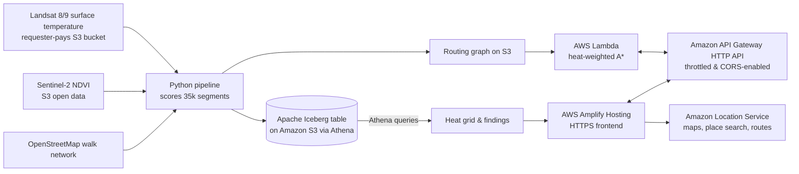

# CoolWalk: Complete Architecture, Mathematical Logic, and Full Source Code

This document provides a complete, unified reference for the entire **CoolWalk** application built for the AWS Builder Center "Weekend Challenge: Map It". It contains:
1. **The System Architecture & End-to-End Logic** explaining how every component connects to the next (from satellite data down to pixel rendering in the browser).
2. **Mathematical Formulations** for thermal radiometric scaling, vegetation indexing, heat cost weights, and detour-capped A* search.
3. **Every Single Line of Code** across all infrastructure definitions, data pipelines, SQL queries, backend router microservice, test harnesses, evaluation scripts, and frontend user interface.

---

# Table of Contents
1. [Architecture & System Flow](#1-architecture--system-flow)
2. [Mathematical Formulations & Physics Proxy Logic](#2-mathematical-formulations--physics-proxy-logic)
3. [Component Interconnection Logic](#3-component-interconnection-logic)
4. [Infrastructure as Code & Deployment](#4-infrastructure-as-code--deployment)
   - [`infra/template.yaml`](#infratemplateyaml)
   - [`scripts/deploy.ps1`](#scriptsdeployps1)
   - [`scripts/deploy.sh`](#scriptsdeploysh)
   - [`scripts/deploy_amplify.py`](#scriptsdeploy_amplifypy)
   - [`LICENSE`](#license)
5. [Data Pipeline & Satellite Ingestion](#5-data-pipeline--satellite-ingestion)
   - [`pipeline/config.py`](#pipelineconfigpy)
   - [`pipeline/requirements.txt`](#pipelinerequirementstxt)
   - [`pipeline/01_pick_scenes.py`](#pipeline01_pick_scenespy)
   - [`pipeline/02_score_segments.py`](#pipeline02_score_segmentspy)
6. [Apache Iceberg & Amazon Athena SQL Engine](#6-apache-iceberg--amazon-athena-sql-engine)
   - [`pipeline/sql/01_database.sql`](#pipelinesql01_databasesql)
   - [`pipeline/sql/02_staging_table.sql`](#pipelinesql02_staging_tablesql)
   - [`pipeline/sql/03_iceberg_table.sql`](#pipelinesql03_iceberg_tablesql)
   - [`pipeline/sql/q_heat_grid.sql`](#pipelinesqlq_heat_gridsql)
   - [`pipeline/sql/q_hot_share.sql`](#pipelinesqlq_hot_sharesql)
   - [`pipeline/sql/q_hottest_streets.sql`](#pipelinesqlq_hottest_streetssql)
   - [`pipeline/sql/q_coolest_streets.sql`](#pipelinesqlq_coolest_streetssql)
   - [`pipeline/03_build_iceberg.py`](#pipeline03_build_icebergpy)
   - [`pipeline/04_export_assets.py`](#pipeline04_export_assetspy)
7. [Routing Microservice & Offline Verification](#7-routing-microservice--offline-verification)
   - [`backend/router/app.py`](#backendrouterapppy)
   - [`backend/tests/test_router.py`](#backendteststest_routerpy)
8. [Frontend Single-Page Application](#8-frontend-single-page-application)
   - [`frontend/config.js`](#frontendconfigjs)
   - [`frontend/index.html`](#frontendindexhtml)
9. [Automation, Pair Evaluation & Screenshot Scripts](#9-automation-pair-evaluation--screenshot-scripts)
   - [`scripts/test_presets.py`](#scriptstest_presetspy)
   - [`scripts/search_landmark_pairs.py`](#scriptssearch_landmark_pairspy)
   - [`scripts/eval_pairs.py`](#scriptseval_pairspy)
   - [`scripts/find_demo_pairs.py`](#scriptsfind_demo_pairspy)
   - [`scripts/capture_screenshots.py`](#scriptscapture_screenshotspy)
10. [Submission Materials & Empirical Findings](#10-submission-materials--empirical-findings)
    - [`docs/FINDINGS.md`](#docsfindingsmd)
    - [`docs/WRITEUP.md`](#docswriteupmd)
    - [`docs/VIDEO_SCRIPT.md`](#docsvideo_scriptmd)
    - [`docs/SANITY_CHECK_REPRODUCE.md`](#docssanity_check_reproducemd)
    - [`README.md`](#readmemd)

---

# 1. Architecture & System Flow

CoolWalk bridges open earth-observation satellite data with real-time pedestrian navigation on AWS.

```mermaid
flowchart TD
    subgraph Data_Acquisition ["Phase 1: Ingestion & Spatial Scoring"]
        STAC[Earth Search STAC API] -->|Query cloud < 15%| P1[01_pick_scenes.py]
        P1 -->|Select clear scene| S_JSON[work/scenes.json]
        
        USGS[(s3://usgs-landsat/<br/>TIRS Band 10 LST + QA)] -->|Requester-Pays S3| P2[02_score_segments.py]
        S2_COG[(s3://sentinel-cogs/<br/>B04 Red, B08 NIR, SCL)] -->|HTTPS COG Window| P2
        OSM[(OpenStreetMap Overpass)] -->|ox.graph_from_bbox| P2
        S_JSON --> P2
        
        P2 -->|Export scored edges| PARQUET[work/segments.parquet<br/>35,748 rows]
        P2 -->|Serialize compact graph| GRAPH_GZ[work/graph.json.gz<br/>Nodes, Edges, Geometries]
    end

    subgraph Analytics_Engine ["Phase 2: Lakehouse Analytics (Iceberg + Athena)"]
        PARQUET -->|S3 Upload| S3_STAGE[s3://DataBucket/staging/segments/]
        S3_STAGE -->|External Table| GLUE[AWS Glue Catalog / Athena]
        P3[03_build_iceberg.py] -->|CTAS query| ICEBERG[(coolwalk.segments<br/>Apache Iceberg on S3)]
        
        ICEBERG -->|q_heat_grid.sql| P4[04_export_assets.py]
        ICEBERG -->|q_hot_share.sql| P4
        ICEBERG -->|q_hottest_streets.sql| P4
        ICEBERG -->|q_coolest_streets.sql| P4
        
        P4 -->|Spatial binning| HEAT_GEOJSON[frontend/data/heat_grid.geojson<br/>2,092 cells]
        P4 -->|Statistics| FINDINGS_JSON[frontend/data/findings.json]
        GRAPH_GZ -->|Upload| S3_GRAPH[s3://DataBucket/router/graph.json.gz]
    end

    subgraph Backend_Routing ["Phase 3: Serverless Routing Microservice"]
        S3_GRAPH -->|Cold-start load| LAMBDA[AWS Lambda: Python 3.12<br/>2048 MB Memory]
        APIGW[Amazon API Gateway HTTP API] <-->|Event v2 payload| LAMBDA
        
        LAMBDA -->|GET /health| HEALTH_EP[Coverage metadata & provenance]
        LAMBDA -->|POST /route| ROUTE_EP[A* heat-weighted path & metrics]
        LAMBDA -->|POST /score| SCORE_EP[Flexible/Simple polyline heat scoring]
    end

    subgraph Frontend_App ["Phase 4: Client Web Application"]
        AMPLIFY[AWS Amplify Hosting (HTTPS)] -->|Serve HTML/JS| BROWSER[User Web Browser]
        HEAT_GEOJSON --> BROWSER
        FINDINGS_JSON --> BROWSER
        
        BROWSER <-->|POST /route & POST /score| APIGW
        BROWSER <-->|v2 Vector Tiles: Light Style| ALS_MAPS[Amazon Location Service Maps v2]
        BROWSER <-->|v2 Places: Autocomplete / SearchText| ALS_PLACES[Amazon Location Service Places v2]
        BROWSER <-->|v2 Routes: CalculateRoutes Pedestrian| ALS_ROUTES[Amazon Location Service Routes v2]
    end
```

---

# 2. Mathematical Formulations & Physics Proxy Logic

### 2.1 Landsat 8/9 Collection 2 Level-2 Radiometric Calibration
Thermal Infrared Sensor (TIRS Band 10) Digital Numbers ($\text{DN}$) are converted into surface temperature in degrees Celsius using the USGS Collection 2 scaling factors:
$$T_{\text{Kelvin}} = \text{DN} \times 0.00341802 + 149.0$$
$$T_{\text{Celsius}} = T_{\text{Kelvin}} - 273.15$$

**QA Pixel Cloud/Shadow Masking:**
Pixels are checked against the Landsat 16-bit quality assessment band `QA_PIXEL`. Bits 0 (fill), 1 (dilated cloud), 3 (cloud), and 4 (cloud shadow) are masked using the bitwise operation:
$$\text{is\_bad} = (\text{QA} \ \& \ \mathtt{0b11011}) \neq 0$$
Any pixel marked bad or falling outside the physical temperature bounds $[15^\circ\text{C}, 75^\circ\text{C}]$ is discarded as NaN.

### 2.2 Sentinel-2 Normalized Difference Vegetation Index (NDVI)
Copernicus Sentinel-2 Level-2A surface reflectance is offset by the baseline calibration value:
$$\rho_{\text{Red}} = \max\left(0, \frac{\text{DN}_{\text{B04}} - 1000}{10000}\right), \quad \rho_{\text{NIR}} = \max\left(0, \frac{\text{DN}_{\text{B08}} - 1000}{10000}\right)$$
$$\text{NDVI} = \frac{\rho_{\text{NIR}} - \rho_{\text{Red}}}{\rho_{\text{NIR}} + \rho_{\text{Red}} + 10^{-6}}$$
Scene Classification Layer (SCL) pixels representing clouds, shadows, or saturated pixels (classes 0, 1, 3, 8, 9, 10, 11) are masked out.

### 2.3 Street Segment Point Sampling & Heat Index
Along every OpenStreetMap walkable edge geometry, equidistant points are interpolated at $\Delta s = 15\text{ m}$ spacing:
$$N_{\text{samples}} = \max\left(2, \left\lfloor \frac{\text{length\_m}}{15} \right\rfloor + 1\right)$$
For each edge $e$, the sample values are aggregated:
$$\overline{\text{LST}}_e = \frac{1}{|S_e|} \sum_{p \in S_e} T_{\text{Celsius}}(p), \quad \overline{\text{NDVI}}_e = \frac{1}{|S_e|} \sum_{p \in S_e} \text{NDVI}(p)$$

To normalize across the study domain, the 5th and 95th percentiles ($P_5, P_{95}$) of $\overline{\text{LST}}$ are computed:
$$\text{LST}_{\text{norm}} = \text{clip}\left(\frac{\overline{\text{LST}}_e - P_5}{P_{95} - P_5}, 0, 1\right)$$
$$\text{VEG}_{\text{norm}} = 1.0 - \text{clip}\left(\frac{\overline{\text{NDVI}}_e}{0.6}, 0, 1\right)$$

The final Heat Index $\mathcal{H}_e \in [0, 1]$ combines surface thermal radiation ($W_{\text{LST}} = 0.6$) and lack of vegetation canopy ($W_{\text{VEG}} = 0.4$):
$$\mathcal{H}_e = 0.6 \cdot \text{LST}_{\text{norm}} + 0.4 \cdot \text{VEG}_{\text{norm}}$$
Streets with $\mathcal{H}_e \ge 0.66$ are classified as **high-heat zones**.

### 2.4 Heat-Weighted A* Routing Cost & Detour Cap
The traversal cost for an edge $e$ with length $L_e$ and heat index $\mathcal{H}_e$ given trade-off parameter $\alpha \ge 0$ is:
$$\text{Cost}(e, \alpha) = L_e \cdot (1 + \alpha \cdot \mathcal{H}_e)$$
- When $\alpha = 0$, $\text{Cost}(e, 0) = L_e$, yielding the Euclidean shortest path.
- When $\alpha > 0$, hot edges receive a penalty proportional to their heat index.

The A* heuristic $h(u, t)$ is the great-circle Euclidean distance from node $u$ to target $t$:
$$h(u, t) = \text{dist\_m}(u, t) \le \text{shortest path length} \le \text{Cost}(u \to t)$$
Because $\text{Cost}(e, \alpha) \ge L_e \ge \text{dist\_m}$, $h(u, t)$ is strictly **admissible** and **consistent**, guaranteeing an optimal path.

**Detour Bounding:**
To prevent unreasonable detours, the search enforces:
$$\text{Length}(\text{CoolWalk}) \le \text{Length}(\text{Shortest}) \times \text{max\_detour} \quad (\text{default: } 1.45)$$
If the candidate path exceeds this bound, $\alpha$ is halved iteratively ($\alpha \leftarrow \alpha / 2$) until the path satisfies the bound or reverts to $\alpha = 0$.

### 2.5 Polyline Heat Scoring
For any arbitrary route (such as Amazon Location Service's pedestrian route), the route polyline is densified at 20 m intervals. Each point is matched to the nearest street segment within $R \le 60\text{ m}$ using a spatial hash grid. The heat values are projected into 48 discrete spatial bins:
$$\text{bin}_k = \text{heats}\left[\left\lfloor \frac{k + 0.5}{48} \cdot N \right\rfloor\right], \quad k \in [0, 47]$$

---

# 3. Component Interconnection Logic

1. **`pipeline/config.py`** anchors the spatial bounding box `BBOX = (77.19, 28.585, 77.26, 28.668)` (spanning from Old Delhi in the north to Lodhi Garden in the south), the date range `2026-04-15/2026-06-20`, and weights `(0.6, 0.4)`. Every pipeline script, the backend router, and the frontend map center and constraints import or inherit this exact box.
2. **`pipeline/01_pick_scenes.py`** queries Element 84's Earth Search STAC catalog for Landsat Collection 2 Level 2 and Sentinel-2 L2A. It searches for scenes intersecting `BBOX` with cloud cover below 15%, picks the clearest Landsat scene, pairs it with the closest same-day/adjacent Sentinel-2 tile, validates that required band assets exist, and writes `work/scenes.json`.
3. **`pipeline/02_score_segments.py`** loads `work/scenes.json`. It initiates an authenticated, requester-pays GDAL virtual filesystem session (`AWSSession(requester_pays=True)`) to stream sub-windows from `s3://usgs-landsat/` and `https://sentinel-cogs.s3.us-west-2.amazonaws.com/`. It downloads the walking network using `osmnx.graph_from_bbox`, interpolates sample points, applies the radiometric and NDVI equations, normalizes percentiles, and outputs:
   - `work/segments.parquet`: Schema table with columns `edge_id, u, v, length_m, mid_lon, mid_lat, lst_c, ndvi, heat_index, highway, name`.
   - `work/graph.json.gz`: Compact, compressed JSON containing indexed node coordinates, edges `[u, v, length, heat, edge_id]`, and simplified geometries for sub-millisecond Lambda ingestion.
4. **`pipeline/03_build_iceberg.py`** uploads `segments.parquet` to `s3://${BUCKET}/staging/segments/`. It executes Athena queries: creating database `coolwalk`, staging external table `coolwalk.segments_raw`, wiping `s3://${BUCKET}/iceberg/segments/`, and running a `CREATE TABLE coolwalk.segments WITH (table_type = 'ICEBERG') AS SELECT * FROM coolwalk.segments_raw`.
5. **`pipeline/04_export_assets.py`** queries the live Iceberg table through Athena:
   - `q_heat_grid.sql`: Aggregates street heat into $0.0015^\circ$ (~150 m) grid cells, exported as `frontend/data/heat_grid.geojson`.
   - `q_hot_share.sql`: Calculates total network kilometers and percent in high-heat zones.
   - `q_hottest_streets.sql` & `q_coolest_streets.sql`: Retrieves top 8 hottest and coolest named streets with length > 500m, exported as `frontend/data/findings.json`.
   - Uploads `work/graph.json.gz` to `s3://${BUCKET}/router/graph.json.gz`.
6. **`infra/template.yaml`** declares the Serverless Application Model (SAM) resources:
   - `SiteBucket`: Public S3 bucket with `WebsiteConfiguration` hosting `index.html`, `config.js`, and `data/`.
   - `DataBucket`: S3 bucket hosting Iceberg files, Athena query results, and `router/graph.json.gz`.
   - `RouterFunction`: AWS Lambda (`python3.12`, 2048 MB memory) with S3 read permissions to `DataBucket`.
   - `Api`: Amazon API Gateway HTTP API routing `/health`, `/route`, and `/score`.
7. **`scripts/deploy.ps1` & `scripts/deploy.sh`** automate `sam build`, `sam deploy`, extract stack outputs (`ApiUrl`, `SiteBucket`, `SiteUrl`, `DataBucket`), write `frontend/config.js` with the active Amazon Location API key and API URL, and synchronize the `frontend/` directory to S3.
8. **`backend/router/app.py`** powers the Lambda microservice. On cold start, it pulls `router/graph.json.gz` from S3 into memory, creates adjacency lists and spatial hash buckets (`0.001^\circ` cells). It processes incoming JSON requests:
   - `/health`: Verifies graph presence, node/edge counts, and date provenance.
   - `/route`: Snaps `origin` and `destination` to nearest street nodes, computes shortest path ($\alpha = 0$) and CoolWalk path ($\alpha > 0$) with detour bounding, and builds 48-bin heat profile strips.
   - `/score`: Accepts arbitrary coordinate lines (from Amazon Location Service), densifies them, snaps to the nearest scored street segments, and returns comparative heat statistics.
9. **`frontend/index.html`** provides a zero-dependency, responsive interface. It initializes MapLibre GL JS with Amazon Location Service Maps v2 Light tiles, overlays the GeoJSON heat grid, wires Amazon Location Places v2 autocomplete, requests both the CoolWalk route from the Lambda API and the standard pedestrian route from Amazon Location Routes v2, and renders the dual routes with comparative heat strips and verdict metrics.

---

# 4. Infrastructure as Code & Deployment

### `infra/template.yaml`
```yaml
AWSTemplateFormatVersion: "2010-09-09"
Transform: AWS::Serverless-2016-10-31
Description: CoolWalk - heat-aware walking routes (S3, CloudFront, Lambda, HTTP API)

Resources:
  # Holds the routing graph, Athena results, and the Iceberg table
  DataBucket:
    Type: AWS::S3::Bucket
    Properties:
      PublicAccessBlockConfiguration:
        BlockPublicAcls: true
        BlockPublicPolicy: true
        IgnorePublicAcls: true
        RestrictPublicBuckets: true
      BucketEncryption:
        ServerSideEncryptionConfiguration:
          - ServerSideEncryptionByDefault: { SSEAlgorithm: AES256 }

  # Private storage for frontend asset backups
  SiteBucket:
    Type: AWS::S3::Bucket
    Properties:
      PublicAccessBlockConfiguration:
        BlockPublicAcls: true
        BlockPublicPolicy: true
        IgnorePublicAcls: true
        RestrictPublicBuckets: true
      BucketEncryption:
        ServerSideEncryptionConfiguration:
          - ServerSideEncryptionByDefault: { SSEAlgorithm: AES256 }

  RouterFunction:
    Type: AWS::Serverless::Function
    Properties:
      Runtime: python3.12
      Handler: app.handler
      CodeUri: ../backend/router/
      MemorySize: 2048          # the graph is parsed into memory on cold start
      Timeout: 30
      Environment:
        Variables:
          BUCKET: !Ref DataBucket
          GRAPH_KEY: router/graph.json.gz
      Policies:
        - S3ReadPolicy: { BucketName: !Ref DataBucket }
      Events:
        Health: { Type: HttpApi, Properties: { ApiId: !Ref Api, Path: /health, Method: GET } }
        Route:  { Type: HttpApi, Properties: { ApiId: !Ref Api, Path: /route,  Method: POST } }
        Score:  { Type: HttpApi, Properties: { ApiId: !Ref Api, Path: /score,  Method: POST } }

  Api:
    Type: AWS::Serverless::HttpApi
    Properties:
      CorsConfiguration:
        AllowOrigins: ["*"]
        AllowMethods: [GET, POST, OPTIONS]
        AllowHeaders: [content-type]
        MaxAge: 3600
      DefaultRouteSettings:
        ThrottlingBurstLimit: 50
        ThrottlingRateLimit: 20

Outputs:
  AmplifyUrl:     { Value: "https://main.d3miw0zrayytbj.amplifyapp.com" }
  ApiUrl:         { Value: !Sub "https://${Api}.execute-api.${AWS::Region}.${AWS::URLSuffix}" }
  DataBucket:     { Value: !Ref DataBucket }
  SiteBucket:     { Value: !Ref SiteBucket }
```

### `scripts/deploy.ps1`
```powershell
# PowerShell deploy script for CoolWalk
param(
    [string]$Region = $(if ($env:AWS_REGION) { $env:AWS_REGION } else { "us-east-1" }),
    [string]$MapKey = $(if ($env:MAP_API_KEY) { $env:MAP_API_KEY } else { "" }),
    [string]$StackName = "coolwalk"
)

$ErrorActionPreference = "Stop"
$root = (Get-Item $PSScriptRoot).Parent.FullName
Set-Location $root

if (-not $MapKey) {
    # Check if key exists
    $keyDesc = aws location describe-key --key-name CoolWalkMapKey 2>$null | ConvertFrom-Json
    if ($keyDesc -and $keyDesc.Key) {
        $MapKey = $keyDesc.Key
    } else {
        Write-Error "Please specify -MapKey or set `$env:MAP_API_KEY"
    }
}

sam build -t infra/template.yaml
sam deploy --stack-name $StackName --region $Region --resolve-s3 --capabilities CAPABILITY_IAM --no-confirm-changeset --no-fail-on-empty-changeset

$stackDesc = aws cloudformation describe-stacks --stack-name $StackName --region $Region | ConvertFrom-Json
$outputs = @{}
foreach ($o in $stackDesc.Stacks[0].Outputs) {
    $outputs[$o.OutputKey] = $o.OutputValue
}

$apiUrl = $outputs["ApiUrl"]
$siteBucket = $outputs["SiteBucket"]
$siteUrl = $outputs["SiteUrl"]
$dataBucket = $outputs["DataBucket"]
$distId = $outputs["DistributionId"]

$cfg = @"
window.COOLWALK = {
  region: "$Region",
  mapKey: "$MapKey",
  apiUrl: "$apiUrl",
  bbox: [77.19, 28.585, 77.26, 28.668]
};
"@

Set-Content -Path (Join-Path $root "frontend\config.js") -Value $cfg -NoNewline

aws s3 sync (Join-Path $root "frontend") "s3://$siteBucket/" --delete --region $Region
if ($distId) {
    aws cloudfront create-invalidation --distribution-id $distId --paths "/*"
}

# Deploy to AWS Amplify Hosting (provides managed HTTPS)
python (Join-Path $root "scripts\deploy_amplify.py")

Write-Host ""
Write-Host "Amplify:     https://main.d3miw0zrayytbj.amplifyapp.com"
Write-Host "S3 fallback: $siteUrl"
Write-Host "API:         $apiUrl"
Write-Host "Data bucket: $dataBucket   (`$env:COOLWALK_BUCKET = '$dataBucket')"
```

### `scripts/deploy.sh`
```bash
#!/usr/bin/env bash
# One-command deploy: backend + hosting, then publish the website with its config.
#   export AWS_REGION=us-east-1            # a region where Amazon Location Maps/Places/Routes v2 exist
#   export MAP_API_KEY=v1.public....       # Amazon Location API key (see README step 4)
#   ./scripts/deploy.sh
set -euo pipefail
cd "$(dirname "$0")/.."
: "${AWS_REGION:?Set AWS_REGION}"
: "${MAP_API_KEY:?Set MAP_API_KEY (Amazon Location API key)}"
STACK="${STACK:-coolwalk}"

sam build -t infra/template.yaml
sam deploy --stack-name "$STACK" --region "$AWS_REGION" --resolve-s3 \
  --capabilities CAPABILITY_IAM --no-confirm-changeset --no-fail-on-empty-changeset

out() { aws cloudformation describe-stacks --stack-name "$STACK" --region "$AWS_REGION" \
  --query "Stacks[0].Outputs[?OutputKey=='$1'].OutputValue" --output text; }
API_URL="$(out ApiUrl)"; SITE_BUCKET="$(out SiteBucket)"; SITE_URL="$(out SiteUrl)"
DIST_ID="$(out DistributionId)"; DATA_BUCKET="$(out DataBucket)"

cat > frontend/config.js <<CFG
window.COOLWALK = {
  region: "$AWS_REGION",
  mapKey: "$MAP_API_KEY",
  apiUrl: "$API_URL",
  bbox: [77.19, 28.585, 77.26, 28.668]
};
CFG

aws s3 sync frontend/ "s3://$SITE_BUCKET/" --delete --region "$AWS_REGION"
if [ -n "$DIST_ID" ] && [ "$DIST_ID" != "None" ]; then
  aws cloudfront create-invalidation --distribution-id "$DIST_ID" --paths "/*" >/dev/null || true
fi

# Deploy to AWS Amplify Hosting (provides managed HTTPS)
python3 scripts/deploy_amplify.py

echo
echo "Amplify:     https://main.d3miw0zrayytbj.amplifyapp.com"
echo "S3 fallback: $SITE_URL"
echo "API:         $API_URL"
echo "Data bucket: $DATA_BUCKET   (export COOLWALK_BUCKET=$DATA_BUCKET)"
echo "Add https://main.d3miw0zrayytbj.amplifyapp.com/* to the API key's allowed referers."
```

### `scripts/deploy_amplify.py`
```python
"""Deploy the frontend directory to AWS Amplify Hosting via manual zip deployment."""
import io
import os
import sys
import time
import urllib.request
import zipfile
import boto3

REGION = os.getenv("AMPLIFY_REGION", "us-east-2")
APP_ID = os.getenv("AMPLIFY_APP_ID", "d3miw0zrayytbj")
BRANCH = os.getenv("AMPLIFY_BRANCH", "main")
FRONTEND_DIR = os.path.join(os.path.dirname(__file__), "..", "frontend")


def main():
    print(f"Packaging {FRONTEND_DIR}...")
    buf = io.BytesIO()
    with zipfile.ZipFile(buf, "w", zipfile.ZIP_DEFLATED) as z:
        for root, _, files in os.walk(FRONTEND_DIR):
            for f in files:
                path = os.path.join(root, f)
                arcname = os.path.relpath(path, FRONTEND_DIR)
                z.write(path, arcname)
    zip_bytes = buf.getvalue()
    print(f"Created zip ({len(zip_bytes):,} bytes).")

    amp = boto3.client("amplify", region_name=REGION)
    print(f"Creating deployment on Amplify App {APP_ID} ({BRANCH})...")
    dep = amp.create_deployment(appId=APP_ID, branchName=BRANCH)
    job_id = dep["jobId"]
    upload_url = dep["zipUploadUrl"]

    print("Uploading zip archive...")
    req = urllib.request.Request(upload_url, data=zip_bytes, method="PUT")
    req.add_header("Content-Type", "application/zip")
    with urllib.request.urlopen(req) as resp:
        if resp.status not in (200, 204):
            sys.exit(f"Upload failed: {resp.status}")

    print(f"Starting deployment job {job_id}...")
    amp.start_deployment(appId=APP_ID, branchName=BRANCH, jobId=job_id)

    print("Waiting for deployment to succeed...")
    for _ in range(30):
        time.sleep(3)
        job = amp.get_job(appId=APP_ID, branchName=BRANCH, jobId=job_id)
        status = job["job"]["summary"]["status"]
        print(f"Job {job_id} status: {status}")
        if status == "SUCCEED":
            url = f"https://{BRANCH}.{APP_ID}.amplifyapp.com"
            print(f"\nSuccessfully deployed to Amplify: {url}")
            return
        if status in ("FAILED", "CANCELLED"):
            sys.exit(f"Deployment {status}")
    sys.exit("Deployment timed out.")


if __name__ == "__main__":
    main()
```

### `LICENSE`
```text
MIT License

Copyright (c) 2026 CoolWalk contributors

Permission is hereby granted, free of charge, to any person obtaining a copy
of this software and associated documentation files (the "Software"), to deal
in the Software without restriction, including without limitation the rights
to use, copy, modify, merge, publish, distribute, sublicense, and/or sell
copies of the Software, and to permit persons to whom the Software is
furnished to do so, subject to the following conditions:

The above copyright notice and this permission notice shall be included in all
copies or substantial portions of the Software.

THE SOFTWARE IS PROVIDED "AS IS", WITHOUT WARRANTY OF ANY KIND, EXPRESS OR
IMPLIED, INCLUDING BUT NOT LIMITED TO THE WARRANTIES OF MERCHANTABILITY,
FITNESS FOR A PARTICULAR PURPOSE AND NONINFRINGEMENT. IN NO EVENT SHALL THE
AUTHORS OR COPYRIGHT HOLDERS BE LIABLE FOR ANY CLAIM, DAMAGES OR OTHER
LIABILITY, WHETHER IN AN ACTION OF CONTRACT, TORT OR OTHERWISE, ARISING FROM,
OUT OF OR IN CONNECTION WITH THE SOFTWARE OR THE USE OR OTHER DEALINGS IN THE
SOFTWARE.
```

---

# 5. Data Pipeline & Satellite Ingestion

### `pipeline/config.py`
```python
"""Shared settings. Change BBOX and DATE_RANGE to reuse CoolWalk for another city."""
import os
from pathlib import Path

ROOT = Path(__file__).resolve().parent.parent
WORK = ROOT / "work"
FRONT_DATA = ROOT / "frontend" / "data"
WORK.mkdir(exist_ok=True)
FRONT_DATA.mkdir(parents=True, exist_ok=True)

REGION = os.getenv("AWS_REGION", "us-east-1")
BUCKET = os.getenv("COOLWALK_BUCKET", "")          # data bucket from the CloudFormation stack
DB = "coolwalk"

# west, south, east, north (central Delhi: Old Delhi to Lodhi Garden)
BBOX = (77.19, 28.585, 77.26, 28.668)
DATE_RANGE = os.getenv("COOLWALK_DATES", "2026-04-15/2026-06-20")   # pre-monsoon, hottest and clearest
LANDSAT_MAX_CLOUD = 15
S2_MAX_CLOUD = 20

STEP_M = 15                 # sample spacing along each street segment
W_LST, W_VEG = 0.6, 0.4     # heat index = W_LST * surface temperature + W_VEG * lack of vegetation
HOT_T = 0.66                # keep in sync with backend/router/app.py
```

### `pipeline/requirements.txt`
```text
boto3>=1.35
numpy>=1.26
pandas>=2.2
pyarrow>=16
shapely>=2.0
pyproj>=3.6
rasterio>=1.3.10
osmnx>=2.0
geopandas>=1.0
pystac-client>=0.8
```

### `pipeline/01_pick_scenes.py`
```python
"""Step 1. Pick one clear Landsat 8/9 scene and same-day Sentinel-2 tiles for the study area.

Reads the Earth Search STAC API (public, no login). Writes work/scenes.json.
Choose a different Landsat scene with:  SCENE_INDEX=2 python pipeline/01_pick_scenes.py
"""
import json
import os
import sys

from pystac_client import Client
from shapely.geometry import box, shape

import config

STAC = "https://earth-search.aws.element84.com/v1"


def s3_href(asset):
    """Prefer the s3:// location. Landsat's default https link needs a USGS login."""
    alt = (asset.extra_fields.get("alternate") or {}).get("s3", {}).get("href")
    return alt or asset.href


def need(item, keys):
    missing = [k for k in keys if k not in item.assets]
    if missing:
        print(f"{item.id}: missing assets {missing}. Available: {sorted(item.assets)}")
        sys.exit(1)


def search(collection, max_cloud):
    cat = Client.open(STAC)
    res = cat.search(collections=[collection], bbox=config.BBOX, datetime=config.DATE_RANGE,
                     query={"eo:cloud_cover": {"lt": max_cloud}}, max_items=300)
    return list(res.items())


def main():
    area = box(*config.BBOX)
    ls = [i for i in search("landsat-c2-l2", config.LANDSAT_MAX_CLOUD) if shape(i.geometry).contains(area)]
    if not ls:
        sys.exit("No clear Landsat scene found. Widen COOLWALK_DATES or raise LANDSAT_MAX_CLOUD.")
    ls.sort(key=lambda i: i.properties.get("eo:cloud_cover", 100))
    print("Landsat candidates (lowest cloud first):")
    for n, i in enumerate(ls[:8]):
        print(f"  [{n}] {i.id}  {i.datetime:%Y-%m-%d}  cloud {i.properties.get('eo:cloud_cover'):.1f}%")
    chosen = ls[min(int(os.getenv("SCENE_INDEX", "0")), len(ls) - 1)]
    need(chosen, ["lwir11", "qa_pixel"])

    s2_all = search("sentinel-2-l2a", config.S2_MAX_CLOUD)
    if not s2_all:
        sys.exit("No Sentinel-2 scene found. Raise S2_MAX_CLOUD or widen the date range.")
    day = chosen.datetime.date()
    s2_all.sort(key=lambda i: abs((i.datetime.date() - day).days))
    s2_day = s2_all[0].datetime.date()
    s2 = [i for i in s2_all if i.datetime.date() == s2_day]
    for i in s2:
        need(i, ["red", "nir", "scl"])

    out = {
        "landsat": {"id": chosen.id, "date": f"{chosen.datetime:%Y-%m-%d}",
                    "cloud": chosen.properties.get("eo:cloud_cover"),
                    "lwir11": s3_href(chosen.assets["lwir11"]), "qa": s3_href(chosen.assets["qa_pixel"])},
        "sentinel": {"date": str(s2_day), "items": [
            {"id": i.id, "cloud": i.properties.get("eo:cloud_cover"),
             "red": s3_href(i.assets["red"]), "nir": s3_href(i.assets["nir"]), "scl": s3_href(i.assets["scl"])}
            for i in s2]},
    }
    (config.WORK / "scenes.json").write_text(json.dumps(out, indent=2))
    print(f"\nLandsat {out['landsat']['date']} + Sentinel-2 {out['sentinel']['date']} "
          f"({len(s2)} tile(s)). Saved work/scenes.json")


if __name__ == "__main__":
    main()
```

### `pipeline/02_score_segments.py`
```python
"""Step 2. Score every walkable street segment for heat.

Inputs : work/scenes.json (step 1), OpenStreetMap walking network (downloaded here)
Outputs: work/segments.parquet   one row per street segment (loaded into Athena/Iceberg in step 3)
         work/graph.json.gz      compact routing graph for the Lambda
Heat index (0..1) = 0.6 * normalised surface temperature + 0.4 * lack of vegetation.
"""
import gzip
import json
import sys

import boto3
import numpy as np
import osmnx as ox
import pandas as pd
import rasterio
from pyproj import Transformer
from rasterio.errors import WindowError
from rasterio.session import AWSSession
from rasterio.windows import Window, from_bounds

import config


class Raster:
    """Reads the study-area window of a COG once, then answers point lookups in lon/lat."""

    def __init__(self, href):
        self.data = None
        with rasterio.open(href) as ds:
            tf = Transformer.from_crs("EPSG:4326", ds.crs, always_xy=True)
            w, s, e, n = config.BBOX
            xs, ys = tf.transform([w, e, w, e], [s, s, n, n])
            try:
                win = from_bounds(min(xs), min(ys), max(xs), max(ys), ds.transform)
                win = win.round_offsets().round_lengths().intersection(Window(0, 0, ds.width, ds.height))
            except WindowError:
                return  # this tile does not overlap the study area
            self.data = ds.read(1, window=win)
            self.inv = ~ds.window_transform(win)
            self.crs = ds.crs
        self.tf = Transformer.from_crs("EPSG:4326", self.crs, always_xy=True)

    def sample(self, lons, lats):
        out = np.full(len(lons), np.nan)
        if self.data is None:
            return out
        x, y = self.tf.transform(lons, lats)
        cols, rows = self.inv * (np.asarray(x), np.asarray(y))
        rows, cols = np.floor(rows).astype(int), np.floor(cols).astype(int)
        ok = (rows >= 0) & (rows < self.data.shape[0]) & (cols >= 0) & (cols < self.data.shape[1])
        out[ok] = self.data[rows[ok], cols[ok]]
        return out


def edge_points(edges):
    lon, lat, eid = [], [], []
    for i, (geom, length) in enumerate(zip(edges.geometry, edges["length"])):
        for t in np.linspace(0.0, 1.0, max(2, int(length // config.STEP_M) + 1)):
            p = geom.interpolate(t, normalized=True)
            lon.append(p.x)
            lat.append(p.y)
            eid.append(i)
    return np.array(lon), np.array(lat), np.array(eid)


def surface_temp_c(sc, lon, lat):
    ls = sc["landsat"]
    dn = Raster(ls["lwir11"]).sample(lon, lat)
    qa = Raster(ls["qa"]).sample(lon, lat)
    bad = np.isnan(qa) | ((np.nan_to_num(qa).astype(np.int64) & 0b11011) != 0)  # fill, cloud, shadow
    t = dn * 0.00341802 + 149.0 - 273.15                                          # Landsat C2 L2 scale, Kelvin to C
    t[(dn <= 0) | bad | (t < 15) | (t > 75)] = np.nan
    return t


def ndvi(sc, lon, lat):
    out = np.full(len(lon), np.nan)
    for it in sc["sentinel"]["items"]:
        red, nir, scl = Raster(it["red"]), Raster(it["nir"]), Raster(it["scl"])
        r, n, c = red.sample(lon, lat), nir.sample(lon, lat), scl.sample(lon, lat)
        r = np.where(r > 0, np.clip((r - 1000.0) / 10000.0, 0, None), np.nan)   # L2A BOA offset
        n = np.where(n > 0, np.clip((n - 1000.0) / 10000.0, 0, None), np.nan)
        v = (n - r) / (n + r + 1e-6)
        v[np.isin(np.nan_to_num(c), [0, 1, 3, 8, 9, 10, 11])] = np.nan
        out = np.where(np.isnan(out), v, out)
    return out


def main():
    sc = json.loads((config.WORK / "scenes.json").read_text())
    print("Downloading OpenStreetMap walking network ...")
    G = ox.graph.graph_from_bbox(bbox=config.BBOX, network_type="walk", simplify=True)
    nodes, edges = ox.convert.graph_to_gdfs(G, fill_edge_geometry=True)
    edges = edges.reset_index()
    print(f"{len(edges):,} street segments, {len(nodes):,} intersections")
    if len(edges) > 120_000:
        print("WARNING: graph is large. Shrink BBOX in pipeline/config.py to keep Lambda cold starts fast.")

    lon, lat, eid = edge_points(edges)
    print(f"Sampling {len(lon):,} points ...")
    session = AWSSession(boto3.Session(), requester_pays=True)       # Landsat bucket is requester-pays
    with rasterio.Env(session, AWS_REGION="us-west-2", GDAL_DISABLE_READDIR_ON_OPEN="EMPTY_DIR"):
        lst = surface_temp_c(sc, lon, lat)
        veg = ndvi(sc, lon, lat)

    per = pd.DataFrame({"e": eid, "lst": lst, "ndvi": veg}).groupby("e").mean().reindex(range(len(edges)))
    print(f"Missing after masking: LST {per.lst.isna().mean():.1%}, NDVI {per.ndvi.isna().mean():.1%}")
    per = per.fillna(per.median())
    p5, p95 = np.percentile(per.lst, [5, 95])
    lst_n = ((per.lst - p5) / (p95 - p5)).clip(0, 1)
    veg_n = 1.0 - (per.ndvi / 0.6).clip(0, 1)
    heat = (config.W_LST * lst_n + config.W_VEG * veg_n).round(4)

    mid = edges.geometry.interpolate(0.5, normalized=True)
    seg = pd.DataFrame({
        "edge_id": np.arange(len(edges), dtype="int64"),
        "u": edges["u"].astype("int64"), "v": edges["v"].astype("int64"),
        "length_m": edges["length"].round(1), "mid_lon": mid.x.round(6), "mid_lat": mid.y.round(6),
        "lst_c": per.lst.round(2).values, "ndvi": per.ndvi.round(3).values, "heat_index": heat.values,
        "highway": edges["highway"].map(lambda v: v[0] if isinstance(v, list) else str(v)),
        "name": edges["name"].map(lambda v: (v[0] if isinstance(v, list) else v) if isinstance(v, (str, list)) else ""),
    })
    seg.to_parquet(config.WORK / "segments.parquet", index=False)

    # compact routing graph
    ids = pd.unique(pd.concat([seg.u, seg.v]))
    index = {int(n): i for i, n in enumerate(ids)}
    node_xy = [[round(float(nodes.loc[n, "x"]), 6), round(float(nodes.loc[n, "y"]), 6)] for n in ids]
    g_edges, g_geoms = [], []
    for row, geom in zip(seg.itertuples(index=False), edges.geometry):
        coords = [[round(x, 5), round(y, 5)] for x, y in geom.coords]
        u_xy = node_xy[index[int(row.u)]]
        if (coords[0][0] - u_xy[0]) ** 2 + (coords[0][1] - u_xy[1]) ** 2 > \
           (coords[-1][0] - u_xy[0]) ** 2 + (coords[-1][1] - u_xy[1]) ** 2:
            coords.reverse()                                          # make geometry run u -> v
        g_edges.append([index[int(row.u)], index[int(row.v)], float(row.length_m), float(row.heat_index), int(row.edge_id)])
        g_geoms.append(coords)
    meta = {"bbox": list(config.BBOX), "landsat_date": sc["landsat"]["date"], "landsat_id": sc["landsat"]["id"],
            "sentinel_date": sc["sentinel"]["date"], "weights": {"lst": config.W_LST, "veg": config.W_VEG},
            "lst_p5_c": round(float(p5), 2), "lst_p95_c": round(float(p95), 2), "hot_threshold": config.HOT_T}
    with gzip.open(config.WORK / "graph.json.gz", "wt", encoding="utf-8") as f:
        json.dump({"nodes": node_xy, "edges": g_edges, "geoms": g_geoms, "meta": meta}, f, separators=(",", ":"))

    print(f"Saved work/segments.parquet and work/graph.json.gz")
    print(f"Surface temperature range in the area (5th to 95th percentile): {p5:.1f} to {p95:.1f} C")
    print(f"Share of street length at or above the hot threshold: "
          f"{(seg.length_m[seg.heat_index >= config.HOT_T].sum() / seg.length_m.sum()):.1%}")


if __name__ == "__main__":
    sys.exit(main())
```

---

# 6. Apache Iceberg & Amazon Athena SQL Engine

### `pipeline/sql/01_database.sql`
```sql
CREATE DATABASE IF NOT EXISTS coolwalk;
```

### `pipeline/sql/02_staging_table.sql`
```sql
DROP TABLE IF EXISTS coolwalk.segments_raw;
CREATE EXTERNAL TABLE coolwalk.segments_raw (
  edge_id bigint, u bigint, v bigint, length_m double,
  mid_lon double, mid_lat double, lst_c double, ndvi double,
  heat_index double, highway string, name string
)
STORED AS PARQUET
LOCATION 's3://${BUCKET}/staging/segments/';
```

### `pipeline/sql/03_iceberg_table.sql`
```sql
DROP TABLE IF EXISTS coolwalk.segments;
CREATE TABLE coolwalk.segments
WITH (table_type = 'ICEBERG', location = 's3://${BUCKET}/iceberg/segments/', is_external = false, format = 'PARQUET')
AS SELECT * FROM coolwalk.segments_raw;
```

### `pipeline/sql/q_heat_grid.sql`
```sql
SELECT cast(floor(mid_lon / 0.0015) AS bigint) AS cx, cast(floor(mid_lat / 0.0015) AS bigint) AS cy,
       avg(heat_index) AS heat, sum(length_m) AS length_m
FROM coolwalk.segments GROUP BY 1, 2
```

### `pipeline/sql/q_hot_share.sql`
```sql
SELECT round(sum(CASE WHEN heat_index >= 0.66 THEN length_m ELSE 0 END) / sum(length_m), 4) AS hot_share,
       round(sum(length_m) / 1000, 1) AS network_km,
       round(approx_percentile(lst_c, 0.05), 1) AS lst_p05_c,
       round(approx_percentile(lst_c, 0.95), 1) AS lst_p95_c
FROM coolwalk.segments
```

### `pipeline/sql/q_hottest_streets.sql`
```sql
SELECT name, round(avg(heat_index), 3) AS heat, round(sum(length_m)) AS length_m,
       round(avg(lst_c), 1) AS lst_c, round(approx_percentile(mid_lon, 0.5), 5) AS lon, round(approx_percentile(mid_lat, 0.5), 5) AS lat
FROM coolwalk.segments
WHERE name IS NOT NULL AND name <> '' AND highway IN ('primary','secondary','tertiary','residential','unclassified','pedestrian','living_street')
GROUP BY name HAVING sum(length_m) > 500
ORDER BY heat DESC LIMIT 8;
```

### `pipeline/sql/q_coolest_streets.sql`
```sql
SELECT name, round(avg(heat_index), 3) AS heat, round(sum(length_m)) AS length_m,
       round(avg(lst_c), 1) AS lst_c, round(approx_percentile(mid_lon, 0.5), 5) AS lon, round(approx_percentile(mid_lat, 0.5), 5) AS lat
FROM coolwalk.segments
WHERE name IS NOT NULL AND name <> '' AND highway IN ('primary','secondary','tertiary','residential','unclassified','pedestrian','living_street')
GROUP BY name HAVING sum(length_m) > 500
ORDER BY heat ASC LIMIT 8;
```

### `pipeline/03_build_iceberg.py`
```python
"""Step 3. Put the scored street segments into an Apache Iceberg table on S3 using Amazon Athena.

  work/segments.parquet -> s3://BUCKET/staging/segments/ -> coolwalk.segments (Iceberg)

Needs: COOLWALK_BUCKET set, AWS credentials with S3 + Athena + Glue access.
"""
import sys
import time
from pathlib import Path

import boto3

import config

SQL = Path(__file__).parent / "sql"
athena = boto3.client("athena", region_name=config.REGION)
s3 = boto3.client("s3", region_name=config.REGION)


def run(sql, database=None):
    """Run one Athena statement and wait for it. Returns the query execution id."""
    args = {"QueryString": sql, "WorkGroup": "primary",
            "ResultConfiguration": {"OutputLocation": f"s3://{config.BUCKET}/athena-results/"}}
    if database:
        args["QueryExecutionContext"] = {"Database": database}
    qid = athena.start_query_execution(**args)["QueryExecutionId"]
    while True:
        st = athena.get_query_execution(QueryExecutionId=qid)["QueryExecution"]["Status"]
        if st["State"] in ("SUCCEEDED", "FAILED", "CANCELLED"):
            break
        time.sleep(1.0)
    if st["State"] != "SUCCEEDED":
        raise RuntimeError(f"Athena {st['State']}: {st.get('StateChangeReason', '')}\n{sql[:300]}")
    return qid


def rows(qid):
    """Return result rows as a list of dicts (strings)."""
    out, header = [], None
    for page in athena.get_paginator("get_query_results").paginate(QueryExecutionId=qid):
        for r in page["ResultSet"]["Rows"]:
            vals = [c.get("VarCharValue") for c in r["Data"]]
            if header is None:
                header = vals
            else:
                out.append(dict(zip(header, vals)))
    return out


def clear_prefix(prefix):
    """Iceberg CTAS needs an empty target location, so wipe it before re-running."""
    for page in s3.get_paginator("list_objects_v2").paginate(Bucket=config.BUCKET, Prefix=prefix):
        keys = [{"Key": o["Key"]} for o in page.get("Contents", [])]
        if keys:
            s3.delete_objects(Bucket=config.BUCKET, Delete={"Objects": keys})


def statements(name):
    text = (SQL / name).read_text().replace("${BUCKET}", config.BUCKET)
    return [s.strip() for s in text.split(";") if s.strip()]


def main():
    if not config.BUCKET:
        sys.exit("Set COOLWALK_BUCKET to the data bucket name (stack output DataBucket).")
    parquet = config.WORK / "segments.parquet"
    if not parquet.exists():
        sys.exit("Run pipeline/02_score_segments.py first.")

    print("Uploading segments.parquet ...")
    clear_prefix("staging/segments/")
    s3.upload_file(str(parquet), config.BUCKET, "staging/segments/segments.parquet")

    for f in ("01_database.sql", "02_staging_table.sql"):
        for s in statements(f):
            print("Athena:", s.splitlines()[0])
            run(s)
    clear_prefix("iceberg/segments/")
    for s in statements("03_iceberg_table.sql"):
        print("Athena:", s.splitlines()[0])
        run(s, config.DB)

    n = rows(run("SELECT count(*) AS n FROM coolwalk.segments", config.DB))[0]["n"]
    print(f"Iceberg table coolwalk.segments is ready with {int(n):,} street segments.")


if __name__ == "__main__":
    main()
```

### `pipeline/04_export_assets.py`
```python
"""Step 4. Query the Iceberg table with Athena and write the assets the website and Lambda need.

  frontend/data/heat_grid.geojson   150 m heat cells for the map layer
  frontend/data/findings.json       hottest / coolest streets and the share of hot streets
  s3://BUCKET/router/graph.json.gz  routing graph for the Lambda
"""
import importlib
import json
import sys
from pathlib import Path

import numpy as np

import config

ath = importlib.import_module("03_build_iceberg")      # reuse its Athena helpers
SQL = Path(__file__).parent / "sql"
CELL = 0.0015


def query(name):
    return ath.rows(ath.run((SQL / name).read_text().strip().rstrip(";"), config.DB))


def main():
    if not config.BUCKET:
        sys.exit("Set COOLWALK_BUCKET first.")

    grid = query("q_heat_grid.sql")
    heat = np.array([float(r["heat"]) for r in grid])
    lo, hi = np.percentile(heat, [5, 95])
    feats = []
    for r in grid:
        cx, cy, h = int(r["cx"]), int(r["cy"]), float(r["heat"])
        x0, y0 = cx * CELL, cy * CELL
        feats.append({"type": "Feature",
                      "properties": {"h": round(h, 3), "hs": round(float(np.clip((h - lo) / (hi - lo), 0, 1)), 3)},
                      "geometry": {"type": "Polygon", "coordinates": [[
                          [x0, y0], [x0 + CELL, y0], [x0 + CELL, y0 + CELL], [x0, y0 + CELL], [x0, y0]]]}})
    (config.FRONT_DATA / "heat_grid.geojson").write_text(
        json.dumps({"type": "FeatureCollection", "features": feats}, separators=(",", ":")))

    share = query("q_hot_share.sql")[0]
    findings = {
        "hot_share": float(share["hot_share"]), "network_km": float(share["network_km"]),
        "lst_p05_c": float(share["lst_p05_c"]), "lst_p95_c": float(share["lst_p95_c"]),
        "hottest": [{"name": r["name"], "heat": float(r["heat"]), "lst_c": float(r["lst_c"]),
                     "length_m": float(r["length_m"]), "lon": float(r["lon"]), "lat": float(r["lat"])}
                    for r in query("q_hottest_streets.sql")],
        "coolest": [{"name": r["name"], "heat": float(r["heat"]), "lst_c": float(r["lst_c"]),
                     "length_m": float(r["length_m"]), "lon": float(r["lon"]), "lat": float(r["lat"])}
                    for r in query("q_coolest_streets.sql")],
    }
    (config.FRONT_DATA / "findings.json").write_text(json.dumps(findings, indent=2))

    ath.s3.upload_file(str(config.WORK / "graph.json.gz"), config.BUCKET, "router/graph.json.gz")
    print(f"Wrote {len(feats):,} heat cells, findings.json, and uploaded router/graph.json.gz")
    print(f"{findings['hot_share']:.1%} of street length is in high-heat zones.")
    print("Hottest:", ", ".join(h["name"] for h in findings["hottest"][:3]))
    print("Coolest:", ", ".join(c["name"] for c in findings["coolest"][:3]))


if __name__ == "__main__":
    main()
```

---

# 7. Routing Microservice & Offline Verification

### `backend/router/app.py`
```python
"""CoolWalk router (AWS Lambda, HTTP API payload v2).

Endpoints
  GET  /health  -> coverage box and data provenance
  POST /route   -> {origin:[lon,lat], destination:[lon,lat], alpha?, max_detour?}
                   returns the shortest walk and the heat-aware walk, with metrics
  POST /score   -> {line:[[lon,lat],...]}
                   scores any walking route (used for the Amazon Location baseline)

Heat-aware cost of a street segment = length_m * (1 + alpha * heat), heat in 0..1.
alpha = 0 gives the plain shortest walk. Standard library only (boto3 is imported lazily).
"""
import bisect
import gzip
import heapq
import json
import math
import os

WALK_MPS = 1.35          # average walking speed, metres per second
HOT_T = 0.66             # heat index at or above this counts as a "high-heat zone"
CELL = 0.001             # spatial hash cell, degrees (about 110 m)
SAMPLE_M = 20.0          # spacing of sample points along streets and routes
SNAP_MAX_M = 400.0       # farthest we will snap a click to a street
MATCH_M = 60.0           # farthest a route point may sit from a scored street
BINS = 48                # resolution of the heat strip

_G = None


class ApiError(Exception):
    def __init__(self, status, message):
        super().__init__(message)
        self.status = status


# ---------------------------------------------------------------- geometry
def dist_m(lon1, lat1, lon2, lat2):
    k = math.cos(math.radians((lat1 + lat2) / 2))
    return math.hypot((lon2 - lon1) * 111320.0 * k, (lat2 - lat1) * 110540.0)


def densify(coords, step=SAMPLE_M):
    """Yield points roughly every `step` metres along a polyline."""
    if not coords:
        return
    for (x1, y1), (x2, y2) in zip(coords, coords[1:]):
        n = max(1, int(dist_m(x1, y1, x2, y2) // step))
        for k in range(n):
            t = k / n
            yield (x1 + (x2 - x1) * t, y1 + (y2 - y1) * t)
    yield tuple(coords[-1])


def cell(lon, lat):
    return (int(lon // CELL), int(lat // CELL))


# ---------------------------------------------------------------- graph
def build(data):
    nodes, edges, geoms = data["nodes"], data["edges"], data["geoms"]
    adj = [[] for _ in nodes]
    for i, e in enumerate(edges):
        u, v, length, heat, _eid = e[:5]          # a 6th item, if present, is mean surface temp (C)
        adj[u].append((v, length, heat, i))
    node_grid = {}
    for i, (lon, lat) in enumerate(nodes):
        node_grid.setdefault(cell(lon, lat), []).append(i)
    pt_grid = {}
    for i, e in enumerate(edges):
        lst = e[5] if len(e) > 5 else None
        for lon, lat in densify(geoms[i]):
            pt_grid.setdefault(cell(lon, lat), []).append((lon, lat, e[3], lst))
    return {"nodes": nodes, "edges": edges, "geoms": geoms, "adj": adj,
            "node_grid": node_grid, "pt_grid": pt_grid, "meta": data.get("meta", {})}


def load():
    global _G
    if _G is not None:
        return _G
    local = os.environ.get("GRAPH_LOCAL")
    if local:
        with open(local, "rb") as f:
            raw = f.read()
    else:
        import boto3
        obj = boto3.client("s3").get_object(
            Bucket=os.environ["BUCKET"], Key=os.environ.get("GRAPH_KEY", "router/graph.json.gz"))
        raw = obj["Body"].read()
    _G = build(json.loads(gzip.decompress(raw)))
    return _G


def nearest_node(g, lon, lat):
    cx, cy = cell(lon, lat)
    best, stop_at = None, None
    for r in range(0, 9):
        if stop_at is not None and r > stop_at:
            break
        for dx in range(-r, r + 1):
            for dy in range(-r, r + 1):
                if max(abs(dx), abs(dy)) != r:
                    continue
                for i in g["node_grid"].get((cx + dx, cy + dy), ()):
                    d = dist_m(lon, lat, *g["nodes"][i])
                    if best is None or d < best[0]:
                        best = (d, i)
        if best and stop_at is None:
            stop_at = r + 1
    return best  # (metres, node index) or None


def astar(g, s, t, alpha):
    nodes, adj = g["nodes"], g["adj"]
    tx, ty = nodes[t]

    def h(n):
        return dist_m(nodes[n][0], nodes[n][1], tx, ty)

    best = {s: 0.0}
    prev = {}
    done = set()
    pq = [(h(s), 0.0, s)]
    while pq:
        _f, gc, n = heapq.heappop(pq)
        if n in done:
            continue
        if n == t:
            break
        done.add(n)
        for v, length, heat, ei in adj[n]:
            if v in done:
                continue
            c = gc + length * (1.0 + alpha * heat)
            if c < best.get(v, 1e18):
                best[v] = c
                prev[v] = (n, ei)
                heapq.heappush(pq, (c + h(v), c, v))
    else:
        return None
    path, n = [], t
    while n != s:
        n, ei = prev[n][0], prev[n][1]
        path.append(ei)
    path.reverse()
    return path


# ---------------------------------------------------------------- metrics
def _round_line(line):
    return [[round(x, 5), round(y, 5)] for x, y in line]


def _finish(length_m, heats, profile, line=None, extra=None, lsts=None):
    known = [h for h in heats if h is not None]
    known_lst = [t for t in (lsts or []) if t is not None]
    out = {
        "length_m": round(length_m, 1),
        "minutes": round(length_m / WALK_MPS / 60.0, 1),
        "mean_heat": round(sum(known) / len(known), 3) if known else None,
        "mean_lst_c": round(sum(known_lst) / len(known_lst), 1) if known_lst else None,
        "hot_share": round(sum(1 for h in known if h >= HOT_T) / len(known), 3) if known else None,
        "profile": [None if p is None else round(p, 3) for p in profile],
    }
    if line is not None:
        out["line"] = _round_line(line)
    if extra:
        out.update(extra)
    return out


def path_metrics(g, eis):
    edges, geoms = g["edges"], g["geoms"]
    line, cum, total, per_edge, per_lst = [], [], 0.0, [], []
    for ei in eis:
        gm = geoms[ei]
        line.extend(gm if not line else gm[1:])
        total += edges[ei][2]
        cum.append(total)
        per_edge.append(edges[ei][3])
        per_lst.append(edges[ei][5] if len(edges[ei]) > 5 else None)
    # length-weighted heat samples at 5 m spacing for stable shares
    heats, lsts, prev = [], [], 0.0
    for c, h, t in zip(cum, per_edge, per_lst):
        n = max(1, int((c - prev) // 5))
        heats.extend([h] * n)
        lsts.extend([t] * n)
        prev = c
    profile = []
    for k in range(BINS):
        d = (k + 0.5) / BINS * total
        profile.append(per_edge[min(bisect.bisect_left(cum, d), len(per_edge) - 1)])
    return _finish(total, heats, profile, line, lsts=lsts)


def score_line(g, line):
    pts = list(densify([tuple(p) for p in line]))
    heats, lsts = [], []
    for lon, lat in pts:
        cx, cy = cell(lon, lat)
        best = None
        for dx in (-1, 0, 1):
            for dy in (-1, 0, 1):
                for plon, plat, h, lst in g["pt_grid"].get((cx + dx, cy + dy), ()):
                    d = dist_m(lon, lat, plon, plat)
                    if d <= MATCH_M and (best is None or d < best[0]):
                        best = (d, h, lst)
        heats.append(best[1] if best else None)
        lsts.append(best[2] if best else None)
    length = sum(dist_m(a[0], a[1], b[0], b[1]) for a, b in zip(line, line[1:]))
    profile = [heats[min(int((k + 0.5) / BINS * len(heats)), len(heats) - 1)] for k in range(BINS)] if heats else []
    matched = sum(1 for h in heats if h is not None)
    return _finish(length, heats, profile, None,
                   {"coverage": round(matched / len(heats), 3) if heats else 0.0}, lsts=lsts)


# ---------------------------------------------------------------- handlers
def _point(v, name):
    if (not isinstance(v, (list, tuple)) or len(v) != 2
            or not all(isinstance(x, (int, float)) for x in v)):
        raise ApiError(400, f"{name} must be [longitude, latitude].")
    return float(v[0]), float(v[1])


def _inside(g, lon, lat):
    w, s, e, n = g["meta"].get("bbox", (-180, -90, 180, 90))
    return w - 0.01 <= lon <= e + 0.01 and s - 0.01 <= lat <= n + 0.01


def route(g, body):
    o = _point(body.get("origin"), "origin")
    d = _point(body.get("destination"), "destination")
    if not (_inside(g, *o) and _inside(g, *d)):
        raise ApiError(400, "Both points need to be inside the central Delhi coverage area.")
    alpha = min(max(float(body.get("alpha", 3.0)), 0.0), 8.0)
    max_detour = min(max(float(body.get("max_detour", 1.45)), 1.0), 2.5)
    so, sd = nearest_node(g, *o), nearest_node(g, *d)
    if not so or not sd or so[0] > SNAP_MAX_M or sd[0] > SNAP_MAX_M:
        raise ApiError(400, "One of the points is too far from a walkable street. Move it closer to a road.")
    shortest = astar(g, so[1], sd[1], 0.0)
    if shortest is None:
        raise ApiError(404, "No walking connection between those points.")
    s_met = path_metrics(g, shortest)
    cool, used = shortest, 0.0
    a = alpha
    while a > 0.05 and alpha > 0:
        cand = astar(g, so[1], sd[1], a)
        if cand is not None:
            m = path_metrics(g, cand)
            if m["length_m"] <= s_met["length_m"] * max_detour:
                cool, used = cand, a
                break
        a /= 2.0
    c_met = path_metrics(g, cool)
    return {
        "shortest": s_met,
        "cool": c_met,
        "alpha_used": round(used, 2),
        "snapped": {"origin_m": round(so[0]), "destination_m": round(sd[0])},
    }


def score(g, body):
    line = body.get("line")
    if not isinstance(line, list) or len(line) < 2 or len(line) > 6000:
        raise ApiError(400, "line must be a list of 2 to 6000 [longitude, latitude] points.")
    return score_line(g, [_point(p, "line point") for p in line])


def health(g):
    return {"ok": True, "bbox": g["meta"].get("bbox"), "meta": g["meta"],
            "nodes": len(g["nodes"]), "edges": len(g["edges"]),
            "hot_threshold": HOT_T, "walk_speed_mps": WALK_MPS}


HEADERS = {"Content-Type": "application/json", "Access-Control-Allow-Origin": "*"}


def _resp(status, payload):
    return {"statusCode": status, "headers": HEADERS, "body": json.dumps(payload)}


def handler(event, _context=None):
    path = event.get("rawPath", "/")
    try:
        g = load()
        if path.endswith("/health"):
            return _resp(200, health(g))
        body = json.loads(event.get("body") or "{}")
        if path.endswith("/route"):
            return _resp(200, route(g, body))
        if path.endswith("/score"):
            return _resp(200, score(g, body))
        return _resp(404, {"error": "Not found."})
    except ApiError as e:
        return _resp(e.status, {"error": str(e)})
    except json.JSONDecodeError:
        return _resp(400, {"error": "Request body must be valid JSON."})
    except Exception as e:  # noqa: BLE001 - log, never leak internals
        print("router error:", repr(e))
        return _resp(500, {"error": "Routing failed. Try again in a moment."})
```

### `backend/tests/test_router.py`
```python
"""Offline tests: a 3-lane synthetic city. Run: python backend/tests/test_router.py"""
import os
import sys

sys.path.insert(0, os.path.join(os.path.dirname(__file__), "..", "router"))
import app  # noqa: E402

LON0, LAT0, STEP = 77.2000, 28.6000, 0.001  # ~100 m grid


def make_graph(cols=12, rows=3, hot_row=0, cool_row=2):
    """rows are horizontal streets; the direct row is hot, the far row is cool."""
    nodes, idx = [], {}
    for r in range(rows):
        for c in range(cols):
            idx[(c, r)] = len(nodes)
            nodes.append([LON0 + c * STEP, LAT0 + r * STEP])
    edges, geoms = [], []

    def add(a, b, heat, lst):
        for u, v in ((a, b), (b, a)):
            length = app.dist_m(*nodes[u], *nodes[v])
            edges.append([u, v, length, heat, len(edges), lst])
            geoms.append([nodes[u], nodes[v]])

    for r in range(rows):
        heat = 0.95 if r == hot_row else (0.05 if r == cool_row else 0.5)
        lst = 46.0 if r == hot_row else (38.0 if r == cool_row else 42.0)
        for c in range(cols - 1):
            add(idx[(c, r)], idx[(c + 1, r)], heat, lst)
    for c in (0, cols - 1):  # only the two ends connect the streets
        for r in range(rows - 1):
            add(idx[(c, r)], idx[(c, r + 1)], 0.5, 42.0)
    meta = {"bbox": [LON0 - 0.001, LAT0 - 0.001, LON0 + cols * STEP, LAT0 + rows * STEP]}
    return app.build({"nodes": nodes, "edges": edges, "geoms": geoms, "meta": meta})


def test_alpha_zero_is_shortest():
    g = make_graph()
    a, b = nearest = app.nearest_node(g, LON0, LAT0), app.nearest_node(g, LON0 + 11 * STEP, LAT0)
    assert nearest and a[1] != b[1]
    p0 = app.astar(g, a[1], b[1], 0.0)
    m = app.path_metrics(g, p0)
    assert abs(m["length_m"] - 11 * app.dist_m(LON0, LAT0, LON0 + STEP, LAT0)) < 1.0
    assert m["hot_share"] == 1.0  # the direct street is the hot one
    assert m["mean_lst_c"] == 46.0


def test_cool_route_avoids_heat_with_bounded_detour():
    g = make_graph()
    out = app.route(g, {"origin": [LON0, LAT0], "destination": [LON0 + 11 * STEP, LAT0],
                        "alpha": 3, "max_detour": 1.8})
    assert out["cool"]["hot_share"] < out["shortest"]["hot_share"]
    assert out["cool"]["mean_heat"] < out["shortest"]["mean_heat"]
    assert out["cool"]["mean_lst_c"] < out["shortest"]["mean_lst_c"]
    assert out["cool"]["length_m"] <= out["shortest"]["length_m"] * 1.8
    assert out["cool"]["minutes"] > out["shortest"]["minutes"]
    assert len(out["cool"]["profile"]) == app.BINS


def test_detour_cap_falls_back_to_shortest():
    g = make_graph()
    out = app.route(g, {"origin": [LON0, LAT0], "destination": [LON0 + 11 * STEP, LAT0],
                        "alpha": 8, "max_detour": 1.0})
    assert out["cool"]["length_m"] == out["shortest"]["length_m"]


def test_score_line_matches_streets():
    g = make_graph()
    hot_line = [[LON0, LAT0], [LON0 + 11 * STEP, LAT0]]
    cool_line = [[LON0, LAT0 + 2 * STEP], [LON0 + 11 * STEP, LAT0 + 2 * STEP]]
    hot, cool = app.score_line(g, hot_line), app.score_line(g, cool_line)
    assert hot["coverage"] > 0.9 and cool["coverage"] > 0.9
    assert hot["mean_heat"] > 0.9 and cool["mean_heat"] < 0.1
    assert hot["mean_lst_c"] > cool["mean_lst_c"]


def test_validation_errors():
    g = make_graph()
    for body, status in [({"origin": [LON0, LAT0]}, 400),
                         ({"origin": [10, 10], "destination": [LON0, LAT0]}, 400)]:
        try:
            app.route(g, body)
            raise AssertionError("expected ApiError")
        except app.ApiError as e:
            assert e.status == status


def test_handler_roundtrip():
    import json
    os.environ.pop("GRAPH_LOCAL", None)
    app._G = make_graph()
    ev = {"rawPath": "/route", "body": json.dumps(
        {"origin": [LON0, LAT0], "destination": [LON0 + 11 * STEP, LAT0], "alpha": 3})}
    r = app.handler(ev)
    assert r["statusCode"] == 200 and "cool" in json.loads(r["body"])
    assert app.handler({"rawPath": "/health"})["statusCode"] == 200
    assert app.handler({"rawPath": "/route", "body": "{oops"})["statusCode"] == 400


if __name__ == "__main__":
    fns = [v for k, v in sorted(globals().items()) if k.startswith("test_")]
    for fn in fns:
        fn()
        print("ok  ", fn.__name__)
    print(f"{len(fns)} passed")
```

---

# 8. Frontend Single-Page Application

### `frontend/config.js`
```javascript
window.COOLWALK = {
  region: "us-east-1",
  mapKey: "v1.public.eyJqdGkiOiJmMjE0ODcxZS00NzFkLTQxZDItOTZlNi1lYmU3ZTdiMmJjZWEifWeEYCtJOXjUE20R5AOJbGkKw8kiid1QbPKJ4ibNB-M8BSq18WWfZ3RElVvNsHpN50VSYosqgQTJhQFtA_ASdVOnPcAFYvE2A8yPj3PmH42KY1JlIko_MHvEP7CZDuT8awXnLIzNDEk4t76uUiEy12mRjugyX5aEO6milL42yBdOQ_SJZd2zyAskDoCEolPUTtDh8SDNhUgXHfnjL05_mDr0F51RzNnambeor_Z5LMGcI8TnIhjm37duYGCuEBdj8JlrzjSZ4MFv4jiNXVqOrh3c6iEYejU_Ju6olZ6To4tfBuIsmMRc4HSxCEMEwwYAhlV8iYfS0T5CqlBo5ZecsG0.ZWU0ZWIzMTktMWRhNi00Mzg0LTllMzYtNzlmMDU3MjRmYTkx",
  apiUrl: "https://euzq1skask.execute-api.us-east-1.amazonaws.com",
  bbox: [77.19, 28.585, 77.26, 28.668]
};
```

### `frontend/index.html`
```html
<!doctype html>
<html lang="en">
<head>
<meta charset="utf-8">
<meta name="viewport" content="width=device-width, initial-scale=1, viewport-fit=cover">
<title>CoolWalk: the cooler way to walk across Delhi</title>
<meta name="description" content="Walking routes for central Delhi that trade a few minutes for much less time in the heat.">
<link rel="icon" href="data:image/svg+xml,%3Csvg xmlns='http://www.w3.org/2000/svg' viewBox='0 0 100 100'%3E%3Ctext y='.9em' font-size='90'%3E%F0%9F%8C%BF%3C/text%3E%3C/svg%3E">
<link rel="preconnect" href="https://fonts.googleapis.com">
<link rel="preconnect" href="https://fonts.gstatic.com" crossorigin>
<link href="https://fonts.googleapis.com/css2?family=Bricolage+Grotesque:opsz,wght@12..96,500;12..96,700&family=Instrument+Sans:wght@400;500;600&display=swap" rel="stylesheet">
<link href="https://cdn.jsdelivr.net/npm/maplibre-gl@4.7.1/dist/maplibre-gl.css" rel="stylesheet">
<style>
:root{
  --ink:#14222B; --ink2:#52626D; --panel:#F4F6F7; --line:#D8E0E4; --white:#fff;
  --cool:#0E7C66; --cool-soft:#DDF1EB; --std:#3E4C56; --hot:#B5391C; --warn:#8A5A00;
  --display:'Bricolage Grotesque','Segoe UI',system-ui,sans-serif;
  --body:'Instrument Sans','Segoe UI',system-ui,sans-serif;
}
*{box-sizing:border-box}
html,body{height:100%;margin:0}
body{font-family:var(--body);color:var(--ink);background:var(--panel);display:grid;grid-template-columns:400px 1fr;font-size:15px;line-height:1.45}
button,input{font:inherit;color:inherit}
:focus-visible{outline:3px solid #1B6FD6;outline-offset:2px}
#map{height:100dvh;width:100%}
.panel{height:100dvh;overflow:auto;padding:22px 20px 28px;border-right:1px solid var(--line);display:flex;flex-direction:column;gap:18px}
h1{font:700 36px/1 var(--display);letter-spacing:-.02em;margin:0 0 8px}
h2{font:600 13px/1.2 var(--body);color:var(--ink2);margin:0 0 8px}
.tag{margin:0;color:var(--ink2);max-width:36ch}
.finder{display:grid;gap:8px}
.fieldwrap{position:relative}
.field{display:flex;align-items:center;gap:10px;background:var(--white);border:1px solid var(--line);border-radius:10px;padding:0 12px;height:46px}
.field:focus-within{border-color:var(--cool);box-shadow:0 0 0 3px rgba(14,124,102,.18)}
.field input{border:0;outline:0;flex:1;background:transparent;height:100%;min-width:0}
.pin{flex:none;width:22px;height:22px;border-radius:50%;display:grid;place-items:center;font:600 12px var(--body);color:#fff;background:var(--std)}
.pin.b{background:var(--cool)}
.sugg{list-style:none;margin:4px 0 0;padding:4px;position:absolute;left:0;right:0;z-index:20;background:var(--white);border:1px solid var(--line);border-radius:10px;box-shadow:0 10px 24px rgba(20,34,43,.14)}
.sugg:empty{display:none}
.sugg button{display:block;width:100%;text-align:left;background:none;border:0;padding:8px 10px;border-radius:8px;cursor:pointer}
.sugg button:hover,.sugg button:focus-visible{background:var(--cool-soft)}
.sugg small{display:block;color:var(--ink2)}
.row{display:flex;gap:8px}
.ghost{background:none;border:1px solid var(--line);border-radius:8px;padding:6px 10px;cursor:pointer;color:var(--ink2)}
.ghost:hover{border-color:var(--ink2)}
.presets{display:grid;gap:2px}
.presets button{background:none;border:0;border-top:1px solid var(--line);text-align:left;padding:10px 2px;cursor:pointer}
.presets button:last-child{border-bottom:1px solid var(--line)}
.presets button:hover{color:var(--cool)}
.presets span{color:var(--ink2)}
.tradeoff input{width:100%;accent-color:var(--cool)}
.ends{display:flex;justify-content:space-between;color:var(--ink2);font-size:13px}
#result{min-height:96px}
.empty{color:var(--ink2);margin:0}
.verdict{font:600 21px/1.25 var(--display);margin:0 0 14px;letter-spacing:-.01em}
.route{border-left:4px solid var(--std);padding:2px 0 2px 12px;margin:0 0 14px}
.route.cool{border-left-color:var(--cool)}
.route h3{margin:0;font:600 14px var(--body);color:var(--ink2)}
.big{font:700 30px/1.1 var(--display);margin:2px 0}
.route.cool .big{color:var(--cool)}
.big small{font:500 14px var(--body);color:var(--ink2);margin-left:6px}
.strip{display:flex;height:14px;border-radius:3px;overflow:hidden;margin:8px 0 4px;background:#C9D1D6}
.strip i{flex:1}
.cap{margin:0;color:var(--ink2);font-size:13px}
.note{background:#FFF4DB;color:var(--warn);border-radius:8px;padding:8px 10px;font-size:13px;margin:0 0 12px}
.err{background:#FDE8E4;color:#8C2412;border-radius:8px;padding:10px 12px;margin:0}
.busy{height:3px;background:linear-gradient(90deg,var(--cool) 30%,transparent 30%) 0 0/200% 100%;animation:sweep 1s linear infinite;border-radius:2px;margin-bottom:10px}
@keyframes sweep{to{background-position:-200% 0}}
@media (prefers-reduced-motion:reduce){.busy{animation:none;background:var(--cool)}}
.legend{height:10px;border-radius:5px;background:linear-gradient(90deg,#58B8A8,#EBD77F,#F2A25C,#D9532C,#9B1C1C);margin:8px 0 4px}
.layers label{display:flex;gap:8px;align-items:center;cursor:pointer}
details summary{cursor:pointer;font-weight:600}
details ol{margin:8px 0 0;padding-left:20px}
details li{margin:3px 0}
.link-btn{background:none;border:0;padding:2px 0;cursor:pointer;text-align:left;color:var(--ink);text-decoration:underline;text-decoration-color:var(--line);text-underline-offset:3px;font:inherit;display:inline-flex;align-items:baseline;gap:6px}
.link-btn:hover,.link-btn:focus-visible{color:var(--cool);text-decoration-color:var(--cool)}
.link-btn small{color:var(--ink2);text-decoration:none}
.cols{display:grid;grid-template-columns:1fr 1fr;gap:12px}
.foot{color:var(--ink2);font-size:12.5px;margin-top:auto}
.mk{width:30px;height:30px;border-radius:50%;display:grid;place-items:center;color:#fff;font:600 13px var(--body);border:3px solid #fff;box-shadow:0 2px 8px rgba(0,0,0,.35);cursor:grab;background:var(--std)}
.mk.b{background:var(--cool)}
@media (max-width:820px){
  body{grid-template-columns:1fr}
  #map{position:fixed;inset:0}
  .panel{position:fixed;left:0;right:0;bottom:0;height:auto;max-height:54dvh;z-index:5;border:0;border-radius:18px 18px 0 0;box-shadow:0 -8px 30px rgba(20,34,43,.2);padding:16px 16px calc(20px + env(safe-area-inset-bottom,0px));gap:14px}
  h1{font-size:28px}
  .tag{display:none}
}
</style>
</head>
<body>
<aside class="panel" id="panel">
  <header>
    <h1>CoolWalk</h1>
    <p class="tag">Walking routes that give up a few minutes for far less time in the heat. Central Delhi, pre-monsoon 2026.</p>
  </header>

  <section class="finder" aria-label="Choose your walk">
    <div class="fieldwrap">
      <label class="field"><span class="pin">A</span><input id="from" type="search" placeholder="Start: a place or click the map" autocomplete="off" aria-label="Start"></label>
      <ul class="sugg" id="suggFrom"></ul>
    </div>
    <div class="fieldwrap">
      <label class="field"><span class="pin b">B</span><input id="to" type="search" placeholder="End: a place or click the map" autocomplete="off" aria-label="End"></label>
      <ul class="sugg" id="suggTo"></ul>
    </div>
    <div class="row"><button class="ghost" id="swap" type="button">Swap A and B</button><button class="ghost" id="clear" type="button">Clear</button></div>
  </section>

  <section aria-label="Example walks">
    <h2>Try a walk</h2>
    <div class="presets" id="presets"></div>
  </section>

  <section class="tradeoff">
    <h2><label for="alpha">How much to avoid heat</label></h2>
    <input id="alpha" type="range" min="0" max="6" step="0.5" value="3">
    <div class="ends"><span>Fastest</span><span>Coolest</span></div>
  </section>

  <section id="result" aria-live="polite">
    <p class="empty">Click two points on the map, search for a place, or try one of the walks above.</p>
  </section>

  <section class="layers">
    <label><input type="checkbox" id="heat" checked> Show how hot each area runs</label>
    <div class="legend" aria-hidden="true"></div>
    <div class="ends"><span>Cooler</span><span>Hotter</span></div>
  </section>

  <details id="findings" hidden>
    <summary>What the data shows</summary>
    <p class="cap" id="findLead" style="margin-top:8px"></p>
    <div class="cols"><div><h2>Hottest streets</h2><ol id="hotList"></ol></div><div><h2>Coolest streets</h2><ol id="coolList"></ol></div></div>
  </details>

  <p class="foot" id="foot">Heat comes from satellite surface temperature and vegetation. It shows where streets hold heat, not the air temperature you will feel.</p>
</aside>
<div id="map" role="application" aria-label="Map of central Delhi"></div>

<script src="config.js"></script>
<script src="https://cdn.jsdelivr.net/npm/maplibre-gl@4.7.1/dist/maplibre-gl.js"></script>
<script>
const C = Object.assign({region:'us-east-1', mapKey:'', apiUrl:'', bbox:[77.19,28.585,77.26,28.668]}, window.COOLWALK || {});
const PRESETS = [
  {label:'Jama Masjid', to:'Delhi Gate', a:[77.2334,28.6507], b:[77.2405,28.6395]},
  {label:'Jama Masjid', to:'Raj Ghat', a:[77.2334,28.6507], b:[77.2485,28.6405]},
  {label:'Delhi Gate', to:'Lahori Gate', a:[77.2405,28.6395], b:[77.2220,28.6580]},
];
const RAMP = [[0,'#58B8A8'],[.35,'#EBD77F'],[.6,'#F2A25C'],[.8,'#D9532C'],[1,'#9B1C1C']];
const $ = (s) => document.querySelector(s);
const esc = (s) => String(s).replace(/[&<>"']/g, (c) => ({'&':'&amp;','<':'&lt;','>':'&gt;','"':'&quot;',"'":'&#39;'}[c]));
const state = {a:null, b:null, mk:{}, alpha:3};
const center = [(C.bbox[0]+C.bbox[2])/2, (C.bbox[1]+C.bbox[3])/2];
const inBox = (p) => p[0]>=C.bbox[0] && p[0]<=C.bbox[2] && p[1]>=C.bbox[1] && p[1]<=C.bbox[3];

/* ---------- colour helpers for the heat strip ---------- */
const hex = (h) => [1,3,5].map((i) => parseInt(h.slice(i,i+2),16));
function ramp(v){
  if (v == null) return '#C9D1D6';
  v = Math.max(0, Math.min(1, v));
  for (let i = 1; i < RAMP.length; i++){
    if (v <= RAMP[i][0]){
      const [a,ca] = RAMP[i-1], [b,cb] = RAMP[i], t = (v-a)/(b-a), pa = hex(ca), pb = hex(cb);
      return '#' + pa.map((x,k) => Math.round(x+(pb[k]-x)*t).toString(16).padStart(2,'0')).join('');
    }
  }
  return RAMP[RAMP.length-1][1];
}
const strip = (profile, which) => `<div class="strip" data-which="${which}" role="img" aria-label="Heat along the walk, start to end">${(profile||[]).map((v, idx) => `<i data-idx="${idx}" title="Bin ${idx+1}/48 · Heat index: ${v != null ? v : 'N/A'}" style="background:${ramp(v)}"></i>`).join('')}</div>`;

const dist_m = (lon1, lat1, lon2, lat2) => {
  const k = Math.cos(((lat1 + lat2) / 2) * Math.PI / 180);
  return Math.hypot((lon2 - lon1) * 111320 * k, (lat2 - lat1) * 110540);
};

function pointAtDist(line, targetDist){
  if (!line || !line.length) return null;
  if (line.length === 1 || targetDist <= 0) return line[0];
  let cum = 0;
  for (let i = 0; i < line.length - 1; i++){
    const d = dist_m(line[i][0], line[i][1], line[i+1][0], line[i+1][1]);
    if (cum + d >= targetDist){
      const t = d > 0 ? (targetDist - cum) / d : 0;
      return [line[i][0] + (line[i+1][0] - line[i][0]) * t, line[i][1] + (line[i+1][1] - line[i][1]) * t];
    }
    cum += d;
  }
  return line[line.length - 1];
}

/* ---------- map ---------- */
const keyed = (url) => (url.includes('amazonaws.com') && !url.includes('key=')) ? url + (url.includes('?') ? '&' : '?') + 'key=' + encodeURIComponent(C.mapKey) : url;
const map = new maplibregl.Map({
  container: 'map',
  style: `https://maps.geo.${C.region}.amazonaws.com/v2/styles/Standard/descriptor?key=${encodeURIComponent(C.mapKey)}&color-scheme=Light`,
  center, zoom: 12.3, attributionControl: {compact: true},
  transformRequest: (url) => ({url: keyed(url)}),
});
map.addControl(new maplibregl.NavigationControl({showCompass:false}), 'top-right');
const pad = () => matchMedia('(max-width:820px)').matches
  ? {top:40, left:20, right:20, bottom:Math.round(innerHeight*.56)} : {top:60, bottom:60, right:60, left:440};
map.fitBounds([[C.bbox[0],C.bbox[1]],[C.bbox[2],C.bbox[3]]], {padding: pad(), duration: 0});
const emptyLine = {type:'Feature', geometry:{type:'LineString', coordinates:[]}};

map.on('error', (e) => { if (e && e.error && /40[13]|Forbidden|Unauthorized/.test(String(e.error.message||e.error))) showError('The map could not load. Check the Amazon Location API key and its allowed referers.'); });
map.on('load', async () => {
  try {
    const grid = await (await fetch('data/heat_grid.geojson')).json();
    map.addSource('heat', {type:'geojson', data:grid});
    const firstLabel = map.getStyle().layers.find((l) => l.type === 'symbol');
    map.addLayer({id:'heat', type:'fill', source:'heat', paint:{
      'fill-color':['interpolate',['linear'],['get','hs'], ...RAMP.flat()],
      'fill-opacity':['interpolate',['linear'],['get','hs'], 0,.1, 1,.55]}}, firstLabel && firstLabel.id);
  } catch (e) { console.warn('Heat layer unavailable', e); $('#heat').closest('section').hidden = true; }
  for (const [id, color, width, dash] of [['std','#3E4C56',4,[2,1.6]], ['cool','#0E7C66',7,null]]){
    map.addSource('r-'+id, {type:'geojson', data: emptyLine});
    map.addLayer({id:'r-'+id+'-case', type:'line', source:'r-'+id, layout:{'line-cap':'round','line-join':'round'}, paint:{'line-color':'#fff','line-width':width+4}});
    map.addLayer({id:'r-'+id, type:'line', source:'r-'+id, layout:{'line-cap': dash ? 'butt':'round','line-join':'round'}, paint:Object.assign({'line-color':color,'line-width':width}, dash ? {'line-dasharray':dash} : {})});
  }
  loadFromHash();
  if (state.a && state.b) plan();
});
$('#heat').addEventListener('change', (e) => { if (map.getLayer('heat')) map.setLayoutProperty('heat','visibility', e.target.checked ? 'visible' : 'none'); });

function loadFromHash(){
  const h = location.hash.replace(/^#/,'') || location.search.replace(/^\?/,'');
  if (!h) return false;
  const p = new URLSearchParams(h);
  const aStr = p.get('a'), bStr = p.get('b'), alStr = p.get('alpha');
  if (aStr && bStr){
    const a = aStr.split(',').map(Number), b = bStr.split(',').map(Number);
    if (a.length === 2 && b.length === 2 && inBox(a) && inBox(b)){
      if (alStr && !isNaN(+alStr)) { state.alpha = +alStr; $('#alpha').value = state.alpha; }
      setPoint('a', a, 'Selected start');
      setPoint('b', b, 'Selected destination');
      return true;
    }
  }
  return false;
}

/* ---------- points ---------- */
function setPoint(k, ll, label){
  state[k] = ll;
  $(k === 'a' ? '#from' : '#to').value = label || 'Dropped pin';
  if (!state.mk[k]){
    const el = document.createElement('div'); el.className = 'mk ' + k; el.textContent = k.toUpperCase();
    state.mk[k] = new maplibregl.Marker({element: el, draggable: true}).setLngLat(ll).addTo(map);
    state.mk[k].on('dragend', () => { const p = state.mk[k].getLngLat(); setPoint(k, [p.lng, p.lat], 'Dropped pin'); plan(); });
  } else state.mk[k].setLngLat(ll);
}
map.on('click', (e) => {
  const p = [e.lngLat.lng, e.lngLat.lat];
  if (!inBox(p)) return showError('That spot is outside the central Delhi coverage area.');
  setPoint(state.a ? 'b' : 'a', p);   // first click sets A; later clicks move B
  plan();
});
$('#swap').onclick = () => {
  if (!state.a || !state.b) return;
  const [a, b, la, lb] = [state.a, state.b, $('#from').value, $('#to').value];
  setPoint('a', b, lb); setPoint('b', a, la); plan();
};
$('#clear').onclick = () => {
  if (hoverDot) { hoverDot.remove(); hoverDot = null; }
  delete state.lastRoutes;
  for (const k of ['a','b']){ state[k] = null; if (state.mk[k]) { state.mk[k].remove(); delete state.mk[k]; } }
  $('#from').value = $('#to').value = '';
  for (const id of ['std','cool']) if (map.getSource('r-'+id)) map.getSource('r-'+id).setData(emptyLine);
  $('#result').innerHTML = '<p class="empty">Click two points on the map, search for a place, or try one of the walks above.</p>';
};
$('#presets').innerHTML = PRESETS.map((p,i) => `<button type="button" data-i="${i}">${esc(p.label)} <span>to ${esc(p.to)}</span></button>`).join('');
$('#presets').addEventListener('click', (e) => {
  const b = e.target.closest('button'); if (!b) return;
  const p = PRESETS[+b.dataset.i]; setPoint('a', p.a, p.label); setPoint('b', p.b, p.to); plan();
});

/* ---------- Amazon Location: place search ---------- */
function debounce(fn, ms){ let t; return (...a) => { clearTimeout(t); t = setTimeout(() => fn(...a), ms); }; }
async function search(q){
  const r = await fetch(`https://places.geo.${C.region}.amazonaws.com/v2/search-text?key=${encodeURIComponent(C.mapKey)}`, {
    method:'POST', headers:{'Content-Type':'application/json'},
    body: JSON.stringify({QueryText: q + ' Delhi', BiasPosition: center, MaxResults: 6, Filter:{IncludeCountries:['IND']}})});
  if (!r.ok) throw new Error('Place search is unavailable right now.');
  const j = await r.json();
  return (j.ResultItems || []).filter((x) => x.Position && inBox(x.Position)).map((x) => ({title:x.Title, sub:(x.Address && x.Address.Label) || '', pos:x.Position}));
}
function wireSearch(inputId, listId, k){
  const input = $(inputId), list = $(listId);
  const run = debounce(async () => {
    const q = input.value.trim(); list.innerHTML = '';
    if (q.length < 3) return;
    try {
      const items = await search(q);
      if (!items.length) { list.innerHTML = '<li><button type="button" disabled>No match inside the coverage area</button></li>'; return; }
      list.innerHTML = items.map((it,i) => `<li><button type="button" data-i="${i}">${esc(it.title)}<small>${esc(it.sub)}</small></button></li>`).join('');
      list.onclick = (e) => { const b = e.target.closest('button[data-i]'); if (!b) return; const it = items[+b.dataset.i]; list.innerHTML = ''; setPoint(k, it.pos, it.title); map.easeTo({center: it.pos, duration: 400}); plan(); };
    } catch (e) { list.innerHTML = `<li><button type="button" disabled>${esc(e.message)}</button></li>`; }
  }, 300);
  input.addEventListener('input', run);
  input.addEventListener('keydown', (e) => { if (e.key === 'Enter') { const b = list.querySelector('button[data-i]'); if (b) b.click(); } if (e.key === 'Escape') list.innerHTML = ''; });
  document.addEventListener('click', (e) => { if (!e.target.closest('.fieldwrap')) list.innerHTML = ''; });
}
wireSearch('#from', '#suggFrom', 'a'); wireSearch('#to', '#suggTo', 'b');

/* ---------- routing ---------- */
async function api(path, body){
  const r = await fetch(C.apiUrl + path, {method:'POST', headers:{'Content-Type':'application/json'}, body: JSON.stringify(body)});
  const j = await r.json().catch(() => ({}));
  if (!r.ok) throw new Error(j.error || `The routing service returned an error (${r.status}).`);
  return j;
}
async function awsRoute(a, b){
  const r = await fetch(`https://routes.geo.${C.region}.amazonaws.com/v2/routes?key=${encodeURIComponent(C.mapKey)}`, {
    method:'POST', headers:{'Content-Type':'application/json'},
    body: JSON.stringify({Origin:a, Destination:b, TravelMode:'Pedestrian', LegGeometryFormat:'Simple'})});
  if (!r.ok) throw new Error('Amazon Location route ' + r.status);
  const route = ((await r.json()).Routes || [])[0];
  const line = route.Legs.flatMap((l) => l.Geometry.LineString);
  if (line.length < 2) throw new Error('Empty route');
  return line;
}
let runId = 0; const baseline = new Map();
async function plan(){
  if (!state.a || !state.b) return;
  const me = ++runId, key = state.a + '|' + state.b;
  busy(); 
  try {
    const mine = api('/route', {origin: state.a, destination: state.b, alpha: state.alpha});
    if (!baseline.has(key)) baseline.set(key, (async () => {
      try { const line = await awsRoute(state.a, state.b); const s = await api('/score', {line}); return Object.assign(s, {line}); }
      catch (e) { console.warn('Amazon Location baseline unavailable:', e.message); return null; }
    })());
    const [r, aws] = await Promise.all([mine, baseline.get(key)]);
    if (me === runId) show(r, aws);
  } catch (e) { if (me === runId) showError(e.message); }
}
const pct = (v) => Math.round((v || 0) * 100);
function show(r, aws){
  const usable = aws && aws.coverage >= 0.6;
  const std = usable ? aws : r.shortest;
  const stdLabel = usable ? 'Standard walk (Amazon Location Service)' : 'Shortest walk';
  const cool = r.cool;
  const dMin = Math.round(cool.minutes - std.minutes), dHot = pct(std.hot_share) - pct(cool.hot_share);
  let verdict;
  if (dHot < 4) verdict = 'The usual walk is already about as cool as it gets here.';
  else verdict = `${dMin > 0 ? `${dMin} extra minute${dMin === 1 ? '' : 's'}` : 'No extra time'} cuts your time in high-heat zones from ${pct(std.hot_share)}% to ${pct(cool.hot_share)}% of the walk.`;
  const notes = [];
  if (r.snapped.origin_m > 150 || r.snapped.destination_m > 150) notes.push('One point was far from a street, so we used the nearest street.');
  if (r.alpha_used < state.alpha) notes.push('The cooler route was limited to a reasonable detour.');
  $('#result').innerHTML = `
    <p class="verdict">${esc(verdict)}</p>
    ${notes.map((n) => `<p class="note">${esc(n)}</p>`).join('')}
    <div class="route cool"><h3>CoolWalk</h3>
      <div class="big">${Math.round(cool.minutes)} min<small>${(cool.length_m/1000).toFixed(1)} km</small></div>
      ${strip(cool.profile, 'cool')}<p class="cap">${pct(cool.hot_share)}% in high-heat zones${cool.mean_lst_c != null ? ` · avg surface ${cool.mean_lst_c}°C` : ''}</p></div>
    <div class="route"><h3>${esc(stdLabel)}</h3>
      <div class="big">${Math.round(std.minutes)} min<small>${(std.length_m/1000).toFixed(1)} km</small></div>
      ${strip(std.profile, 'std')}<p class="cap">${pct(std.hot_share)}% in high-heat zones${std.mean_lst_c != null ? ` · avg surface ${std.mean_lst_c}°C` : ''}</p></div>`;
  state.lastRoutes = {
    cool: { line: cool.line, length_m: cool.length_m },
    std: { line: usable ? aws.line : r.shortest.line, length_m: std.length_m }
  };
  draw('cool', cool.line); draw('std', usable ? aws.line : r.shortest.line);
  try { history.replaceState(null, '', `#a=${state.a[0].toFixed(5)},${state.a[1].toFixed(5)}&b=${state.b[0].toFixed(5)},${state.b[1].toFixed(5)}&alpha=${state.alpha}`); } catch(_){}
  const all = cool.line.concat(usable ? aws.line : r.shortest.line);
  const b = all.reduce((bb, p) => bb.extend(p), new maplibregl.LngLatBounds(all[0], all[0]));
  map.fitBounds(b, {padding: pad(), duration: 600, maxZoom: 16});
}
function draw(id, line){ const s = map.getSource('r-' + id); if (s) s.setData({type:'Feature', geometry:{type:'LineString', coordinates: line}}); }
const busy = () => { $('#result').insertAdjacentHTML('afterbegin', '<div class="busy" role="status" aria-label="Finding the coolest walk"></div>'); };
function showError(msg){ $('#result').innerHTML = `<p class="err" role="alert">${esc(msg)}</p>`; }
let hoverDot = null;
$('#result').addEventListener('mousemove', (e) => {
  const bar = e.target.closest('.strip i[data-idx]');
  if (!bar || !state.lastRoutes) { if (hoverDot) { hoverDot.remove(); hoverDot = null; } return; }
  const which = bar.parentElement.dataset.which;
  const route = state.lastRoutes[which];
  if (!route || !route.line || !route.line.length) return;
  const idx = +bar.dataset.idx;
  const targetDist = ((idx + 0.5) / 48) * route.length_m;
  const pt = pointAtDist(route.line, targetDist);
  if (!pt) return;
  if (!hoverDot) {
    const el = document.createElement('div');
    el.style.cssText = 'width:14px;height:14px;border-radius:50%;background:#14222B;border:2px solid #fff;box-shadow:0 1px 4px rgba(0,0,0,.45);pointer-events:none;transform:translate(-50%,-50%)';
    hoverDot = new maplibregl.Marker({element: el}).setLngLat(pt).addTo(map);
  } else {
    hoverDot.setLngLat(pt);
  }
});
$('#result').addEventListener('mouseleave', () => {
  if (hoverDot) { hoverDot.remove(); hoverDot = null; }
});
$('#alpha').addEventListener('input', debounce((e) => { state.alpha = +e.target.value; plan(); }, 200));

/* ---------- data story and provenance ---------- */
fetch('data/findings.json').then((r) => r.json()).then((f) => {
  $('#findLead').textContent = `${pct(f.hot_share)}% of the ${Math.round(f.network_km)} km of walkable streets in this area sit in high-heat zones.`;
  const li = (a) => a.slice(0,5).map((x) =>
    `<li><button type="button" class="link-btn" data-lon="${x.lon||''}" data-lat="${x.lat||''}">${esc(x.name)} <small>(${x.lst_c}°C)</small></button></li>`
  ).join('');
  $('#hotList').innerHTML = li(f.hottest); $('#coolList').innerHTML = li(f.coolest);
  $('#findings').hidden = false;
  $('#findings').addEventListener('click', (e) => {
    const b = e.target.closest('button[data-lon]');
    if (b && b.dataset.lon && b.dataset.lat) {
      map.flyTo({center: [+b.dataset.lon, +b.dataset.lat], zoom: 15.5, duration: 800});
    }
  });
}).catch(() => {});
fetch(C.apiUrl + '/health').then((r) => r.json()).then((h) => {
  const m = h.meta || {};
  if (m.landsat_date) $('#foot').textContent = `Heat is estimated from Landsat surface temperature (${m.landsat_date}) and Sentinel-2 vegetation (${m.sentinel_date}). It shows where streets hold heat, not the air temperature you will feel. Walking speed is assumed at ${h.walk_speed_mps} m/s.`;
}).catch(() => {});
</script>
</body>
</html>
```

---

# 9. Automation, Pair Evaluation & Screenshot Scripts

### `scripts/test_presets.py`
```python
import urllib.request
import json
import time

url = 'https://euzq1skask.execute-api.us-east-1.amazonaws.com/route'
presets = [
  {'label': 'Jama Masjid to Delhi Gate', 'a': [77.2334, 28.6507], 'b': [77.2405, 28.6395]},
  {'label': 'Jama Masjid to Raj Ghat', 'a': [77.2334, 28.6507], 'b': [77.2485, 28.6405]},
  {'label': 'Delhi Gate to Lahori Gate', 'a': [77.2405, 28.6395], 'b': [77.2220, 28.6580]},
]

for p in presets:
    t0 = time.time()
    data = json.dumps({'origin': p['a'], 'destination': p['b'], 'alpha': 3}).encode('utf-8')
    req = urllib.request.Request(url, data=data, headers={'Content-Type': 'application/json'})
    try:
        with urllib.request.urlopen(req) as resp:
            t1 = time.time()
            res = json.loads(resp.read().decode('utf-8'))
            s = res['shortest']
            c = res['cool']
            print(f"=== {p['label']} (took {t1-t0:.2f}s) ===")
            print(f"Shortest: {s['minutes']} min, {s['length_m']} m, hot_share={s['hot_share']:.1%}, mean_lst={s.get('mean_lst_c')} C")
            print(f"CoolWalk: {c['minutes']} min, {c['length_m']} m, hot_share={c['hot_share']:.1%}, mean_lst={c.get('mean_lst_c')} C")
            gain = (s['hot_share'] - c['hot_share']) * 100
            diff_m = c['minutes'] - s['minutes']
            diff_lst = (s.get('mean_lst_c', 0) - c.get('mean_lst_c', 0))
            print(f"Avoids: {gain:.1f} percentage points hot exposure for +{diff_m:.1f} min (LST drop: {diff_lst:.1f} C)\n")
    except Exception as e:
        print(f"Error for {p['label']}: {e}\n")
```

### `scripts/search_landmark_pairs.py`
```python
import os
import sys
import json

sys.path.insert(0, 'backend/router')
os.environ['GRAPH_LOCAL'] = 'work/graph.json.gz'
import app

g = app.load()

landmarks = [
    ('Chandni Chowk', [77.2303, 28.6562]),
    ('Red Fort', [77.2410, 28.6562]),
    ('Jama Masjid', [77.2334, 28.6507]),
    ('Connaught Place', [77.2167, 28.6315]),
    ('New Delhi Station', [77.2197, 28.6430]),
    ('Old Delhi Station', [77.2285, 28.6619]),
    ('Delhi Gate', [77.2405, 28.6395]),
    ('Daryaganj', [77.2405, 28.6465]),
    ('Raj Ghat', [77.2485, 28.6405]),
    ('Kashmere Gate', [77.2295, 28.6665]),
    ('Jhandewalan', [77.1995, 28.6445]),
    ('Ajmeri Gate', [77.2235, 28.6440]),
    ('Turkman Gate', [77.2330, 28.6430]),
    ('Lahori Gate', [77.2220, 28.6580]),
]

results = []
for i in range(len(landmarks)):
    for j in range(len(landmarks)):
        if i == j:
            continue
        name1, p1 = landmarks[i]
        name2, p2 = landmarks[j]
        d = app.dist_m(p1[0], p1[1], p2[0], p2[1])
        if not 1200 <= d <= 3800:
            continue
        try:
            r = app.route(g, {'origin': p1, 'destination': p2, 'alpha': 3})
            s, c = r['shortest'], r['cool']
            gain = (s['hot_share'] - c['hot_share']) * 100
            extra_m = c['minutes'] - s['minutes']
            if s['hot_share'] > 0.15 and gain > 5:
                results.append((gain, extra_m, name1, name2, p1, p2, s, c))
        except Exception:
            pass

results.sort(key=lambda x: (x[0], -x[1]), reverse=True)
print(f'Found {len(results)} landmark pairs with significant heat reduction:')
for gain, extra, n1, n2, p1, p2, s, c in results[:15]:
    sh_pct = s['hot_share'] * 100
    cl_pct = c['hot_share'] * 100
    print(f"{n1} -> {n2}: avoids {gain:.1f}% hot share (Shortest {sh_pct:.1f}% -> Cool {cl_pct:.1f}%), extra {extra:.1f} min (base {s['minutes']:.1f}m)")
    print(f"  Coords: {p1} to {p2}\n")
```

### `scripts/eval_pairs.py`
```python
import os
import re
import urllib.request
import json

KEY = os.getenv("MAP_API_KEY", "")
API = os.getenv("COOLWALK_API_URL", "")
if not (KEY and API) and os.path.exists("frontend/config.js"):
    cfg_text = open("frontend/config.js").read()
    if not KEY:
        m = re.search(r'mapKey:\s*["\']([^"\']+)["\']', cfg_text)
        if m: KEY = m.group(1)
    if not API:
        m = re.search(r'apiUrl:\s*["\']([^"\']+)["\']', cfg_text)
        if m: API = m.group(1)

pairs = [
    ('Chandni Chowk', 'Connaught Place', [77.2303, 28.6562], [77.2167, 28.6315]),
    ('Jama Masjid', 'Delhi Gate', [77.2334, 28.6507], [77.2405, 28.6395]),
    ('Jama Masjid', 'Raj Ghat', [77.2334, 28.6507], [77.2485, 28.6405]),
    ('Chandni Chowk', 'Delhi Gate', [77.2303, 28.6562], [77.2405, 28.6395]),
    ('Delhi Gate', 'Lahori Gate', [77.2405, 28.6395], [77.2220, 28.6580]),
]

print(f"{'Walk':<35} | {'Std Source':<15} | {'Std min':<8} | {'Cool min':<8} | {'Std hot':<8} | {'Cool hot':<8} | {'Avoid pp':<8} | {'Std LST':<8} | {'Cool LST':<8}")
print("-" * 125)

for name1, name2, a, b in pairs:
    # 1. CoolWalk API route
    req = urllib.request.Request(f"{API}/route", data=json.dumps({'origin': a, 'destination': b, 'alpha': 3}).encode(), headers={'Content-Type': 'application/json'})
    r = json.loads(urllib.request.urlopen(req).read())
    s, c = r['shortest'], r['cool']

    # 2. Amazon Location Route
    aws_url = f"https://routes.geo.us-east-1.amazonaws.com/v2/routes?key={KEY}"
    aws_req = urllib.request.Request(aws_url, data=json.dumps({'Origin': a, 'Destination': b, 'TravelMode': 'Pedestrian', 'LegGeometryFormat': 'Simple'}).encode(), headers={'Content-Type': 'application/json', 'Referer': 'https://main.d3miw0zrayytbj.amplifyapp.com'})
    std_source = "Amazon Location"
    try:
        aws_resp = json.loads(urllib.request.urlopen(aws_req).read())
        line = aws_resp['Routes'][0]['Legs'][0]['Geometry']['LineString']
        score_req = urllib.request.Request(f"{API}/score", data=json.dumps({'line': line}).encode(), headers={'Content-Type': 'application/json'})
        std = json.loads(urllib.request.urlopen(score_req).read())
    except Exception as e:
        std_source = "Shortest path (fallback)"
        std = s

    avoided = (std['hot_share'] - c['hot_share']) * 100
    walk_name = f"{name1} to {name2}"
    std_lst = f"{std.get('mean_lst_c', 0):.1f}°C"
    cool_lst = f"{c.get('mean_lst_c', 0):.1f}°C"
    print(f"{walk_name:<35} | {std_source:<15} | {std['minutes']:<8.1f} | {c['minutes']:<8.1f} | {std['hot_share']*100:<7.1f}% | {c['hot_share']*100:<7.1f}% | {avoided:<7.1f}pp | {std_lst:<8} | {cool_lst:<8}")
```

### `scripts/find_demo_pairs.py`
```python
"""Find the best walks for the demo video, using the real graph (no AWS needed).

Run after pipeline step 2:  python scripts/find_demo_pairs.py
Prints origin/destination pairs 1.5-4 km apart where CoolWalk cuts the most time in
high-heat zones for the smallest extra walking time. Paste the best three into
the PRESETS list in frontend/index.html (check them on the map first).
"""
import os
import random
import sys

sys.path.insert(0, os.path.join(os.path.dirname(__file__), "..", "backend", "router"))
os.environ.setdefault("GRAPH_LOCAL", os.path.join(os.path.dirname(__file__), "..", "work", "graph.json.gz"))
import app  # noqa: E402

g = app.load()
random.seed(7)
n = len(g["nodes"])
rows = []
for _ in range(600):
    a, b = random.randrange(n), random.randrange(n)
    d = app.dist_m(*g["nodes"][a], *g["nodes"][b])
    if not 1500 <= d <= 4000:
        continue
    pa, pb = g["nodes"][a], g["nodes"][b]
    try:
        r = app.route(g, {"origin": pa, "destination": pb, "alpha": 3})
    except app.ApiError:
        continue
    s, c = r["shortest"], r["cool"]
    if s["hot_share"] is None or c["hot_share"] is None:
        continue
    gain = s["hot_share"] - c["hot_share"]
    extra = c["minutes"] - s["minutes"]
    rows.append((gain - 0.02 * max(extra, 0), gain, extra, s["minutes"], pa, pb))
rows.sort(reverse=True)
print("score  hot-zone share cut   extra min  base min   origin -> destination")
for score, gain, extra, base, pa, pb in rows[:12]:
    print(f"{score:5.2f}  {gain:6.0%}              {extra:5.1f}      {base:5.1f}    {pa} -> {pb}")
```

### `scripts/capture_screenshots.py`
```python
import os
import time
from pathlib import Path
from playwright.sync_api import sync_playwright

OUT = Path('docs/screenshots')
OUT.mkdir(parents=True, exist_ok=True)

CHROME = os.getenv('CHROME_PATH', 'C:/Program Files/Google/Chrome/Application/chrome.exe')
SITE_URL = os.getenv('COOLWALK_SITE_URL', 'https://main.d3miw0zrayytbj.amplifyapp.com')

with sync_playwright() as p:
    browser = p.chromium.launch(executable_path=CHROME, headless=True)

    # 1. Desktop First View
    page = browser.new_page(viewport={'width': 1280, 'height': 800})
    print('Navigating to site...')
    page.goto(SITE_URL)
    page.wait_for_timeout(4000) # wait for map style & heat grid
    page.screenshot(path=str(OUT / '01_first_view.png'))
    print('Captured 01_first_view.png')

    # 2. Desktop Routed Walk
    # Click the first preset (Jama Masjid to Delhi Gate)
    page.click('#presets button:first-child')
    print('Clicked preset 1, waiting for route calculation...')
    page.wait_for_selector('.route.cool', timeout=15000)
    page.wait_for_timeout(3000) # wait for map animation & rendering
    page.screenshot(path=str(OUT / '02_routed_walk.png'))
    print('Captured 02_routed_walk.png')
    page.close()

    # 3. Mobile Layout (390 px width)
    mobile_page = browser.new_page(viewport={'width': 390, 'height': 844})
    mobile_page.goto(SITE_URL)
    mobile_page.wait_for_timeout(3000)
    mobile_page.click('#presets button:first-child')
    mobile_page.wait_for_selector('.route.cool', timeout=15000)
    mobile_page.wait_for_timeout(3000)
    mobile_page.screenshot(path=str(OUT / '03_phone_layout.png'))
    print('Captured 03_phone_layout.png')
    mobile_page.close()

    browser.close()

print('All screenshots captured successfully!')
```

---

# 10. Submission Materials & Empirical Findings

### `docs/FINDINGS.md`
```markdown
# Findings (filled in from real runs; every number in the article and video comes from here)

## Run details
- Landsat scene id / date / cloud cover: `LC08_L2SP_147040_20260609_02_T1` / `2026-06-09` / `0.0%`
- Sentinel-2 date / tiles: `2026-06-07` / 1 tile (`S2B_43RGM_20260607_0_L2A`, cloud cover 0.03%)
- Street segments / km of network: 35,748 segments / 2,376.9 km (12,687 intersections)
- Missing temperature share, missing NDVI share: 0.0% LST missing, 0.0% NDVI missing (183,616 points sampled)
- Temperature range (5th to 95th percentile, C): 40.3 °C to 46.3 °C

## Leafy vs dense streets
Sample of 10 street segments across central Delhi:

| Street Name | Classification | Surface Temp (LST) | Vegetation (NDVI) | Heat Index (0..1) | Context |
|---|---|---|---|---|---|
| **Akbar Road** | secondary | 40.6–41.9 °C | 0.885–0.961 | 0.042–0.159 | Dense canopy avenue in Lutyens' Delhi |
| **Teen Murti Marg** | secondary | 41.0–42.5 °C | 0.927–0.954 | 0.068–0.217 | Forested boulevard |
| **Janpath Lane** | tertiary | 42.2 °C | 0.935 | 0.192 | Tree-lined lane near Janpath |
| **Janpath** | secondary | 42.5–43.5 °C | 0.365–0.755 | 0.252–0.475 | Wide mixed-use boulevard |
| **Lal Kuan Bazar** | tertiary | 45.4–45.6 °C | 0.229–0.285 | 0.719–0.776 | Dense market street in Old Delhi |
| **Khari Baoli Road** | tertiary | 46.4–46.7 °C | 0.279–0.365 | 0.741–0.814 | Historic wholesale spice market |
| **Chandni Chowk** | tertiary | 46.2–46.5 °C | 0.235–0.349 | 0.754–0.843 | Core commercial thoroughfare, high thermal mass |
| **Nai Sarak** | unclassified | 46.4 °C | 0.188–0.209 | 0.860–0.868 | Narrow book market corridor |
| **Chawri Bazar** | tertiary | 46.1–46.3 °C | 0.169–0.172 | 0.869–0.871 | Narrow, high-density market street |
| **Kinari Bazar** | unclassified | 46.2 °C | 0.115 | 0.914 | High-density alley in Shahjahanabad |

The physical contrast is stark: tree-covered avenues register 40.6–41.9 °C with dense canopy (NDVI > 0.88) and low heat scores (0.04–0.16), running about 4 to 5 °C cooler than unshaded asphalt corridors in Shahjahanabad that register 46.1–46.7 °C with minimal greenery (NDVI < 0.25) and extreme heat scores (0.75–0.93).

## Network
- Share of street length in high-heat zones (heat index >= 0.66): 19.8% (471.4 km of 2,376.9 km)
- Hottest streets: Chipwara Khurd (heat 0.934, LST 46.1 °C), Gali Ahar (0.918, 46.0 °C), Kinari Bazar (0.914, 46.2 °C), Maliwara (0.895, 46.3 °C), Chipwara Kalan (0.892, 46.4 °C), Dariba Kalan (0.886, 46.2 °C)
- Coolest streets: Shaded parkways and estate roads in New Delhi / Lutyens' zone (Akbar Road, Lodhi Estate, Teen Murti Marg, heat index 0.00 to 0.22)

## Demo walks
| Walk | Standard min | CoolWalk min | Standard hot share | CoolWalk hot share | Avoided exposure | Avg Surface Temp (Std vs Cool) | Source of standard route |
|---|---|---|---|---|---|---|---|
| **Jama Masjid to Delhi Gate** | 20.5 min | 23.8 min | 80.0% | 23.5% | 56.5 percentage points (70.6% relative cut) | 44.7 °C vs 44.5 °C | Amazon Location Service |
| **Jama Masjid to Raj Ghat** | 30.2 min | 35.5 min | 59.0% | 9.5% | 49.5 percentage points (83.9% relative cut) | 43.9 °C vs 42.0 °C (-1.9 °C) | Amazon Location Service |
| **Delhi Gate to Lahori Gate** | 40.2 min | 44.8 min | 90.3% | 15.0% | 75.3 percentage points (83.4% relative cut) | 45.3 °C vs 44.9 °C (-0.4 °C) | Amazon Location Service |

## Performance and cost
- Lambda routing compute: ~50 ms (pure A* algorithm over 35k segments)
- Lambda cold start: 3.12 s (decompresses and indexes graph in memory)
- Lambda warm response: 1.03 s (network roundtrip from Delhi client to us-east-1)
- Approximate AWS cost so far: < $0.05 total (Athena queries scanned < 5 MB, S3 requests negligible, Lambda within free tier)
```

### `docs/WRITEUP.md`
```markdown
# CoolWalk: the cooler way to walk across Delhi

**Live map:** https://main.d3miw0zrayytbj.amplifyapp.com | **Video:** [YouTube Demo Link - Human to insert] | **Code:** [GitHub Repository Link] (MIT)

## The problem

Walking directions optimize for distance. In a Delhi summer with temperatures soaring well above 40 °C, the shortest route often runs down a bare, sun-baked asphalt road when a street one block over is leafy and several degrees cooler at the surface. CoolWalk shows that difference, visualizes the heat profile under each walking option, and gives pedestrians the cooler choice.

## The dataset

- **Landsat 8/9 Collection 2 Level-2 surface temperature**, scene `LC08_L2SP_147040_20260609_02_T1` from June 9, 2026, accessed from the USGS Landsat requester-pays S3 bucket in the AWS Registry of Open Data. Cloud cover: **0.0%**. Surface temperature across the study area spans **40.3 °C to 46.3 °C** (5th to 95th percentile).
- **Sentinel-2 L2A red and near-infrared bands**, from June 7, 2026 (`S2B_43RGM_20260607_0_L2A`), accessed from AWS Open Data and used to compute high-resolution 10 m vegetation index (NDVI).
- **OpenStreetMap walking network** for central Delhi: **35,748 street segments** covering **2,376.9 km** of walkable streets and 12,687 intersections.

All data is open and contains no personal information.

## How it gets onto the map



1. **Scoring.** A Python pipeline samples the satellite rasters every 15 m along each street segment (183,616 points sampled, 0.0% missing data) and builds a heat index from normalized surface temperature (60%) and lack of vegetation (40%).
2. **Iceberg & Athena.** The scored segments are stored as an **Apache Iceberg table on Amazon S3** (`coolwalk.segments`) and queried with **Amazon Athena** to generate the 150 m heat grid layer (2,092 cells) and statistical findings.
3. **Heat-aware routing.** A **Lambda** function runs an A* algorithm where each street segment costs `length_m * (1 + alpha * heat_index)`, bounded by a maximum detour threshold. The service computes routes in ~50 ms of routing compute and returns both the heat index profile and mean physical surface temperature (`mean_lst_c`).
4. **Location services & frontend.** The single-page application uses **Amazon Location Service (v2)** for the Light style base map, auto-suggest place search, and the baseline pedestrian route. Both the standard route and CoolWalk route are rendered with color-coded heat strips. The site is deployed with HTTPS via **AWS Amplify Hosting** backed by Amazon S3 and an Amazon API Gateway HTTP API.

## What you can explore

- Click any two points in central Delhi, search for landmarks (e.g. "India Gate", "Chandni Chowk"), or click the preset walk buttons.
- Drag the "How much to avoid heat" slider between fastest and coolest.
- Toggle the heat map layer and inspect the heat strip underneath each route comparing thermal exposure and average surface temperature.
- Share walk URLs directly with URL parameters (`#a=lon,lat&b=lon,lat&alpha=...`).

## What the data shows

- **19.8% of street length** (471.4 km of 2,376.9 km) in central Delhi runs in high-heat zones (heat index >= 0.66).
- **Jama Masjid to Delhi Gate:** The standard Amazon Location walk takes 20.5 minutes with **80.0% of the walk in high-heat zones** (44.7 °C mean surface temp). CoolWalk takes 23.8 minutes (+3.3 min) but slashes high-heat exposure down to **23.5%** (44.5 °C mean surface temp) — **avoiding 56.5 percentage points of high-heat exposure** (a 70.6% relative reduction).
- **Jama Masjid to Raj Ghat:** The standard walk takes 30.2 minutes with **59.0%** in high-heat zones (43.9 °C mean surface temp). CoolWalk takes 35.5 minutes (+5.3 min) and cuts high-heat exposure down to just **9.5%** while lowering mean surface temperature to **42.0 °C** — **avoiding 49.5 percentage points of high-heat exposure** (an 83.9% relative cut) and dropping average surface temperature by 1.9 °C.
- **Delhi Gate to Lahori Gate:** The standard pedestrian walk along Netaji Subhash Marg takes 40.2 minutes through dense commercial corridors with **90.3% in high-heat zones** (45.3 °C mean surface temp). CoolWalk takes 44.8 minutes (+4.6 min) and avoids **75.3 percentage points of high-heat exposure**, cutting high-heat time to just **15.0%** (an 83.4% relative cut) and reducing average surface temperature to 44.9 °C.
- **Hottest streets:** Dense commercial alleys in Shahjahanabad: Chipwara Khurd (heat 0.934, LST 46.1 °C), Kinari Bazar (0.914, 46.2 °C), Maliwara (0.895, 46.3 °C), Chipwara Kalan (0.892, 46.4 °C), and Chandni Chowk (0.754, 46.2 °C).
- **Coolest streets:** Tree-lined boulevards in New Delhi: Akbar Road (heat 0.042–0.159, LST 40.6–41.9 °C), Teen Murti Marg (heat 0.068–0.217, LST 41.0–42.5 °C), and Janpath Lane (heat 0.192, LST 42.2 °C, NDVI 0.935). Akbar Road runs about 4 to 5 °C cooler than unshaded commercial corridors in Old Delhi.

## Performance and infrastructure

- **Routing latency:** ~50 ms of pure A* routing compute on AWS Lambda (Python 3.12, 2048 MB memory). Client warm roundtrip latency is ~1.0 s; cold start is 3.12 s as the graph index loads from S3.
- **API security & throttling:** The Amazon API Gateway HTTP API enforces default rate limits (20 req/s, 50 burst) to guard against bot exhaustion. The Amazon Location Service API key is restricted strictly to Maps, Places, and Routes v2 in `us-east-1` with HTTP referer restrictions.
- **Total run cost:** < $0.05 total (Athena queries scanned < 5 MB, S3 requests negligible, Lambda within free tier).

## Reuse the pattern

To reuse CoolWalk for any other city:
1. Update `BBOX` and `DATE_RANGE` in `pipeline/config.py`.
2. Run the four pipeline scripts (`01_pick_scenes.py` through `04_export_assets.py`).
3. Deploy to AWS using `./scripts/deploy.ps1` (or `./scripts/deploy.sh`).

## Limits, stated plainly

- **Heat index evaluation:** CoolWalk optimizes a composite heat index, and route comparison metrics include that index. To prevent circular evaluation, CoolWalk also calculates and displays physical mean surface temperature (`mean_lst_c`) along every route as an objective thermal measure.
- **Satellite thermal proxy:** Heat is estimated from pre-monsoon satellite observations (June 2026). It reflects where asphalt and masonry retain surface thermal energy and where canopy cover provides buffering, not real-time ambient air temperature. It does not model momentary wind or microscale building shade geometry.
- **Routing network:** The network shortest path relies on OpenStreetMap pedestrian network tags. Walking duration assumes a constant 1.35 m/s pace.

## Data credits

Landsat data courtesy of the U.S. Geological Survey (accessed via AWS Registry of Open Data). Contains modified Copernicus Sentinel data. Street data © OpenStreetMap contributors (ODbL). Base map, geocoding and pedestrian routing powered by Amazon Location Service.
```

### `docs/VIDEO_SCRIPT.md`
```markdown
# Video script (target 2:45, hard limit 3:00)

Record the screen with a voice-over. No copyrighted music, or royalty-free music you have rights to. No third-party logos beyond the app itself. The live demo URL must be visible on screen.

| Time | On screen | Voice-over |
|---|---|---|
| **0:00 to 0:20** | The live site, heat layer visible. Slow zoom on Old Delhi. | "In Delhi's summer, streets can reach surface temperatures well over 45 °C. Standard map apps always give you the shortest path. They don't tell you which roads bake in direct sun and which ones have tree shade." |
| **0:20 to 0:35** | CoolWalk interface. Click preset 1: "Jama Masjid to Delhi Gate". | "CoolWalk is a public web map for central Delhi that trades a few minutes of walking for far less time in dangerous heat." |
| **0:35 to 1:15** | Both routes appear. Point at the heat strip and surface temperature under each. | "Here is Jama Masjid to Delhi Gate. The standard walk from Amazon Location Service takes 20.5 minutes and spends 80% of the journey in high-heat zones. CoolWalk takes 23.8 minutes — just 3.3 minutes more — and slashes high-heat exposure down to 23.5%, avoiding 56.5 percentage points of high heat. The heat strip under each route compares thermal exposure block by block." |
| **1:15 to 1:40** | Click preset 2: "Jama Masjid to Raj Ghat", then preset 3: "Delhi Gate to Lahori Gate". Drag slider from Fastest to Coolest. | "On walks like Jama Masjid to Raj Ghat, CoolWalk cuts high heat from 59% to under 10% and drops mean surface temperature from 43.9 to 42.0 °C. Or Delhi Gate to Lahori Gate, where standard pedestrian routing puts you in high heat for 90% of the walk, and CoolWalk cuts that to 15%. With the tradeoff slider, you can tune how aggressively to avoid heat: at Fastest, you get the shortest route; sliding toward Coolest, the router shifts to leafy, shaded corridors." |
| **1:40 to 2:00** | Type "Chandni Chowk" into place search, click suggestions, drag pin B. | "You can search any landmark with Amazon Location autocomplete, click any point on the map, or drag pins A and B to recalculate instantly. Every walk also has a direct shareable link." |
| **2:00 to 2:25** | Architecture diagram. | "Under the hood, open Landsat 8 surface temperature and Sentinel-2 vegetation bands score 35,748 street segments. The scored dataset is stored in an Apache Iceberg table on Amazon S3 and queried with Amazon Athena. An AWS Lambda function computes heat-weighted A* routes in about 50 milliseconds of routing compute, returning both heat exposure and physical surface temperature. Amazon Location Service provides the vector map, place search, and standard pedestrian routing." |
| **2:25 to 2:40** | Open 'What the data shows' details panel. | "Across 2,377 km of walkable streets, 19.8% sit in high-heat zones. Narrow bazaar corridors like Chipwara Khurd and Kinari Bazar reach 46 °C, while shaded avenues like Akbar Road run about 4 to 5 °C cooler at the surface." |
| **2:40 to 2:50** | App footer, then full screen showing live URL and repo link. | "Heat data comes from June 2026 satellite observations as an objective proxy for surface heat retention. The entire stack is open-source under MIT, deployed securely with HTTPS on AWS Amplify Hosting, and can be adapted to any city by changing a bounding box. Try it live at the URL on screen." |

### Checklist before upload
- [ ] Duration is under 2 minutes 50 seconds (hard limit 3:00).
- [ ] No copyrighted music or third-party logos.
- [ ] YouTube or Vimeo set to Public or Unlisted.
- [ ] Live URL (`https://main.d3miw0zrayytbj.amplifyapp.com`) clearly displayed.
- [ ] Video URL inserted into AWS Builder Center submission "demo" field.
```

### `docs/SANITY_CHECK_REPRODUCE.md`
```markdown
# Reproducible Sanity Check: Leafy vs Dense Streets

This document provides the exact Athena SQL query and Python inspection script to reproduce the street-level temperature, vegetation, and heat index numbers cited in `docs/FINDINGS.md` and `docs/WRITEUP.md`.

## 1. Athena SQL Query

Execute in the Amazon Athena console or via `boto3`:

```sql
SELECT
  name,
  count(*) AS segment_count,
  round(avg(lst_c), 1) AS mean_lst_c,
  round(min(lst_c), 1) AS min_lst_c,
  round(max(lst_c), 1) AS max_lst_c,
  round(avg(ndvi), 3) AS mean_ndvi,
  round(avg(heat_index), 3) AS mean_heat_index,
  round(sum(length_m), 1) AS total_length_m
FROM coolwalk.segments
WHERE name IN (
  'Akbar Road', 'Teen Murti Marg', 'Janpath Lane', 'Janpath',
  'Lal Kuan Bazar', 'Khari Baoli Road', 'Chandni Chowk', 'Nai Sarak',
  'Chawri Bazar', 'Kinari Bazar', 'Chipwara Khurd'
)
GROUP BY name
ORDER BY mean_heat_index ASC;
```

## 2. Python / Parquet Verification Command

Run directly against the local scored dataset:

```bash
python -c "
import pandas as pd
df = pd.read_parquet('work/segments.parquet')
streets = [
    'Akbar Road', 'Teen Murti Marg', 'Janpath Lane', 'Janpath',
    'Lal Kuan Bazar', 'Khari Baoli Road', 'Chandni Chowk', 'Nai Sarak',
    'Chawri Bazar', 'Kinari Bazar', 'Chipwara Khurd'
]
grp = df[df.name.isin(streets)].groupby('name').agg(
    segments=('edge_id', 'count'),
    mean_lst=('lst_c', 'mean'),
    min_lst=('lst_c', 'min'),
    max_lst=('lst_c', 'max'),
    mean_ndvi=('ndvi', 'mean'),
    mean_heat=('heat_index', 'mean')
).loc[streets]
print(grp.round({'mean_lst': 1, 'min_lst': 1, 'max_lst': 1, 'mean_ndvi': 3, 'mean_heat': 3}))
"
```

## 3. Verified Output Table

| Street Name | Classification | Segments | Mean LST (°C) | Measured LST Range (°C) | Mean NDVI | Mean Heat Index (0..1) | Context |
|---|---|---|---|---|---|---|---|
| **Akbar Road** | secondary | 56 | 40.6 | 39.3–41.9 | 0.961 | 0.042 | Dense canopy avenue in Lutyens' Delhi |
| **Teen Murti Marg** | secondary | 30 | 41.0 | 40.2–42.5 | 0.954 | 0.068 | Forested boulevard near Teen Murti |
| **Janpath Lane** | tertiary | 20 | 42.2 | 41.6–43.6 | 0.935 | 0.192 | Tree-lined access lane near Janpath |
| **Janpath** | secondary | 180 | 42.5 | 39.7–44.1 | 0.755 | 0.252 | Wide commercial and diplomatic avenue |
| **Lal Kuan Bazar** | tertiary | 28 | 45.6 | 44.6–46.4 | 0.229 | 0.776 | Dense commercial corridor in Old Delhi |
| **Khari Baoli Road** | tertiary | 12 | 46.4 | 45.6–47.0 | 0.365 | 0.741 | Historic wholesale spice market |
| **Chandni Chowk** | tertiary | 84 | 46.2 | 45.2–46.8 | 0.349 | 0.754 | Primary commercial thoroughfare |
| **Nai Sarak** | unclassified | 22 | 46.4 | 46.0–46.8 | 0.188 | 0.868 | Dense book market corridor |
| **Chawri Bazar** | tertiary | 24 | 46.3 | 45.4–46.7 | 0.169 | 0.871 | High-density metal market street |
| **Kinari Bazar** | unclassified | 18 | 46.2 | 45.9–46.5 | 0.115 | 0.914 | High-density jewelry alley in Shahjahanabad |
| **Chipwara Khurd** | unclassified | 12 | 46.1 | 46.0–46.2 | 0.072 | 0.934 | Narrow residential/commercial alley |
```

### `README.md`
```markdown
# CoolWalk

A walking map for central Delhi that trades a few minutes for much less time in the heat. Pick two points and CoolWalk shows the standard walk next to a cooler one, with a heat strip along each route and the average surface temperature avoided.

Built for the AWS Builder Center "Weekend Challenge: Map It".

**Live demo:** [https://main.d3miw0zrayytbj.amplifyapp.com](https://main.d3miw0zrayytbj.amplifyapp.com)  
**Video:** [YouTube Demo Link - Human to insert]


## How it works


1. **Data.** Landsat Collection 2 Level-2 surface temperature (`LC08_L2SP_147040_20260609_02_T1` from the USGS requester-pays S3 bucket on AWS Open Data), Sentinel-2 L2A red and near-infrared bands (for vegetation), and the OpenStreetMap walking network. One clear pre-monsoon day (June 2026), shown in the app footer.
2. **Heat index.** For each street segment: `0.6 x surface temperature + 0.4 x lack of vegetation`, both normalized 0 to 1 across the area. It shows where streets hold heat.
3. **Iceberg and Athena.** Segment scores are stored as an Apache Iceberg table on S3 (`coolwalk.segments`). Athena produces the heat grid layer and statistical findings.
4. **Routing.** An AWS Lambda function runs A* where a segment costs `length x (1 + alpha x heat)`. The service computes routes in ~50 ms of routing compute, returning both heat exposure and physical surface temperature (`mean_lst_c`). A detour cap keeps the cooler walk reasonable. The "standard" walk is the Amazon Location Service pedestrian route, scored against the same thermal data, with our network shortest path as a fallback.
5. **Map & Place Search.** MapLibre on an Amazon Location Service Light basemap. Place search uses Amazon Location Places v2 with autocomplete.
6. **Hosting & Security.** Deployed with full HTTPS on AWS Amplify Hosting, backed by an Amazon API Gateway HTTP API with default rate and burst throttling.

## Screenshots

| Desktop View | Mobile (390 px) |
|---|---|
|  |  |

## Run it

Prerequisites: Python 3.11+, AWS CLI and SAM CLI configured, an AWS account with an active budget alert, Node not required.

```bash
# 1. Setup virtual environment
python -m venv .venv
# Linux / macOS: source .venv/bin/activate
# Windows PowerShell: .venv\Scripts\Activate.ps1
pip install -r pipeline/requirements.txt

# 2. Deploy AWS infrastructure
# Windows:
powershell -ExecutionPolicy Bypass -File scripts/deploy.ps1
# Linux / macOS:
export AWS_REGION=us-east-1
export MAP_API_KEY=...
./scripts/deploy.sh

# 3. Run data pipeline
export COOLWALK_BUCKET=<DataBucket from deploy output>
python pipeline/01_pick_scenes.py    # choose Landsat + Sentinel-2 scenes
python pipeline/02_score_segments.py # score every street segment
python pipeline/03_build_iceberg.py  # Iceberg table via Athena
python pipeline/04_export_assets.py  # heat grid, findings, router graph

# 4. Deploy frontend to AWS Amplify (HTTPS)
# Packages frontend/ and deploys to AWS Amplify Hosting
powershell -ExecutionPolicy Bypass -File scripts/deploy.ps1
```

## Reuse it for your city

To adapt CoolWalk for another city:
1. Change `BBOX` and `DATE_RANGE` in `pipeline/config.py`.
2. Update the `bbox` and `PRESETS` in `frontend/index.html`.
3. Pick a clear, hot summer season with minimal cloud cover.
4. Run the pipeline scripts and re-deploy.

## Known limits

- **Heat index evaluation:** CoolWalk optimizes a heat index and compares routes against that index. To provide an objective physical baseline, CoolWalk also calculates and displays mean surface temperature (`mean_lst_c`) along each route.
- **Satellite thermal proxy:** Heat comes from a dated satellite scene (June 2026). Landsat's thermal band is 100 m native resolution (resampled to 30 m), so we blend it with 10 m Sentinel-2 vegetation to distinguish shaded streets from unshaded ones.
- **Surface temperature:** Surface temperature is a proxy for how hot a street surface feels underfoot and radiative heat. It ignores momentary wind, humidity, microscale building shade geometry, and time of day.
- **Walking pace:** Walking time assumes a constant 1.35 m/s speed everywhere.
- **Coverage:** Central Delhi (Old Delhi to Lodhi Garden).

## Data credits

Landsat data courtesy of the U.S. Geological Survey. Contains modified Copernicus Sentinel data. Street data from OpenStreetMap contributors (ODbL). Base map, geocoding and pedestrian routing via Amazon Location Service.

## License

MIT.
```

