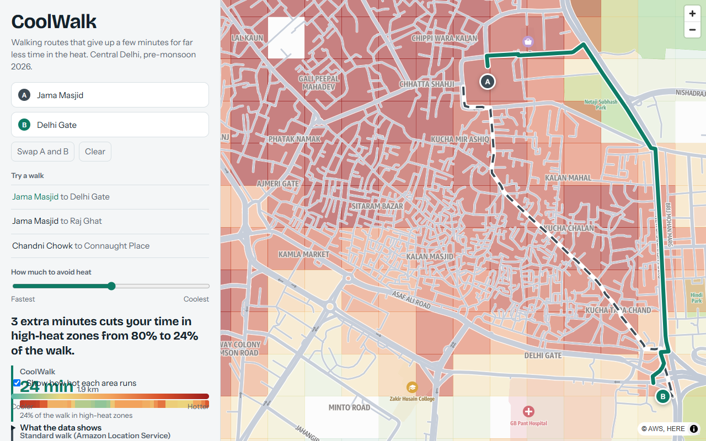
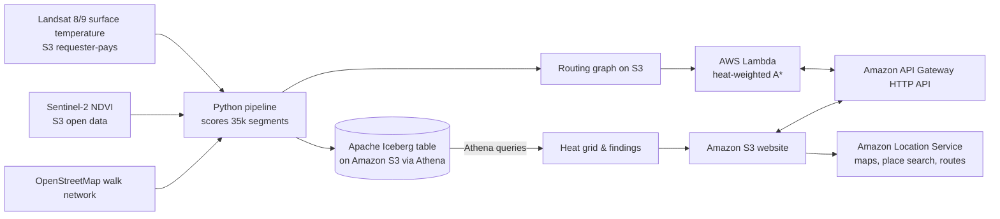
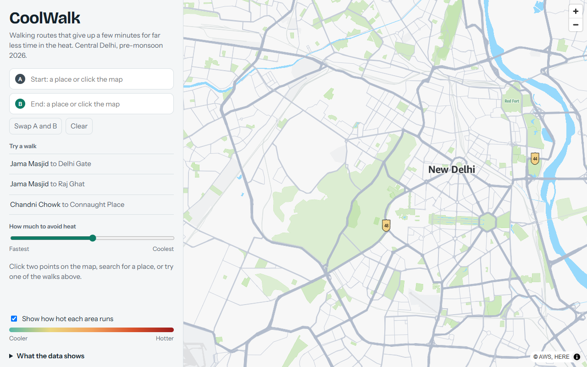
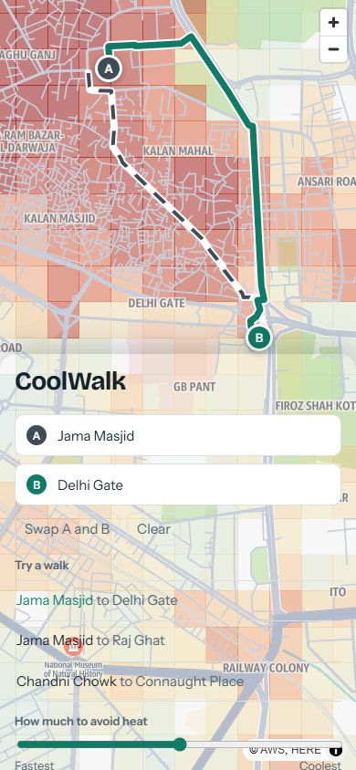

# CoolWalk

A walking map for central Delhi that trades a few minutes for much less time in the heat. Pick two points and CoolWalk shows the standard walk next to a cooler one, with a heat strip along each route.

Built for the AWS Builder Center "Weekend Challenge: Map It".

**Live demo:** [http://coolwalk-sitebucket-5r7fgk6zuvfl.s3-website-us-east-1.amazonaws.com](http://coolwalk-sitebucket-5r7fgk6zuvfl.s3-website-us-east-1.amazonaws.com)  
**Video:** [YouTube Demo Link - Human to insert]



## How it works



1. **Data.** Landsat Collection 2 Level-2 surface temperature (`LC08_L2SP_147040_20260609_02_T1`), Sentinel-2 L2A red and near-infrared bands (for vegetation), and the OpenStreetMap walking network. One clear pre-monsoon day (June 2026), shown in the app footer.
2. **Heat index.** For each street segment: `0.6 x surface temperature + 0.4 x lack of vegetation`, both normalized 0 to 1 across the area. It shows where streets hold heat. It is not air temperature.
3. **Iceberg and Athena.** Segment scores are stored as an Apache Iceberg table on S3 (`coolwalk.segments`). Athena produces the heat grid layer and statistical findings.
4. **Routing.** A Lambda runs A* where a segment costs `length x (1 + alpha x heat)`. A detour cap keeps the cooler walk reasonable. The "standard" walk is the Amazon Location Service pedestrian route, scored against the same heat data, with our own shortest path as a fallback.
5. **Map.** MapLibre on an Amazon Location Service Light basemap. Place search uses Amazon Location Places.

## Screenshots

| Desktop View | Mobile (390 px) |
|---|---|
|  |  |

## Run it

Prerequisites: Python 3.11+, AWS CLI and SAM CLI configured, an AWS account with an active budget alert, Node not required.

```bash
# 1. Setup virtual environment
python -m venv .venv
# Linux / macOS: source .venv/bin/activate
# Windows PowerShell: .venv\Scripts\Activate.ps1
pip install -r pipeline/requirements.txt

# 2. Deploy AWS infrastructure
# Windows:
powershell -ExecutionPolicy Bypass -File scripts/deploy.ps1
# Linux / macOS:
export AWS_REGION=us-east-1
export MAP_API_KEY=...
./scripts/deploy.sh

# 3. Run data pipeline
export COOLWALK_BUCKET=<DataBucket from deploy output>
python pipeline/01_pick_scenes.py    # choose Landsat + Sentinel-2 scenes
python pipeline/02_score_segments.py # score every street segment
python pipeline/03_build_iceberg.py  # Iceberg table via Athena
python pipeline/04_export_assets.py  # heat grid, findings, router graph

# 4. Sync website assets
# Windows:
powershell -ExecutionPolicy Bypass -File scripts/deploy.ps1
# Linux / macOS:
./scripts/deploy.sh
```

## Reuse it for your city

To adapt CoolWalk for another city:
1. Change `BBOX` and `DATE_RANGE` in `pipeline/config.py`.
2. Update the `bbox` and `PRESETS` in `frontend/index.html`.
3. Pick a clear, hot summer season with minimal cloud cover.
4. Run the pipeline scripts and re-deploy.

## Known limits

- Heat comes from a dated satellite scene (June 2026). Landsat's thermal band is 100 m native resolution (resampled to 30 m), so we blend it with 10 m Sentinel-2 vegetation to distinguish shaded streets from unshaded ones.
- Surface temperature is a proxy for how hot a street surface feels underfoot and radiative heat. It ignores momentary wind, humidity, microscale building shade geometry, and time of day.
- Walking time assumes a constant 1.35 m/s speed everywhere.
- Coverage is central Delhi (Old Delhi to Lodhi Garden).

## Data credits

Landsat data courtesy of the U.S. Geological Survey. Contains modified Copernicus Sentinel data. Street data from OpenStreetMap contributors (ODbL). Base map, geocoding and pedestrian routing via Amazon Location Service.

## License

MIT.
