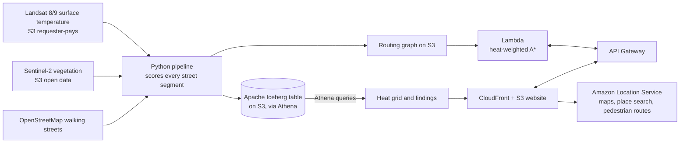

# CoolWalk

A walking map for central Delhi that trades a few minutes for much less time in the heat. Pick two points and CoolWalk shows the standard walk next to a cooler one, with a heat strip along each route.

Built for the AWS Builder Center "Weekend Challenge: Map It". Live demo: `TODO: CloudFront URL`. Video: `TODO`.

## How it works



1. **Data.** Landsat Collection 2 Level-2 surface temperature, Sentinel-2 L2A red and near-infrared bands (for vegetation), and the OpenStreetMap walking network. One clear pre-monsoon day, shown in the app footer.
2. **Heat index.** For each street segment: `0.6 x surface temperature + 0.4 x lack of vegetation`, both scaled 0 to 1 across the area. It shows where streets hold heat. It is not air temperature.
3. **Iceberg and Athena.** Segment scores are stored as an Apache Iceberg table on S3. Athena produces the heat grid layer and the "what the data shows" findings.
4. **Routing.** A Lambda runs A* where a segment costs `length x (1 + alpha x heat)`. A detour cap keeps the cooler walk reasonable. The "standard" walk is the Amazon Location Service pedestrian route, scored against the same heat data, with our own shortest path as a fallback.
5. **Map.** MapLibre on an Amazon Location Service basemap. Place search uses Amazon Location Places.

## Run it

Prerequisites: Python 3.11+, AWS CLI and SAM CLI configured, an AWS account with a budget alert, Node not required.

```bash
python -m venv .venv && . .venv/bin/activate
pip install -r pipeline/requirements.txt
export AWS_REGION=us-east-1          # a region with Amazon Location Maps/Places/Routes v2
export MAP_API_KEY=...               # Amazon Location API key, restricted by referer

python backend/tests/test_router.py  # offline tests
./scripts/deploy.sh                  # creates buckets, CloudFront, Lambda, API
export COOLWALK_BUCKET=<DataBucket from the deploy output>

python pipeline/01_pick_scenes.py    # choose Landsat + Sentinel-2 scenes
python pipeline/02_score_segments.py # score every street segment
python pipeline/03_build_iceberg.py  # Iceberg table via Athena
python pipeline/04_export_assets.py  # heat grid, findings, router graph
python scripts/find_demo_pairs.py    # pick convincing demo walks
./scripts/deploy.sh                  # publish the website with its data
```

## Reuse it for your city

Change `BBOX` and `DATE_RANGE` in `pipeline/config.py`, the `bbox` and `PRESETS` in `frontend/index.html`, and the bbox in `scripts/deploy.sh`. Pick a hot, clear season. Keep the area small enough for the graph to stay under roughly 120,000 street segments.

## Known limits

- Heat comes from one dated satellite scene. Landsat's thermal band is coarse, so we blend it with 10 m vegetation to separate streets.
- Surface temperature is a proxy for how hot a street feels. It ignores wind, humidity, shade from buildings and time of day.
- Walking time assumes 1.35 m/s everywhere.
- Coverage is central Delhi only.

## Data credits

Landsat data courtesy of the U.S. Geological Survey. Contains modified Copernicus Sentinel data. Street data from OpenStreetMap contributors (ODbL). Base map and place data via Amazon Location Service.

## License

MIT.
