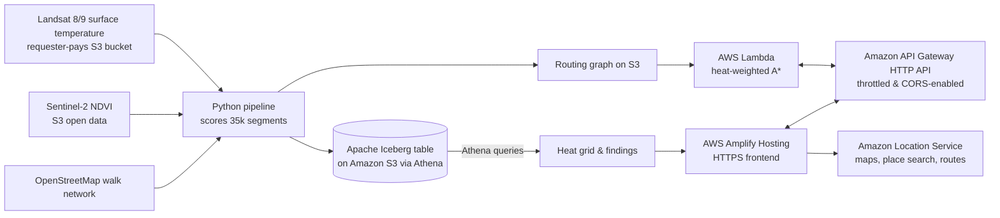

# CoolWalk: the cooler way to walk across Delhi

**Live map:** https://main.d3miw0zrayytbj.amplifyapp.com | **Video:** [YouTube Demo Link - Human to insert] | **Code:** [GitHub Repository Link] (MIT)

## The problem

Walking directions optimize for distance. In a Delhi summer with temperatures soaring well above 40 °C, the shortest route often runs down a bare, sun-baked asphalt road when a street one block over is leafy and several degrees cooler at the surface. CoolWalk shows that difference, visualizes the heat profile under each walking option, and gives pedestrians the cooler choice.

## The dataset

- **Landsat 8/9 Collection 2 Level-2 surface temperature**, scene `LC08_L2SP_147040_20260609_02_T1` from June 9, 2026, accessed from the USGS Landsat requester-pays S3 bucket in the AWS Registry of Open Data. Cloud cover: **0.0%**. Surface temperature across the study area spans **40.3 °C to 46.3 °C** (5th to 95th percentile).
- **Sentinel-2 L2A red and near-infrared bands**, from June 7, 2026 (`S2B_43RGM_20260607_0_L2A`), accessed from AWS Open Data and used to compute high-resolution 10 m vegetation index (NDVI).
- **OpenStreetMap walking network** for central Delhi: **35,748 street segments** covering **2,376.9 km** of walkable streets and 12,687 intersections.

All data is open and contains no personal information.

## How it gets onto the map

1. **Scoring.** A Python pipeline samples the satellite rasters every 15 m along each street segment (183,616 points sampled, 0.0% missing data) and builds a heat index from normalized surface temperature (60%) and lack of vegetation (40%).
2. **Iceberg & Athena.** The scored segments are stored as an **Apache Iceberg table on Amazon S3** (`coolwalk.segments`) and queried with **Amazon Athena** to generate the 150 m heat grid layer (2,092 cells) and statistical findings.
3. **Heat-aware routing.** A **Lambda** function runs an A* algorithm where each street segment costs `length_m * (1 + alpha * heat_index)`, bounded by a maximum detour threshold. The service computes routes in ~50 ms of routing compute and returns both the heat index profile and mean physical surface temperature (`mean_lst_c`).
4. **Location services & frontend.** The single-page application uses **Amazon Location Service (v2)** for the Light style base map, auto-suggest place search, and the baseline pedestrian route. Both the standard route and CoolWalk route are rendered with color-coded heat strips. The site is deployed with HTTPS via **AWS Amplify Hosting** and an Amazon API Gateway HTTP API.

## What you can explore

- Click **"Take the 40-second tour"** for an automated guided walkthrough of central Delhi's thermal landscape and CoolWalk's core features.
- Click **"Where can I cool down?"** to discover the nearest cool refuge (park, water point, or metro station) from your starting location, routed via the coolest path.
- Toggle **"Show places in the heat"** to visualize 974 schools, hospitals/clinics, bus stops, parks, and metro stations colored by thermal exposure with interactive popups.
- Open **"Where shade matters most (Civic Planner View)"** to view and download (CSV) the top 20 high-heat corridors adjacent to schools, clinics, and bus stops prioritized for municipal tree canopy investment.
- Click any two points in central Delhi, search for landmarks (e.g. "India Gate", "Chandni Chowk"), or click the preset walk buttons.
- Drag the "How much to avoid heat" slider between fastest and coolest.
- Toggle the heat map layer and inspect the heat strip underneath each route comparing thermal exposure and average surface temperature.
- Hover and scrub along the 48-bin heat strip to project the exact distance-interpolated location along the route polyline on the map.
- Click any street name in the "What the data shows" panel to fly the camera directly to that street and inspect its measured surface temperature.
- Share walk URLs directly with URL parameters (`#a=lon,lat&b=lon,lat&alpha=...`).

## What the data shows

- **Headline benchmark (500 random trips across Delhi):**
  - **On heat-exposed walks (shortest walk $\ge 50\%$ in high-heat zones; 62 trips, median 41 min):** CoolWalk avoids a median of **9.0 minutes in intense high-heat zones** (a **21.5 percentage-point drop**, mean 25.6 pp) for a median detour of just **1.0 extra minute** (3.3% distance detour). **89% of heat-exposed walks cut high-heat exposure by 5 percentage points or more**.
  - **Across all 500 trips (network-wide baseline, median 44 min):** A median detour of just **1.0 extra minute** (+2.4% distance) avoids **1.0 minute in high-heat zones** (cutting high-heat share by 2.7 percentage points). 42% of trips achieve a high-heat reduction of 5 percentage points or greater, while 41% of trips make no real difference (in leafy residential neighborhoods where the shortest path is already cool).
- **Independent multi-date validation:** Routing on one satellite scene risks overfitting to that date's thermal patterns. We evaluated all 500 benchmark trips against three held-out Landsat scenes spanning different pre-monsoon dates: June 17, 2026 (`LC09`), May 17, 2026 (`LC08`), and April 23, 2026 (`LC09`). CoolWalk consistently delivers a **0.2 to 0.3 °C median surface temperature reduction** across all held-out dates, corroborating that cooler corridors remain consistently cooler across different pre-monsoon dates.
- **Civic infrastructure in the heat:** Cross-referencing 974 open civic points in Delhi with satellite heat revealed significant vulnerabilities: **24 of 73 hospitals and clinics (32.9%)**, **17 of 85 schools (20.0%)**, and **23 of 353 bus stops (6.5%)** sit on streets in high-heat zones.
- **Where shade matters most (Civic Planner View):** An Amazon Athena spatial query cross-referenced high-heat corridors ($\text{heat} \ge 0.66$) with nearby civic facilities within 150 m. The analysis identified 20 priority corridors where pedestrians face unavoidable heat exposure, led by Netaji Subhash Marg (7.2 km hot segments near 5 schools and 8 bus stops), Rani Jhansi Road (8.5 km hot near 3 schools, 1 clinic, and 9 bus stops), and Chitragupta Road (2.5 km hot near 3 schools and 2 clinics). The full dataset is exportable directly from the map interface as CSV.
- **Cool-refuge finder:** CoolWalk embeds 463 public parks, water points, and metro stations into the routing graph, allowing pedestrians in the heat to find their nearest cool refuge via the coolest walking path.
- **19.8% of street length** (471.4 km of 2,376.9 km) in central Delhi runs in high-heat zones (heat index >= 0.66).
- **Jama Masjid to Raj Ghat:** The standard walk takes 30.2 minutes with **59.0%** in high-heat zones (43.9 °C mean surface temp). CoolWalk takes 35.5 minutes (+5.3 min) and cuts high-heat exposure down to just **9.5%** while lowering mean surface temperature to **42.0 °C** — **avoiding 49.5 percentage points of high-heat exposure** (an 83.9% relative cut) and dropping average surface temperature by a significant **1.9 °C**.
- **Jama Masjid to Delhi Gate:** The standard Amazon Location walk takes 20.5 minutes with **80.0% of the walk in high-heat zones** (44.7 °C mean surface temp). CoolWalk takes 23.8 minutes (+3.3 min) and slashes high-heat zone exposure down to **23.5%** (a 56.5 percentage-point drop) by choosing greener, tree-canopied corridors. While the average surface temperature barely changes (44.7 °C vs 44.5 °C), the route is noticeably greener and avoids the sustained thermal mass of unshaded market corridors.
- **Delhi Gate to Lahori Gate:** The standard pedestrian walk between Delhi Gate and Lahori Gate takes 40.2 minutes through dense commercial corridors with **90.3% in high-heat zones** (45.3 °C mean surface temp). CoolWalk takes 44.8 minutes (+4.6 min) and avoids **75.3 percentage points of high-heat exposure**, cutting high-heat time to just **15.0%** (an 83.4% relative cut) and reducing average surface temperature to 44.9 °C.
- **Hottest streets:** Dense commercial alleys in Shahjahanabad: Chipwara Khurd (heat 0.934, LST 46.1 °C), Kinari Bazar (0.914, 46.2 °C), Maliwara (0.895, 46.3 °C), Chipwara Kalan (0.892, 46.4 °C), and Chandni Chowk (0.754, 46.2 °C).
- **Coolest streets:** Tree-lined boulevards in New Delhi: Akbar Road (heat 0.042–0.159, LST 40.6–41.9 °C), Teen Murti Marg (heat 0.068–0.217, LST 41.0–42.5 °C), and Janpath Lane (heat 0.192, LST 42.2 °C, NDVI 0.935). Akbar Road runs about 4 to 6 °C cooler on average than unshaded commercial corridors in Old Delhi (Akbar Road 40.6 °C vs Chandni Chowk 46.2 °C). Complete queries and outputs are recorded in `docs/SANITY_CHECK_REPRODUCE.md`.

## Performance and infrastructure

- **Routing latency:** ~50 ms of pure A* routing compute on AWS Lambda (Python 3.12, 2048 MB memory). Client warm roundtrip latency is ~1.0 s. Amazon EventBridge keeps the Lambda function warm with scheduled 5-minute pings, eliminating cold starts during active use.
- **API security & throttling:** The Amazon API Gateway HTTP API enforces configured rate limits (20 req/s, 50 burst) to guard against bot exhaustion. The Amazon Location Service API key is restricted strictly to Maps, Places, and Routes v2 in `us-east-1` with HTTP referer restrictions and an expiration date of December 15, 2026.
- **Total run cost:** < $0.05 total (Athena queries scanned < 5 MB, S3 requests negligible, Lambda within free tier).

## Reuse the pattern

To reuse CoolWalk for any other city:
1. Update `BBOX` and `DATE_RANGE` in `pipeline/config.py`.
2. Run the four pipeline scripts (`01_pick_scenes.py` through `04_export_assets.py`).
3. Deploy to AWS using `./scripts/deploy.ps1` (or `./scripts/deploy.sh`).

## Limits, stated plainly

- **Heat index evaluation:** CoolWalk optimizes a composite heat index, and route comparison metrics include that index. To prevent circular evaluation, CoolWalk also calculates and displays physical mean surface temperature (`mean_lst_c`) along every route as an objective thermal measure.
- **Satellite thermal proxy:** Heat is estimated from pre-monsoon satellite observations (June 2026). It reflects where asphalt and masonry retain surface thermal energy and where canopy cover provides buffering, not real-time ambient air temperature. It does not model momentary wind or microscale building shade geometry.
- **Routing network:** The network shortest path relies on OpenStreetMap pedestrian network tags. Walking duration assumes a constant 1.35 m/s pace.

## Data credits

Landsat data courtesy of the U.S. Geological Survey (accessed via AWS Registry of Open Data). Contains modified Copernicus Sentinel data. Street data © OpenStreetMap contributors (ODbL). Base map, geocoding and pedestrian routing powered by Amazon Location Service.
