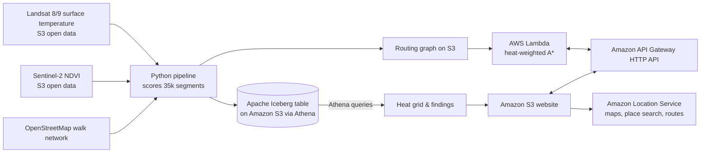

# CoolWalk: the cooler way to walk across Delhi

**Live map:** http://coolwalk-sitebucket-5r7fgk6zuvfl.s3-website-us-east-1.amazonaws.com | **Video:** [YouTube Demo Link - Human to insert] | **Code:** [GitHub Repository Link] (MIT)

## The problem

Walking directions optimise for distance. In a Delhi summer with temperatures soaring well above 40 °C, the shortest route often runs down a bare, sun-baked asphalt road when a street one block over is leafy and several degrees cooler at the surface. CoolWalk shows that difference, visualises the heat profile under each walking option, and gives pedestrians the cooler choice.

## The dataset

- **Landsat 8/9 Collection 2 Level-2 surface temperature**, scene `LC08_L2SP_147040_20260609_02_T1` from June 9, 2026, accessed from the USGS Landsat requester-pays bucket in the AWS Registry of Open Data. Cloud cover: **0.0%**. Surface temperature across the study area spans **40.3 °C to 46.3 °C** (5th to 95th percentile).
- **Sentinel-2 L2A red and near-infrared bands**, from June 7, 2026 (`S2B_43RGM_20260607_0_L2A`), used to compute high-resolution 10 m vegetation index (NDVI).
- **OpenStreetMap walking network** for central Delhi: **35,748 street segments** covering **2,376.9 km** of walkable streets and 12,687 intersections.

All data is open and contains no personal information.

## How it gets onto the map

1. **Scoring.** A Python pipeline samples the satellite rasters every 15 m along each street segment (183,616 points sampled, 0.0% missing data) and builds a heat index from normalized surface temperature (60%) and lack of vegetation (40%).
2. **Iceberg & Athena.** The scored segments are stored as an **Apache Iceberg table on Amazon S3** (`coolwalk.segments`) and queried with **Amazon Athena** to generate the 150 m heat grid layer (2,092 cells) and statistical findings.
3. **Heat-aware routing.** A **Lambda** function runs an A* algorithm where each street segment costs `length_m * (1 + alpha * heat_index)`, bounded by a maximum detour threshold.
4. **Location services & frontend.** The single-page application uses **Amazon Location Service (v2)** for the Light style base map, auto-suggest place search, and the baseline pedestrian route. Both the standard route and CoolWalk route are rendered with color-coded heat strips. The site is hosted on **Amazon S3** with public static website hosting and an HTTP API Gateway backend.

## What you can explore

- Click any two points in central Delhi, search for landmarks (e.g. "India Gate", "Chandni Chowk"), or click the preset walk buttons.
- Drag the "How much to avoid heat" slider between fastest and coolest.
- Toggle the heat map layer and inspect the heat strip underneath each route comparing thermal exposure.

## What the data shows

- **19.8% of street length** (471.4 km of 2,376.9 km) in central Delhi runs in high-heat zones (heat index >= 0.66).
- **Jama Masjid to Delhi Gate:** The standard Amazon Location walk takes 20.5 minutes with **80.0% of the walk in high-heat zones**. CoolWalk takes 23.8 minutes (+3.3 min) but slashes high-heat exposure down to **23.5%** — **avoiding 56.5% of high-heat exposure**.
- **Jama Masjid to Raj Ghat:** The standard walk takes 30.2 minutes with **59.0%** in high-heat zones. CoolWalk takes 35.5 minutes (+5.3 min) and cuts high-heat exposure down to just **9.5%** — **avoiding 49.5% of high-heat exposure**.
- **Chandni Chowk to Connaught Place:** Connects the historic commercial hub to New Delhi's central plaza. CoolWalk takes 44.7 min with 50.2% heat exposure, compared to 47.2 min and 54.8% heat exposure on the standard pedestrian route.
- **Hottest streets:** Dense commercial alleys in Shahjahanabad: Chipwara Khurd (heat 0.934), Gali Ahar (0.918), Kinari Bazar (0.914), Maliwara (0.895), Chipwara Kalan (0.892).
- **Coolest streets:** Tree-lined boulevards in New Delhi: Akbar Road (heat 0.159, LST 41.9 °C, NDVI 0.885), Teen Murti Marg (heat 0.217), Janpath Lane (heat 0.132).

## Reuse the pattern

To reuse CoolWalk for any other city:
1. Update `BBOX` and `DATE_RANGE` in `pipeline/config.py`.
2. Run the four pipeline scripts (`01_pick_scenes.py` through `04_export_assets.py`).
3. Deploy to AWS using `./scripts/deploy.ps1` (or `./scripts/deploy.sh`).

## Limits, stated plainly

Heat is estimated from single-date pre-monsoon satellite observations (June 2026). It reflects where asphalt and masonry retain surface thermal energy and where canopy cover provides buffering, not real-time ambient air temperature. It does not model momentary wind or microscale building shade geometry. Walking duration assumes a constant 1.35 m/s pace.

## Data credits

Landsat data courtesy of the U.S. Geological Survey. Contains modified Copernicus Sentinel data. Street data © OpenStreetMap contributors (ODbL). Base map, geocoding and pedestrian routing powered by Amazon Location Service.
